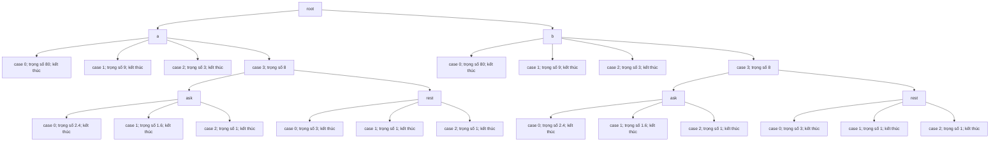
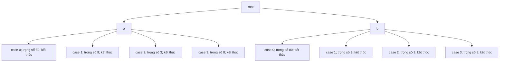

# Đồ thị nội dung v1.1

Có 358 sự kiện trong pool, 5 dự phòng và 34 sản phẩm đầu tư khởi đầu. Các nhánh khó đạt được kiểm bằng fixture; bot mô phỏng không bảo đảm gặp hết nghề.

## Chuỗi đời thường

```mermaid
flowchart LR
  youth_05 -->|sau 1 năm| youth_12
  youth_08 -->|cùng năm| youth_14
  youth_11 -->|sau 1 năm| youth_10
  midlife_16 -->|sau 1 năm| midlife_21
  midlife_22 -->|sau 1 năm| midlife_26
  chain_bullying_1 -->|sau 1 năm| chain_bullying_2
  chain_bullying_1 -->|sau 1 năm| chain_bullying_2
  chain_bullying_1 -->|sau 1 năm| chain_bullying_2
  chain_bullying_1 -->|sau 1 năm| chain_bullying_2
  chain_bullying_1 -->|sau 1 năm| chain_bullying_2
  chain_bullying_1 -->|sau 1 năm| chain_bullying_2
  chain_bullying_2 -->|sau 1 năm| chain_bullying_3
  chain_bullying_2 -->|sau 1 năm| chain_bullying_3
  chain_bullying_2 -->|sau 1 năm| chain_bullying_3
  chain_bullying_2 -->|sau 1 năm| chain_bullying_3
  chain_bullying_2 -->|sau 1 năm| chain_bullying_3
  chain_bullying_2 -->|sau 1 năm| chain_bullying_3
  chain_startup_1 -->|sau 1 năm| chain_startup_2
  chain_startup_1 -->|sau 1 năm| chain_startup_2
  chain_startup_1 -->|sau 1 năm| chain_startup_2
  chain_startup_1 -->|sau 1 năm| chain_startup_2
  chain_startup_1 -->|sau 1 năm| chain_startup_2
  chain_startup_1 -->|sau 1 năm| chain_startup_2
  chain_startup_2 -->|sau 1 năm| chain_startup_3
  chain_startup_2 -->|sau 1 năm| chain_startup_3
  chain_startup_2 -->|sau 1 năm| chain_startup_3
  chain_startup_2 -->|sau 1 năm| chain_startup_3
  chain_startup_2 -->|sau 1 năm| chain_startup_3
  chain_startup_2 -->|sau 1 năm| chain_startup_3
  chain_addiction_1 -->|sau 1 năm| chain_addiction_2
  chain_addiction_1 -->|sau 1 năm| chain_addiction_2
  chain_addiction_1 -->|sau 1 năm| chain_addiction_2
  chain_addiction_1 -->|sau 1 năm| chain_addiction_2
  chain_addiction_1 -->|sau 1 năm| chain_addiction_2
  chain_addiction_1 -->|sau 1 năm| chain_addiction_2
  chain_addiction_2 -->|sau 1 năm| chain_addiction_3
  chain_addiction_2 -->|sau 1 năm| chain_addiction_3
  chain_addiction_2 -->|sau 1 năm| chain_addiction_3
  chain_addiction_2 -->|sau 1 năm| chain_addiction_3
  chain_addiction_2 -->|sau 1 năm| chain_addiction_3
  chain_addiction_2 -->|sau 1 năm| chain_addiction_3
  chain_unemployment_1 -->|sau 1 năm| chain_unemployment_2
  chain_unemployment_1 -->|sau 1 năm| chain_unemployment_2
  chain_unemployment_1 -->|sau 1 năm| chain_unemployment_2
  chain_unemployment_1 -->|sau 1 năm| chain_unemployment_2
  chain_unemployment_1 -->|sau 1 năm| chain_unemployment_2
  chain_unemployment_1 -->|sau 1 năm| chain_unemployment_2
  chain_unemployment_2 -->|sau 1 năm| chain_unemployment_3
  chain_unemployment_2 -->|sau 1 năm| chain_unemployment_3
  chain_unemployment_2 -->|sau 1 năm| chain_unemployment_3
  chain_unemployment_2 -->|sau 1 năm| chain_unemployment_3
  chain_unemployment_2 -->|sau 1 năm| chain_unemployment_3
  chain_unemployment_2 -->|sau 1 năm| chain_unemployment_3
  chain_illness_1 -->|sau 1 năm| chain_illness_2
  chain_illness_1 -->|sau 1 năm| chain_illness_2
  chain_illness_1 -->|sau 1 năm| chain_illness_2
  chain_illness_1 -->|sau 1 năm| chain_illness_2
  chain_illness_1 -->|sau 1 năm| chain_illness_2
  chain_illness_1 -->|sau 1 năm| chain_illness_2
  chain_illness_2 -->|sau 1 năm| chain_illness_3
  chain_illness_2 -->|sau 1 năm| chain_illness_3
  chain_illness_2 -->|sau 1 năm| chain_illness_3
  chain_illness_2 -->|sau 1 năm| chain_illness_3
  chain_illness_2 -->|sau 1 năm| chain_illness_3
  chain_illness_2 -->|sau 1 năm| chain_illness_3
  chain_marriage_1 -->|sau 1 năm| chain_marriage_2
  chain_marriage_1 -->|sau 1 năm| chain_marriage_2
  chain_marriage_1 -->|sau 1 năm| chain_marriage_2
  chain_marriage_1 -->|sau 1 năm| chain_marriage_2
  chain_marriage_1 -->|sau 1 năm| chain_marriage_2
  chain_marriage_1 -->|sau 1 năm| chain_marriage_2
  chain_marriage_2 -->|sau 1 năm| chain_marriage_3
  chain_marriage_2 -->|sau 1 năm| chain_marriage_3
  chain_marriage_2 -->|sau 1 năm| chain_marriage_3
  chain_marriage_2 -->|sau 1 năm| chain_marriage_3
  chain_marriage_2 -->|sau 1 năm| chain_marriage_3
  chain_marriage_2 -->|sau 1 năm| chain_marriage_3
  chain_parenting_1 -->|sau 1 năm| chain_parenting_2
  chain_parenting_1 -->|sau 1 năm| chain_parenting_2
  chain_parenting_1 -->|sau 1 năm| chain_parenting_2
  chain_parenting_1 -->|sau 1 năm| chain_parenting_2
  chain_parenting_1 -->|sau 1 năm| chain_parenting_2
  chain_parenting_1 -->|sau 1 năm| chain_parenting_2
  chain_parenting_2 -->|sau 1 năm| chain_parenting_3
  chain_parenting_2 -->|sau 1 năm| chain_parenting_3
  chain_parenting_2 -->|sau 1 năm| chain_parenting_3
  chain_parenting_2 -->|sau 1 năm| chain_parenting_3
  chain_parenting_2 -->|sau 1 năm| chain_parenting_3
  chain_parenting_2 -->|sau 1 năm| chain_parenting_3
  chain_military_1 -->|sau 1 năm| chain_military_2
  chain_military_1 -->|sau 1 năm| chain_military_2
  chain_military_1 -->|sau 1 năm| chain_military_2
  chain_military_1 -->|sau 1 năm| chain_military_2
  chain_military_1 -->|sau 1 năm| chain_military_2
  chain_military_1 -->|sau 1 năm| chain_military_2
  chain_military_2 -->|sau 1 năm| chain_military_3
  chain_military_2 -->|sau 1 năm| chain_military_3
  chain_military_2 -->|sau 1 năm| chain_military_3
  chain_military_2 -->|sau 1 năm| chain_military_3
  chain_military_2 -->|sau 1 năm| chain_military_3
  chain_military_2 -->|sau 1 năm| chain_military_3
  chain_mentorship_1 -->|sau 1 năm| chain_mentorship_2
  chain_mentorship_1 -->|sau 1 năm| chain_mentorship_2
  chain_mentorship_1 -->|sau 1 năm| chain_mentorship_2
  chain_mentorship_1 -->|sau 1 năm| chain_mentorship_2
  chain_mentorship_1 -->|sau 1 năm| chain_mentorship_2
  chain_mentorship_1 -->|sau 1 năm| chain_mentorship_2
  chain_mentorship_2 -->|sau 1 năm| chain_mentorship_3
  chain_mentorship_2 -->|sau 1 năm| chain_mentorship_3
  chain_mentorship_2 -->|sau 1 năm| chain_mentorship_3
  chain_mentorship_2 -->|sau 1 năm| chain_mentorship_3
  chain_mentorship_2 -->|sau 1 năm| chain_mentorship_3
  chain_mentorship_2 -->|sau 1 năm| chain_mentorship_3
  chain_sports_1 -->|sau 1 năm| chain_sports_2
  chain_sports_1 -->|sau 1 năm| chain_sports_2
  chain_sports_1 -->|sau 1 năm| chain_sports_2
  chain_sports_1 -->|sau 1 năm| chain_sports_2
  chain_sports_1 -->|sau 1 năm| chain_sports_2
  chain_sports_1 -->|sau 1 năm| chain_sports_2
  chain_sports_2 -->|sau 1 năm| chain_sports_3
  chain_sports_2 -->|sau 1 năm| chain_sports_3
  chain_sports_2 -->|sau 1 năm| chain_sports_3
  chain_sports_2 -->|sau 1 năm| chain_sports_3
  chain_sports_2 -->|sau 1 năm| chain_sports_3
  chain_sports_2 -->|sau 1 năm| chain_sports_3
  chain_music_1 -->|sau 1 năm| chain_music_2
  chain_music_1 -->|sau 1 năm| chain_music_2
  chain_music_1 -->|sau 1 năm| chain_music_2
  chain_music_1 -->|sau 1 năm| chain_music_2
  chain_music_1 -->|sau 1 năm| chain_music_2
  chain_music_1 -->|sau 1 năm| chain_music_2
  chain_music_2 -->|sau 1 năm| chain_music_3
  chain_music_2 -->|sau 1 năm| chain_music_3
  chain_music_2 -->|sau 1 năm| chain_music_3
  chain_music_2 -->|sau 1 năm| chain_music_3
  chain_music_2 -->|sau 1 năm| chain_music_3
  chain_music_2 -->|sau 1 năm| chain_music_3
  chain_housing_1 -->|sau 1 năm| chain_housing_2
  chain_housing_1 -->|sau 1 năm| chain_housing_2
  chain_housing_1 -->|sau 1 năm| chain_housing_2
  chain_housing_1 -->|sau 1 năm| chain_housing_2
  chain_housing_1 -->|sau 1 năm| chain_housing_2
  chain_housing_1 -->|sau 1 năm| chain_housing_2
  chain_housing_2 -->|sau 1 năm| chain_housing_3
  chain_housing_2 -->|sau 1 năm| chain_housing_3
  chain_housing_2 -->|sau 1 năm| chain_housing_3
  chain_housing_2 -->|sau 1 năm| chain_housing_3
  chain_housing_2 -->|sau 1 năm| chain_housing_3
  chain_housing_2 -->|sau 1 năm| chain_housing_3
  chain_friendship_1 -->|sau 1 năm| chain_friendship_2
  chain_friendship_1 -->|sau 1 năm| chain_friendship_2
  chain_friendship_1 -->|sau 1 năm| chain_friendship_2
  chain_friendship_1 -->|sau 1 năm| chain_friendship_2
  chain_friendship_1 -->|sau 1 năm| chain_friendship_2
  chain_friendship_1 -->|sau 1 năm| chain_friendship_2
  chain_friendship_2 -->|sau 1 năm| chain_friendship_3
  chain_friendship_2 -->|sau 1 năm| chain_friendship_3
  chain_friendship_2 -->|sau 1 năm| chain_friendship_3
  chain_friendship_2 -->|sau 1 năm| chain_friendship_3
  chain_friendship_2 -->|sau 1 năm| chain_friendship_3
  chain_friendship_2 -->|sau 1 năm| chain_friendship_3
  chain_caregiver_1 -->|sau 1 năm| chain_caregiver_2
  chain_caregiver_1 -->|sau 1 năm| chain_caregiver_2
  chain_caregiver_1 -->|sau 1 năm| chain_caregiver_2
  chain_caregiver_1 -->|sau 1 năm| chain_caregiver_2
  chain_caregiver_1 -->|sau 1 năm| chain_caregiver_2
  chain_caregiver_1 -->|sau 1 năm| chain_caregiver_2
  chain_caregiver_2 -->|sau 1 năm| chain_caregiver_3
  chain_caregiver_2 -->|sau 1 năm| chain_caregiver_3
  chain_caregiver_2 -->|sau 1 năm| chain_caregiver_3
  chain_caregiver_2 -->|sau 1 năm| chain_caregiver_3
  chain_caregiver_2 -->|sau 1 năm| chain_caregiver_3
  chain_caregiver_2 -->|sau 1 năm| chain_caregiver_3
  chain_scholarship_1 -->|sau 1 năm| chain_scholarship_2
  chain_scholarship_1 -->|sau 1 năm| chain_scholarship_2
  chain_scholarship_1 -->|sau 1 năm| chain_scholarship_2
  chain_scholarship_1 -->|sau 1 năm| chain_scholarship_2
  chain_scholarship_1 -->|sau 1 năm| chain_scholarship_2
  chain_scholarship_1 -->|sau 1 năm| chain_scholarship_2
  chain_scholarship_2 -->|sau 1 năm| chain_scholarship_3
  chain_scholarship_2 -->|sau 1 năm| chain_scholarship_3
  chain_scholarship_2 -->|sau 1 năm| chain_scholarship_3
  chain_scholarship_2 -->|sau 1 năm| chain_scholarship_3
  chain_scholarship_2 -->|sau 1 năm| chain_scholarship_3
  chain_scholarship_2 -->|sau 1 năm| chain_scholarship_3
  chain_art_1 -->|sau 1 năm| chain_art_2
  chain_art_1 -->|sau 1 năm| chain_art_2
  chain_art_1 -->|sau 1 năm| chain_art_2
  chain_art_1 -->|sau 1 năm| chain_art_2
  chain_art_1 -->|sau 1 năm| chain_art_2
  chain_art_1 -->|sau 1 năm| chain_art_2
  chain_art_2 -->|sau 1 năm| chain_art_3
  chain_art_2 -->|sau 1 năm| chain_art_3
  chain_art_2 -->|sau 1 năm| chain_art_3
  chain_art_2 -->|sau 1 năm| chain_art_3
  chain_art_2 -->|sau 1 năm| chain_art_3
  chain_art_2 -->|sau 1 năm| chain_art_3
  chain_business_debt_1 -->|sau 1 năm| chain_business_debt_2
  chain_business_debt_1 -->|sau 1 năm| chain_business_debt_2
  chain_business_debt_1 -->|sau 1 năm| chain_business_debt_2
  chain_business_debt_1 -->|sau 1 năm| chain_business_debt_2
  chain_business_debt_1 -->|sau 1 năm| chain_business_debt_2
  chain_business_debt_1 -->|sau 1 năm| chain_business_debt_2
  chain_business_debt_2 -->|sau 1 năm| chain_business_debt_3
  chain_business_debt_2 -->|sau 1 năm| chain_business_debt_3
  chain_business_debt_2 -->|sau 1 năm| chain_business_debt_3
  chain_business_debt_2 -->|sau 1 năm| chain_business_debt_3
  chain_business_debt_2 -->|sau 1 năm| chain_business_debt_3
  chain_business_debt_2 -->|sau 1 năm| chain_business_debt_3
  chain_retirement_1 -->|sau 1 năm| chain_retirement_2
  chain_retirement_1 -->|sau 1 năm| chain_retirement_2
  chain_retirement_1 -->|sau 1 năm| chain_retirement_2
  chain_retirement_1 -->|sau 1 năm| chain_retirement_2
  chain_retirement_1 -->|sau 1 năm| chain_retirement_2
  chain_retirement_1 -->|sau 1 năm| chain_retirement_2
  chain_retirement_2 -->|sau 1 năm| chain_retirement_3
  chain_retirement_2 -->|sau 1 năm| chain_retirement_3
  chain_retirement_2 -->|sau 1 năm| chain_retirement_3
  chain_retirement_2 -->|sau 1 năm| chain_retirement_3
  chain_retirement_2 -->|sau 1 năm| chain_retirement_3
  chain_retirement_2 -->|sau 1 năm| chain_retirement_3
  chain_volunteer_1 -->|sau 1 năm| chain_volunteer_2
  chain_volunteer_1 -->|sau 1 năm| chain_volunteer_2
  chain_volunteer_1 -->|sau 1 năm| chain_volunteer_2
  chain_volunteer_1 -->|sau 1 năm| chain_volunteer_2
  chain_volunteer_1 -->|sau 1 năm| chain_volunteer_2
  chain_volunteer_1 -->|sau 1 năm| chain_volunteer_2
  chain_volunteer_2 -->|sau 1 năm| chain_volunteer_3
  chain_volunteer_2 -->|sau 1 năm| chain_volunteer_3
  chain_volunteer_2 -->|sau 1 năm| chain_volunteer_3
  chain_volunteer_2 -->|sau 1 năm| chain_volunteer_3
  chain_volunteer_2 -->|sau 1 năm| chain_volunteer_3
  chain_volunteer_2 -->|sau 1 năm| chain_volunteer_3
  chain_migration_1 -->|sau 1 năm| chain_migration_2
  chain_migration_1 -->|sau 1 năm| chain_migration_2
  chain_migration_1 -->|sau 1 năm| chain_migration_2
  chain_migration_1 -->|sau 1 năm| chain_migration_2
  chain_migration_1 -->|sau 1 năm| chain_migration_2
  chain_migration_1 -->|sau 1 năm| chain_migration_2
  chain_migration_2 -->|sau 1 năm| chain_migration_3
  chain_migration_2 -->|sau 1 năm| chain_migration_3
  chain_migration_2 -->|sau 1 năm| chain_migration_3
  chain_migration_2 -->|sau 1 năm| chain_migration_3
  chain_migration_2 -->|sau 1 năm| chain_migration_3
  chain_migration_2 -->|sau 1 năm| chain_migration_3
```



Có 20 chuỗi, trung bình 10.73 lá/sự kiện, 30.73% sự kiện có lựa chọn lồng.

Kiểm tra điều kiện bất khả thi bao phủ mâu thuẫn cờ, xuất thân và khoảng số trực tiếp. Không phải chứng minh SAT cho mọi tổ hợp any/not. Báo cáo nhánh chưa gặp và nhánh hiếm nằm trong docs/qa/branch-coverage.json.

## infancy_01



## infancy_02



## infancy_03


## infancy_04


## infancy_05


## infancy_06


## infancy_07


## infancy_08


## infancy_09


## infancy_10


## infancy_11


## infancy_12


## infancy_13


## infancy_14


## infancy_15


## school_01


## school_02


## school_03


## school_04


## school_05

```mermaid
flowchart TD
  root --> n0["a"]
  n0 --> n1["case 0; trọng số 80; kết thúc"]
  n0 --> n2["case 1; trọng số 9; kết thúc"]
  n0 --> n3["case 2; trọng số 3; kết thúc"]
  n0 --> n4["case 3; trọng số 8; kết thúc"]
  root --> n5["b"]
  n5 --> n6["case 0; trọng số 80; kết thúc"]
  n5 --> n7["case 1; trọng số 9; kết thúc"]
  n5 --> n8["case 2; trọng số 3; kết thúc"]
  n5 --> n9["case 3; trọng số 8; kết thúc"]
```

## school_06

```mermaid
flowchart TD
  root --> n0["a"]
  n0 --> n1["case 0; trọng số 80; kết thúc"]
  n0 --> n2["case 1; trọng số 9; kết thúc"]
  n0 --> n3["case 2; trọng số 3; kết thúc"]
  n0 --> n4["case 3; trọng số 8; kết thúc"]
  root --> n5["b"]
  n5 --> n6["case 0; trọng số 80; kết thúc"]
  n5 --> n7["case 1; trọng số 9; kết thúc"]
  n5 --> n8["case 2; trọng số 3; kết thúc"]
  n5 --> n9["case 3; trọng số 8; kết thúc"]
```

## school_07

```mermaid
flowchart TD
  root --> n0["a"]
  n0 --> n1["case 0; trọng số 80; kết thúc"]
  n0 --> n2["case 1; trọng số 9; kết thúc"]
  n0 --> n3["case 2; trọng số 3; kết thúc"]
  n0 --> n4["case 3; trọng số 8"]
  n4 --> n5["ask"]
  n5 --> n6["case 0; trọng số 2.4; kết thúc"]
  n5 --> n7["case 1; trọng số 1.6; kết thúc"]
  n5 --> n8["case 2; trọng số 1; kết thúc"]
  n4 --> n9["rest"]
  n9 --> n10["case 0; trọng số 3; kết thúc"]
  n9 --> n11["case 1; trọng số 1; kết thúc"]
  n9 --> n12["case 2; trọng số 1; kết thúc"]
  root --> n13["b"]
  n13 --> n14["case 0; trọng số 80; kết thúc"]
  n13 --> n15["case 1; trọng số 9; kết thúc"]
  n13 --> n16["case 2; trọng số 3; kết thúc"]
  n13 --> n17["case 3; trọng số 8"]
  n17 --> n18["ask"]
  n18 --> n19["case 0; trọng số 2.4; kết thúc"]
  n18 --> n20["case 1; trọng số 1.6; kết thúc"]
  n18 --> n21["case 2; trọng số 1; kết thúc"]
  n17 --> n22["rest"]
  n22 --> n23["case 0; trọng số 3; kết thúc"]
  n22 --> n24["case 1; trọng số 1; kết thúc"]
  n22 --> n25["case 2; trọng số 1; kết thúc"]
```

## school_08

```mermaid
flowchart TD
  root --> n0["a"]
  n0 --> n1["case 0; trọng số 80; kết thúc"]
  n0 --> n2["case 1; trọng số 9; kết thúc"]
  n0 --> n3["case 2; trọng số 3; kết thúc"]
  n0 --> n4["case 3; trọng số 8; kết thúc"]
  root --> n5["b"]
  n5 --> n6["case 0; trọng số 80; kết thúc"]
  n5 --> n7["case 1; trọng số 9; kết thúc"]
  n5 --> n8["case 2; trọng số 3; kết thúc"]
  n5 --> n9["case 3; trọng số 8; kết thúc"]
```

## school_09

```mermaid
flowchart TD
  root --> n0["a"]
  n0 --> n1["case 0; trọng số 80; kết thúc"]
  n0 --> n2["case 1; trọng số 9; kết thúc"]
  n0 --> n3["case 2; trọng số 3; kết thúc"]
  n0 --> n4["case 3; trọng số 8; kết thúc"]
  root --> n5["b"]
  n5 --> n6["case 0; trọng số 80; kết thúc"]
  n5 --> n7["case 1; trọng số 9; kết thúc"]
  n5 --> n8["case 2; trọng số 3; kết thúc"]
  n5 --> n9["case 3; trọng số 8; kết thúc"]
```

## school_10

```mermaid
flowchart TD
  root --> n0["a"]
  n0 --> n1["case 0; trọng số 80; kết thúc"]
  n0 --> n2["case 1; trọng số 9; kết thúc"]
  n0 --> n3["case 2; trọng số 3; kết thúc"]
  n0 --> n4["case 3; trọng số 8"]
  n4 --> n5["ask"]
  n5 --> n6["case 0; trọng số 2.4; kết thúc"]
  n5 --> n7["case 1; trọng số 1.6; kết thúc"]
  n5 --> n8["case 2; trọng số 1; kết thúc"]
  n4 --> n9["rest"]
  n9 --> n10["case 0; trọng số 3; kết thúc"]
  n9 --> n11["case 1; trọng số 1; kết thúc"]
  n9 --> n12["case 2; trọng số 1; kết thúc"]
  root --> n13["b"]
  n13 --> n14["case 0; trọng số 80; kết thúc"]
  n13 --> n15["case 1; trọng số 9; kết thúc"]
  n13 --> n16["case 2; trọng số 3; kết thúc"]
  n13 --> n17["case 3; trọng số 8"]
  n17 --> n18["ask"]
  n18 --> n19["case 0; trọng số 2.4; kết thúc"]
  n18 --> n20["case 1; trọng số 1.6; kết thúc"]
  n18 --> n21["case 2; trọng số 1; kết thúc"]
  n17 --> n22["rest"]
  n22 --> n23["case 0; trọng số 3; kết thúc"]
  n22 --> n24["case 1; trọng số 1; kết thúc"]
  n22 --> n25["case 2; trọng số 1; kết thúc"]
```

## school_11

```mermaid
flowchart TD
  root --> n0["a"]
  n0 --> n1["case 0; trọng số 80; kết thúc"]
  n0 --> n2["case 1; trọng số 9; kết thúc"]
  n0 --> n3["case 2; trọng số 3; kết thúc"]
  n0 --> n4["case 3; trọng số 8; kết thúc"]
  root --> n5["b"]
  n5 --> n6["case 0; trọng số 80; kết thúc"]
  n5 --> n7["case 1; trọng số 9; kết thúc"]
  n5 --> n8["case 2; trọng số 3; kết thúc"]
  n5 --> n9["case 3; trọng số 8; kết thúc"]
```

## school_12

```mermaid
flowchart TD
  root --> n0["a"]
  n0 --> n1["case 0; trọng số 80; kết thúc"]
  n0 --> n2["case 1; trọng số 9; kết thúc"]
  n0 --> n3["case 2; trọng số 3; kết thúc"]
  n0 --> n4["case 3; trọng số 8; kết thúc"]
  root --> n5["b"]
  n5 --> n6["case 0; trọng số 80; kết thúc"]
  n5 --> n7["case 1; trọng số 9; kết thúc"]
  n5 --> n8["case 2; trọng số 3; kết thúc"]
  n5 --> n9["case 3; trọng số 8; kết thúc"]
```

## school_13

```mermaid
flowchart TD
  root --> n0["a"]
  n0 --> n1["case 0; trọng số 80; kết thúc"]
  n0 --> n2["case 1; trọng số 9; kết thúc"]
  n0 --> n3["case 2; trọng số 3; kết thúc"]
  n0 --> n4["case 3; trọng số 8"]
  n4 --> n5["ask"]
  n5 --> n6["case 0; trọng số 2.4; kết thúc"]
  n5 --> n7["case 1; trọng số 1.6; kết thúc"]
  n5 --> n8["case 2; trọng số 1; kết thúc"]
  n4 --> n9["rest"]
  n9 --> n10["case 0; trọng số 3; kết thúc"]
  n9 --> n11["case 1; trọng số 1; kết thúc"]
  n9 --> n12["case 2; trọng số 1; kết thúc"]
  root --> n13["b"]
  n13 --> n14["case 0; trọng số 80; kết thúc"]
  n13 --> n15["case 1; trọng số 9; kết thúc"]
  n13 --> n16["case 2; trọng số 3; kết thúc"]
  n13 --> n17["case 3; trọng số 8"]
  n17 --> n18["ask"]
  n18 --> n19["case 0; trọng số 2.4; kết thúc"]
  n18 --> n20["case 1; trọng số 1.6; kết thúc"]
  n18 --> n21["case 2; trọng số 1; kết thúc"]
  n17 --> n22["rest"]
  n22 --> n23["case 0; trọng số 3; kết thúc"]
  n22 --> n24["case 1; trọng số 1; kết thúc"]
  n22 --> n25["case 2; trọng số 1; kết thúc"]
```

## school_14

```mermaid
flowchart TD
  root --> n0["a"]
  n0 --> n1["case 0; trọng số 80; kết thúc"]
  n0 --> n2["case 1; trọng số 9; kết thúc"]
  n0 --> n3["case 2; trọng số 3; kết thúc"]
  n0 --> n4["case 3; trọng số 8; kết thúc"]
  root --> n5["b"]
  n5 --> n6["case 0; trọng số 80; kết thúc"]
  n5 --> n7["case 1; trọng số 9; kết thúc"]
  n5 --> n8["case 2; trọng số 3; kết thúc"]
  n5 --> n9["case 3; trọng số 8; kết thúc"]
```

## school_15

```mermaid
flowchart TD
  root --> n0["a"]
  n0 --> n1["case 0; trọng số 80; kết thúc"]
  n0 --> n2["case 1; trọng số 9; kết thúc"]
  n0 --> n3["case 2; trọng số 3; kết thúc"]
  n0 --> n4["case 3; trọng số 8; kết thúc"]
  root --> n5["b"]
  n5 --> n6["case 0; trọng số 80; kết thúc"]
  n5 --> n7["case 1; trọng số 9; kết thúc"]
  n5 --> n8["case 2; trọng số 3; kết thúc"]
  n5 --> n9["case 3; trọng số 8; kết thúc"]
```

## school_16

```mermaid
flowchart TD
  root --> n0["a"]
  n0 --> n1["case 0; trọng số 80; kết thúc"]
  n0 --> n2["case 1; trọng số 9; kết thúc"]
  n0 --> n3["case 2; trọng số 3; kết thúc"]
  n0 --> n4["case 3; trọng số 8"]
  n4 --> n5["ask"]
  n5 --> n6["case 0; trọng số 2.4; kết thúc"]
  n5 --> n7["case 1; trọng số 1.6; kết thúc"]
  n5 --> n8["case 2; trọng số 1; kết thúc"]
  n4 --> n9["rest"]
  n9 --> n10["case 0; trọng số 3; kết thúc"]
  n9 --> n11["case 1; trọng số 1; kết thúc"]
  n9 --> n12["case 2; trọng số 1; kết thúc"]
  root --> n13["b"]
  n13 --> n14["case 0; trọng số 80; kết thúc"]
  n13 --> n15["case 1; trọng số 9; kết thúc"]
  n13 --> n16["case 2; trọng số 3; kết thúc"]
  n13 --> n17["case 3; trọng số 8"]
  n17 --> n18["ask"]
  n18 --> n19["case 0; trọng số 2.4; kết thúc"]
  n18 --> n20["case 1; trọng số 1.6; kết thúc"]
  n18 --> n21["case 2; trọng số 1; kết thúc"]
  n17 --> n22["rest"]
  n22 --> n23["case 0; trọng số 3; kết thúc"]
  n22 --> n24["case 1; trọng số 1; kết thúc"]
  n22 --> n25["case 2; trọng số 1; kết thúc"]
```

## school_17

```mermaid
flowchart TD
  root --> n0["a"]
  n0 --> n1["case 0; trọng số 80; kết thúc"]
  n0 --> n2["case 1; trọng số 9; kết thúc"]
  n0 --> n3["case 2; trọng số 3; kết thúc"]
  n0 --> n4["case 3; trọng số 8; kết thúc"]
  root --> n5["b"]
  n5 --> n6["case 0; trọng số 80; kết thúc"]
  n5 --> n7["case 1; trọng số 9; kết thúc"]
  n5 --> n8["case 2; trọng số 3; kết thúc"]
  n5 --> n9["case 3; trọng số 8; kết thúc"]
```

## school_18

```mermaid
flowchart TD
  root --> n0["a"]
  n0 --> n1["case 0; trọng số 80; kết thúc"]
  n0 --> n2["case 1; trọng số 9; kết thúc"]
  n0 --> n3["case 2; trọng số 3; kết thúc"]
  n0 --> n4["case 3; trọng số 8; kết thúc"]
  root --> n5["b"]
  n5 --> n6["case 0; trọng số 80; kết thúc"]
  n5 --> n7["case 1; trọng số 9; kết thúc"]
  n5 --> n8["case 2; trọng số 3; kết thúc"]
  n5 --> n9["case 3; trọng số 8; kết thúc"]
```

## school_19

```mermaid
flowchart TD
  root --> n0["a"]
  n0 --> n1["case 0; trọng số 80; kết thúc"]
  n0 --> n2["case 1; trọng số 9; kết thúc"]
  n0 --> n3["case 2; trọng số 3; kết thúc"]
  n0 --> n4["case 3; trọng số 8"]
  n4 --> n5["ask"]
  n5 --> n6["case 0; trọng số 2.4; kết thúc"]
  n5 --> n7["case 1; trọng số 1.6; kết thúc"]
  n5 --> n8["case 2; trọng số 1; kết thúc"]
  n4 --> n9["rest"]
  n9 --> n10["case 0; trọng số 3; kết thúc"]
  n9 --> n11["case 1; trọng số 1; kết thúc"]
  n9 --> n12["case 2; trọng số 1; kết thúc"]
  root --> n13["b"]
  n13 --> n14["case 0; trọng số 80; kết thúc"]
  n13 --> n15["case 1; trọng số 9; kết thúc"]
  n13 --> n16["case 2; trọng số 3; kết thúc"]
  n13 --> n17["case 3; trọng số 8"]
  n17 --> n18["ask"]
  n18 --> n19["case 0; trọng số 2.4; kết thúc"]
  n18 --> n20["case 1; trọng số 1.6; kết thúc"]
  n18 --> n21["case 2; trọng số 1; kết thúc"]
  n17 --> n22["rest"]
  n22 --> n23["case 0; trọng số 3; kết thúc"]
  n22 --> n24["case 1; trọng số 1; kết thúc"]
  n22 --> n25["case 2; trọng số 1; kết thúc"]
```

## school_20

```mermaid
flowchart TD
  root --> n0["a"]
  n0 --> n1["case 0; trọng số 80; kết thúc"]
  n0 --> n2["case 1; trọng số 9; kết thúc"]
  n0 --> n3["case 2; trọng số 3; kết thúc"]
  n0 --> n4["case 3; trọng số 8; kết thúc"]
  root --> n5["b"]
  n5 --> n6["case 0; trọng số 80; kết thúc"]
  n5 --> n7["case 1; trọng số 9; kết thúc"]
  n5 --> n8["case 2; trọng số 3; kết thúc"]
  n5 --> n9["case 3; trọng số 8; kết thúc"]
```

## school_21

```mermaid
flowchart TD
  root --> n0["a"]
  n0 --> n1["case 0; trọng số 80; kết thúc"]
  n0 --> n2["case 1; trọng số 9; kết thúc"]
  n0 --> n3["case 2; trọng số 3; kết thúc"]
  n0 --> n4["case 3; trọng số 8; kết thúc"]
  root --> n5["b"]
  n5 --> n6["case 0; trọng số 80; kết thúc"]
  n5 --> n7["case 1; trọng số 9; kết thúc"]
  n5 --> n8["case 2; trọng số 3; kết thúc"]
  n5 --> n9["case 3; trọng số 8; kết thúc"]
```

## school_22

```mermaid
flowchart TD
  root --> n0["a"]
  n0 --> n1["case 0; trọng số 80; kết thúc"]
  n0 --> n2["case 1; trọng số 9; kết thúc"]
  n0 --> n3["case 2; trọng số 3; kết thúc"]
  n0 --> n4["case 3; trọng số 8"]
  n4 --> n5["ask"]
  n5 --> n6["case 0; trọng số 2.4; kết thúc"]
  n5 --> n7["case 1; trọng số 1.6; kết thúc"]
  n5 --> n8["case 2; trọng số 1; kết thúc"]
  n4 --> n9["rest"]
  n9 --> n10["case 0; trọng số 3; kết thúc"]
  n9 --> n11["case 1; trọng số 1; kết thúc"]
  n9 --> n12["case 2; trọng số 1; kết thúc"]
  root --> n13["b"]
  n13 --> n14["case 0; trọng số 80; kết thúc"]
  n13 --> n15["case 1; trọng số 9; kết thúc"]
  n13 --> n16["case 2; trọng số 3; kết thúc"]
  n13 --> n17["case 3; trọng số 8"]
  n17 --> n18["ask"]
  n18 --> n19["case 0; trọng số 2.4; kết thúc"]
  n18 --> n20["case 1; trọng số 1.6; kết thúc"]
  n18 --> n21["case 2; trọng số 1; kết thúc"]
  n17 --> n22["rest"]
  n22 --> n23["case 0; trọng số 3; kết thúc"]
  n22 --> n24["case 1; trọng số 1; kết thúc"]
  n22 --> n25["case 2; trọng số 1; kết thúc"]
```

## school_23

```mermaid
flowchart TD
  root --> n0["a"]
  n0 --> n1["case 0; trọng số 80; kết thúc"]
  n0 --> n2["case 1; trọng số 9; kết thúc"]
  n0 --> n3["case 2; trọng số 3; kết thúc"]
  n0 --> n4["case 3; trọng số 8; kết thúc"]
  root --> n5["b"]
  n5 --> n6["case 0; trọng số 80; kết thúc"]
  n5 --> n7["case 1; trọng số 9; kết thúc"]
  n5 --> n8["case 2; trọng số 3; kết thúc"]
  n5 --> n9["case 3; trọng số 8; kết thúc"]
```

## school_24

```mermaid
flowchart TD
  root --> n0["a"]
  n0 --> n1["case 0; trọng số 80; kết thúc"]
  n0 --> n2["case 1; trọng số 9; kết thúc"]
  n0 --> n3["case 2; trọng số 3; kết thúc"]
  n0 --> n4["case 3; trọng số 8; kết thúc"]
  root --> n5["b"]
  n5 --> n6["case 0; trọng số 80; kết thúc"]
  n5 --> n7["case 1; trọng số 9; kết thúc"]
  n5 --> n8["case 2; trọng số 3; kết thúc"]
  n5 --> n9["case 3; trọng số 8; kết thúc"]
```

## school_25

```mermaid
flowchart TD
  root --> n0["a"]
  n0 --> n1["case 0; trọng số 80; kết thúc"]
  n0 --> n2["case 1; trọng số 9; kết thúc"]
  n0 --> n3["case 2; trọng số 3; kết thúc"]
  n0 --> n4["case 3; trọng số 8"]
  n4 --> n5["ask"]
  n5 --> n6["case 0; trọng số 2.4; kết thúc"]
  n5 --> n7["case 1; trọng số 1.6; kết thúc"]
  n5 --> n8["case 2; trọng số 1; kết thúc"]
  n4 --> n9["rest"]
  n9 --> n10["case 0; trọng số 3; kết thúc"]
  n9 --> n11["case 1; trọng số 1; kết thúc"]
  n9 --> n12["case 2; trọng số 1; kết thúc"]
  root --> n13["b"]
  n13 --> n14["case 0; trọng số 80; kết thúc"]
  n13 --> n15["case 1; trọng số 9; kết thúc"]
  n13 --> n16["case 2; trọng số 3; kết thúc"]
  n13 --> n17["case 3; trọng số 8"]
  n17 --> n18["ask"]
  n18 --> n19["case 0; trọng số 2.4; kết thúc"]
  n18 --> n20["case 1; trọng số 1.6; kết thúc"]
  n18 --> n21["case 2; trọng số 1; kết thúc"]
  n17 --> n22["rest"]
  n22 --> n23["case 0; trọng số 3; kết thúc"]
  n22 --> n24["case 1; trọng số 1; kết thúc"]
  n22 --> n25["case 2; trọng số 1; kết thúc"]
```

## school_26

```mermaid
flowchart TD
  root --> n0["a"]
  n0 --> n1["case 0; trọng số 80; kết thúc"]
  n0 --> n2["case 1; trọng số 9; kết thúc"]
  n0 --> n3["case 2; trọng số 3; kết thúc"]
  n0 --> n4["case 3; trọng số 8; kết thúc"]
  root --> n5["b"]
  n5 --> n6["case 0; trọng số 80; kết thúc"]
  n5 --> n7["case 1; trọng số 9; kết thúc"]
  n5 --> n8["case 2; trọng số 3; kết thúc"]
  n5 --> n9["case 3; trọng số 8; kết thúc"]
```

## school_27

```mermaid
flowchart TD
  root --> n0["a"]
  n0 --> n1["case 0; trọng số 80; kết thúc"]
  n0 --> n2["case 1; trọng số 9; kết thúc"]
  n0 --> n3["case 2; trọng số 3; kết thúc"]
  n0 --> n4["case 3; trọng số 8; kết thúc"]
  root --> n5["b"]
  n5 --> n6["case 0; trọng số 80; kết thúc"]
  n5 --> n7["case 1; trọng số 9; kết thúc"]
  n5 --> n8["case 2; trọng số 3; kết thúc"]
  n5 --> n9["case 3; trọng số 8; kết thúc"]
```

## school_28

```mermaid
flowchart TD
  root --> n0["a"]
  n0 --> n1["case 0; trọng số 80; kết thúc"]
  n0 --> n2["case 1; trọng số 9; kết thúc"]
  n0 --> n3["case 2; trọng số 3; kết thúc"]
  n0 --> n4["case 3; trọng số 8"]
  n4 --> n5["ask"]
  n5 --> n6["case 0; trọng số 2.4; kết thúc"]
  n5 --> n7["case 1; trọng số 1.6; kết thúc"]
  n5 --> n8["case 2; trọng số 1; kết thúc"]
  n4 --> n9["rest"]
  n9 --> n10["case 0; trọng số 3; kết thúc"]
  n9 --> n11["case 1; trọng số 1; kết thúc"]
  n9 --> n12["case 2; trọng số 1; kết thúc"]
  root --> n13["b"]
  n13 --> n14["case 0; trọng số 80; kết thúc"]
  n13 --> n15["case 1; trọng số 9; kết thúc"]
  n13 --> n16["case 2; trọng số 3; kết thúc"]
  n13 --> n17["case 3; trọng số 8"]
  n17 --> n18["ask"]
  n18 --> n19["case 0; trọng số 2.4; kết thúc"]
  n18 --> n20["case 1; trọng số 1.6; kết thúc"]
  n18 --> n21["case 2; trọng số 1; kết thúc"]
  n17 --> n22["rest"]
  n22 --> n23["case 0; trọng số 3; kết thúc"]
  n22 --> n24["case 1; trọng số 1; kết thúc"]
  n22 --> n25["case 2; trọng số 1; kết thúc"]
```

## school_29

```mermaid
flowchart TD
  root --> n0["a"]
  n0 --> n1["case 0; trọng số 80; kết thúc"]
  n0 --> n2["case 1; trọng số 9; kết thúc"]
  n0 --> n3["case 2; trọng số 3; kết thúc"]
  n0 --> n4["case 3; trọng số 8; kết thúc"]
  root --> n5["b"]
  n5 --> n6["case 0; trọng số 80; kết thúc"]
  n5 --> n7["case 1; trọng số 9; kết thúc"]
  n5 --> n8["case 2; trọng số 3; kết thúc"]
  n5 --> n9["case 3; trọng số 8; kết thúc"]
```

## school_30

```mermaid
flowchart TD
  root --> n0["a"]
  n0 --> n1["case 0; trọng số 80; kết thúc"]
  n0 --> n2["case 1; trọng số 9; kết thúc"]
  n0 --> n3["case 2; trọng số 3; kết thúc"]
  n0 --> n4["case 3; trọng số 8; kết thúc"]
  root --> n5["b"]
  n5 --> n6["case 0; trọng số 80; kết thúc"]
  n5 --> n7["case 1; trọng số 9; kết thúc"]
  n5 --> n8["case 2; trọng số 3; kết thúc"]
  n5 --> n9["case 3; trọng số 8; kết thúc"]
```

## school_31

```mermaid
flowchart TD
  root --> n0["a"]
  n0 --> n1["case 0; trọng số 80; kết thúc"]
  n0 --> n2["case 1; trọng số 9; kết thúc"]
  n0 --> n3["case 2; trọng số 3; kết thúc"]
  n0 --> n4["case 3; trọng số 8"]
  n4 --> n5["ask"]
  n5 --> n6["case 0; trọng số 2.4; kết thúc"]
  n5 --> n7["case 1; trọng số 1.6; kết thúc"]
  n5 --> n8["case 2; trọng số 1; kết thúc"]
  n4 --> n9["rest"]
  n9 --> n10["case 0; trọng số 3; kết thúc"]
  n9 --> n11["case 1; trọng số 1; kết thúc"]
  n9 --> n12["case 2; trọng số 1; kết thúc"]
  root --> n13["b"]
  n13 --> n14["case 0; trọng số 80; kết thúc"]
  n13 --> n15["case 1; trọng số 9; kết thúc"]
  n13 --> n16["case 2; trọng số 3; kết thúc"]
  n13 --> n17["case 3; trọng số 8"]
  n17 --> n18["ask"]
  n18 --> n19["case 0; trọng số 2.4; kết thúc"]
  n18 --> n20["case 1; trọng số 1.6; kết thúc"]
  n18 --> n21["case 2; trọng số 1; kết thúc"]
  n17 --> n22["rest"]
  n22 --> n23["case 0; trọng số 3; kết thúc"]
  n22 --> n24["case 1; trọng số 1; kết thúc"]
  n22 --> n25["case 2; trọng số 1; kết thúc"]
```

## school_32

```mermaid
flowchart TD
  root --> n0["a"]
  n0 --> n1["case 0; trọng số 80; kết thúc"]
  n0 --> n2["case 1; trọng số 9; kết thúc"]
  n0 --> n3["case 2; trọng số 3; kết thúc"]
  n0 --> n4["case 3; trọng số 8; kết thúc"]
  root --> n5["b"]
  n5 --> n6["case 0; trọng số 80; kết thúc"]
  n5 --> n7["case 1; trọng số 9; kết thúc"]
  n5 --> n8["case 2; trọng số 3; kết thúc"]
  n5 --> n9["case 3; trọng số 8; kết thúc"]
```

## school_33

```mermaid
flowchart TD
  root --> n0["a"]
  n0 --> n1["case 0; trọng số 80; kết thúc"]
  n0 --> n2["case 1; trọng số 9; kết thúc"]
  n0 --> n3["case 2; trọng số 3; kết thúc"]
  n0 --> n4["case 3; trọng số 8; kết thúc"]
  root --> n5["b"]
  n5 --> n6["case 0; trọng số 80; kết thúc"]
  n5 --> n7["case 1; trọng số 9; kết thúc"]
  n5 --> n8["case 2; trọng số 3; kết thúc"]
  n5 --> n9["case 3; trọng số 8; kết thúc"]
```

## school_34

```mermaid
flowchart TD
  root --> n0["a"]
  n0 --> n1["case 0; trọng số 80; kết thúc"]
  n0 --> n2["case 1; trọng số 9; kết thúc"]
  n0 --> n3["case 2; trọng số 3; kết thúc"]
  n0 --> n4["case 3; trọng số 8"]
  n4 --> n5["ask"]
  n5 --> n6["case 0; trọng số 2.4; kết thúc"]
  n5 --> n7["case 1; trọng số 1.6; kết thúc"]
  n5 --> n8["case 2; trọng số 1; kết thúc"]
  n4 --> n9["rest"]
  n9 --> n10["case 0; trọng số 3; kết thúc"]
  n9 --> n11["case 1; trọng số 1; kết thúc"]
  n9 --> n12["case 2; trọng số 1; kết thúc"]
  root --> n13["b"]
  n13 --> n14["case 0; trọng số 80; kết thúc"]
  n13 --> n15["case 1; trọng số 9; kết thúc"]
  n13 --> n16["case 2; trọng số 3; kết thúc"]
  n13 --> n17["case 3; trọng số 8"]
  n17 --> n18["ask"]
  n18 --> n19["case 0; trọng số 2.4; kết thúc"]
  n18 --> n20["case 1; trọng số 1.6; kết thúc"]
  n18 --> n21["case 2; trọng số 1; kết thúc"]
  n17 --> n22["rest"]
  n22 --> n23["case 0; trọng số 3; kết thúc"]
  n22 --> n24["case 1; trọng số 1; kết thúc"]
  n22 --> n25["case 2; trọng số 1; kết thúc"]
```

## school_35

```mermaid
flowchart TD
  root --> n0["a"]
  n0 --> n1["case 0; trọng số 80; kết thúc"]
  n0 --> n2["case 1; trọng số 9; kết thúc"]
  n0 --> n3["case 2; trọng số 3; kết thúc"]
  n0 --> n4["case 3; trọng số 8; kết thúc"]
  root --> n5["b"]
  n5 --> n6["case 0; trọng số 80; kết thúc"]
  n5 --> n7["case 1; trọng số 9; kết thúc"]
  n5 --> n8["case 2; trọng số 3; kết thúc"]
  n5 --> n9["case 3; trọng số 8; kết thúc"]
```

## school_36

```mermaid
flowchart TD
  root --> n0["a"]
  n0 --> n1["case 0; trọng số 80; kết thúc"]
  n0 --> n2["case 1; trọng số 9; kết thúc"]
  n0 --> n3["case 2; trọng số 3; kết thúc"]
  n0 --> n4["case 3; trọng số 8; kết thúc"]
  root --> n5["b"]
  n5 --> n6["case 0; trọng số 80; kết thúc"]
  n5 --> n7["case 1; trọng số 9; kết thúc"]
  n5 --> n8["case 2; trọng số 3; kết thúc"]
  n5 --> n9["case 3; trọng số 8; kết thúc"]
```

## school_37

```mermaid
flowchart TD
  root --> n0["a"]
  n0 --> n1["case 0; trọng số 80; kết thúc"]
  n0 --> n2["case 1; trọng số 9; kết thúc"]
  n0 --> n3["case 2; trọng số 3; kết thúc"]
  n0 --> n4["case 3; trọng số 8"]
  n4 --> n5["ask"]
  n5 --> n6["case 0; trọng số 2.4; kết thúc"]
  n5 --> n7["case 1; trọng số 1.6; kết thúc"]
  n5 --> n8["case 2; trọng số 1; kết thúc"]
  n4 --> n9["rest"]
  n9 --> n10["case 0; trọng số 3; kết thúc"]
  n9 --> n11["case 1; trọng số 1; kết thúc"]
  n9 --> n12["case 2; trọng số 1; kết thúc"]
  root --> n13["b"]
  n13 --> n14["case 0; trọng số 80; kết thúc"]
  n13 --> n15["case 1; trọng số 9; kết thúc"]
  n13 --> n16["case 2; trọng số 3; kết thúc"]
  n13 --> n17["case 3; trọng số 8"]
  n17 --> n18["ask"]
  n18 --> n19["case 0; trọng số 2.4; kết thúc"]
  n18 --> n20["case 1; trọng số 1.6; kết thúc"]
  n18 --> n21["case 2; trọng số 1; kết thúc"]
  n17 --> n22["rest"]
  n22 --> n23["case 0; trọng số 3; kết thúc"]
  n22 --> n24["case 1; trọng số 1; kết thúc"]
  n22 --> n25["case 2; trọng số 1; kết thúc"]
```

## school_38

```mermaid
flowchart TD
  root --> n0["a"]
  n0 --> n1["case 0; trọng số 80; kết thúc"]
  n0 --> n2["case 1; trọng số 9; kết thúc"]
  n0 --> n3["case 2; trọng số 3; kết thúc"]
  n0 --> n4["case 3; trọng số 8; kết thúc"]
  root --> n5["b"]
  n5 --> n6["case 0; trọng số 80; kết thúc"]
  n5 --> n7["case 1; trọng số 9; kết thúc"]
  n5 --> n8["case 2; trọng số 3; kết thúc"]
  n5 --> n9["case 3; trọng số 8; kết thúc"]
```

## school_39

```mermaid
flowchart TD
  root --> n0["a"]
  n0 --> n1["case 0; trọng số 80; kết thúc"]
  n0 --> n2["case 1; trọng số 9; kết thúc"]
  n0 --> n3["case 2; trọng số 3; kết thúc"]
  n0 --> n4["case 3; trọng số 8; kết thúc"]
  root --> n5["b"]
  n5 --> n6["case 0; trọng số 80; kết thúc"]
  n5 --> n7["case 1; trọng số 9; kết thúc"]
  n5 --> n8["case 2; trọng số 3; kết thúc"]
  n5 --> n9["case 3; trọng số 8; kết thúc"]
```

## school_40

```mermaid
flowchart TD
  root --> n0["a"]
  n0 --> n1["case 0; trọng số 80; kết thúc"]
  n0 --> n2["case 1; trọng số 9; kết thúc"]
  n0 --> n3["case 2; trọng số 3; kết thúc"]
  n0 --> n4["case 3; trọng số 8"]
  n4 --> n5["ask"]
  n5 --> n6["case 0; trọng số 2.4; kết thúc"]
  n5 --> n7["case 1; trọng số 1.6; kết thúc"]
  n5 --> n8["case 2; trọng số 1; kết thúc"]
  n4 --> n9["rest"]
  n9 --> n10["case 0; trọng số 3; kết thúc"]
  n9 --> n11["case 1; trọng số 1; kết thúc"]
  n9 --> n12["case 2; trọng số 1; kết thúc"]
  root --> n13["b"]
  n13 --> n14["case 0; trọng số 80; kết thúc"]
  n13 --> n15["case 1; trọng số 9; kết thúc"]
  n13 --> n16["case 2; trọng số 3; kết thúc"]
  n13 --> n17["case 3; trọng số 8"]
  n17 --> n18["ask"]
  n18 --> n19["case 0; trọng số 2.4; kết thúc"]
  n18 --> n20["case 1; trọng số 1.6; kết thúc"]
  n18 --> n21["case 2; trọng số 1; kết thúc"]
  n17 --> n22["rest"]
  n22 --> n23["case 0; trọng số 3; kết thúc"]
  n22 --> n24["case 1; trọng số 1; kết thúc"]
  n22 --> n25["case 2; trọng số 1; kết thúc"]
```

## youth_01

```mermaid
flowchart TD
  root --> n0["a"]
  n0 --> n1["case 0; trọng số 80; kết thúc"]
  n0 --> n2["case 1; trọng số 9; kết thúc"]
  n0 --> n3["case 2; trọng số 3; kết thúc"]
  n0 --> n4["case 3; trọng số 8; kết thúc"]
  root --> n5["b"]
  n5 --> n6["case 0; trọng số 80; kết thúc"]
  n5 --> n7["case 1; trọng số 9; kết thúc"]
  n5 --> n8["case 2; trọng số 3; kết thúc"]
  n5 --> n9["case 3; trọng số 8; kết thúc"]
```

## youth_02

```mermaid
flowchart TD
  root --> n0["a"]
  n0 --> n1["case 0; trọng số 80; kết thúc"]
  n0 --> n2["case 1; trọng số 9; kết thúc"]
  n0 --> n3["case 2; trọng số 3; kết thúc"]
  n0 --> n4["case 3; trọng số 8; kết thúc"]
  root --> n5["b"]
  n5 --> n6["case 0; trọng số 80; kết thúc"]
  n5 --> n7["case 1; trọng số 9; kết thúc"]
  n5 --> n8["case 2; trọng số 3; kết thúc"]
  n5 --> n9["case 3; trọng số 8; kết thúc"]
```

## youth_03

```mermaid
flowchart TD
  root --> n0["a"]
  n0 --> n1["case 0; trọng số 80; kết thúc"]
  n0 --> n2["case 1; trọng số 9; kết thúc"]
  n0 --> n3["case 2; trọng số 3; kết thúc"]
  n0 --> n4["case 3; trọng số 8"]
  n4 --> n5["ask"]
  n5 --> n6["case 0; trọng số 2.4; kết thúc"]
  n5 --> n7["case 1; trọng số 1.6; kết thúc"]
  n5 --> n8["case 2; trọng số 1; kết thúc"]
  n4 --> n9["rest"]
  n9 --> n10["case 0; trọng số 3; kết thúc"]
  n9 --> n11["case 1; trọng số 1; kết thúc"]
  n9 --> n12["case 2; trọng số 1; kết thúc"]
  root --> n13["b"]
  n13 --> n14["case 0; trọng số 80; kết thúc"]
  n13 --> n15["case 1; trọng số 9; kết thúc"]
  n13 --> n16["case 2; trọng số 3; kết thúc"]
  n13 --> n17["case 3; trọng số 8"]
  n17 --> n18["ask"]
  n18 --> n19["case 0; trọng số 2.4; kết thúc"]
  n18 --> n20["case 1; trọng số 1.6; kết thúc"]
  n18 --> n21["case 2; trọng số 1; kết thúc"]
  n17 --> n22["rest"]
  n22 --> n23["case 0; trọng số 3; kết thúc"]
  n22 --> n24["case 1; trọng số 1; kết thúc"]
  n22 --> n25["case 2; trọng số 1; kết thúc"]
```

## youth_04

```mermaid
flowchart TD
  root --> n0["a"]
  n0 --> n1["case 0; trọng số 80; kết thúc"]
  n0 --> n2["case 1; trọng số 9; kết thúc"]
  n0 --> n3["case 2; trọng số 3; kết thúc"]
  n0 --> n4["case 3; trọng số 8; kết thúc"]
  root --> n5["b"]
  n5 --> n6["case 0; trọng số 80; kết thúc"]
  n5 --> n7["case 1; trọng số 9; kết thúc"]
  n5 --> n8["case 2; trọng số 3; kết thúc"]
  n5 --> n9["case 3; trọng số 8; kết thúc"]
```

## youth_05

```mermaid
flowchart TD
  root --> n0["a"]
  n0 --> n1["case 0; trọng số 80; kết thúc"]
  n0 --> n2["case 1; trọng số 9; kết thúc"]
  n0 --> n3["case 2; trọng số 3; kết thúc"]
  n0 --> n4["case 3; trọng số 8; kết thúc"]
  root --> n5["b"]
  n5 --> n6["case 0; trọng số 80; kết thúc"]
  n5 --> n7["case 1; trọng số 9; kết thúc"]
  n5 --> n8["case 2; trọng số 3; kết thúc"]
  n5 --> n9["case 3; trọng số 8; kết thúc"]
```

## youth_06

```mermaid
flowchart TD
  root --> n0["a"]
  n0 --> n1["case 0; trọng số 80; kết thúc"]
  n0 --> n2["case 1; trọng số 9; kết thúc"]
  n0 --> n3["case 2; trọng số 3; kết thúc"]
  n0 --> n4["case 3; trọng số 8"]
  n4 --> n5["ask"]
  n5 --> n6["case 0; trọng số 2.4; kết thúc"]
  n5 --> n7["case 1; trọng số 1.6; kết thúc"]
  n5 --> n8["case 2; trọng số 1; kết thúc"]
  n4 --> n9["rest"]
  n9 --> n10["case 0; trọng số 3; kết thúc"]
  n9 --> n11["case 1; trọng số 1; kết thúc"]
  n9 --> n12["case 2; trọng số 1; kết thúc"]
  root --> n13["b"]
  n13 --> n14["case 0; trọng số 80; kết thúc"]
  n13 --> n15["case 1; trọng số 9; kết thúc"]
  n13 --> n16["case 2; trọng số 3; kết thúc"]
  n13 --> n17["case 3; trọng số 8"]
  n17 --> n18["ask"]
  n18 --> n19["case 0; trọng số 2.4; kết thúc"]
  n18 --> n20["case 1; trọng số 1.6; kết thúc"]
  n18 --> n21["case 2; trọng số 1; kết thúc"]
  n17 --> n22["rest"]
  n22 --> n23["case 0; trọng số 3; kết thúc"]
  n22 --> n24["case 1; trọng số 1; kết thúc"]
  n22 --> n25["case 2; trọng số 1; kết thúc"]
```

## youth_07

```mermaid
flowchart TD
  root --> n0["a"]
  n0 --> n1["case 0; trọng số 80; kết thúc"]
  n0 --> n2["case 1; trọng số 9; kết thúc"]
  n0 --> n3["case 2; trọng số 3; kết thúc"]
  n0 --> n4["case 3; trọng số 8; kết thúc"]
  root --> n5["b"]
  n5 --> n6["case 0; trọng số 80; kết thúc"]
  n5 --> n7["case 1; trọng số 9; kết thúc"]
  n5 --> n8["case 2; trọng số 3; kết thúc"]
  n5 --> n9["case 3; trọng số 8; kết thúc"]
```

## youth_08

```mermaid
flowchart TD
  root --> n0["a"]
  n0 --> n1["case 0; trọng số 80; kết thúc"]
  n0 --> n2["case 1; trọng số 9; kết thúc"]
  n0 --> n3["case 2; trọng số 3; kết thúc"]
  n0 --> n4["case 3; trọng số 8; kết thúc"]
  root --> n5["b"]
  n5 --> n6["case 0; trọng số 80; kết thúc"]
  n5 --> n7["case 1; trọng số 9; kết thúc"]
  n5 --> n8["case 2; trọng số 3; kết thúc"]
  n5 --> n9["case 3; trọng số 8; kết thúc"]
```

## youth_09

```mermaid
flowchart TD
  root --> n0["a"]
  n0 --> n1["case 0; trọng số 80; kết thúc"]
  n0 --> n2["case 1; trọng số 9; kết thúc"]
  n0 --> n3["case 2; trọng số 3; kết thúc"]
  n0 --> n4["case 3; trọng số 8"]
  n4 --> n5["ask"]
  n5 --> n6["case 0; trọng số 2.4; kết thúc"]
  n5 --> n7["case 1; trọng số 1.6; kết thúc"]
  n5 --> n8["case 2; trọng số 1; kết thúc"]
  n4 --> n9["rest"]
  n9 --> n10["case 0; trọng số 3; kết thúc"]
  n9 --> n11["case 1; trọng số 1; kết thúc"]
  n9 --> n12["case 2; trọng số 1; kết thúc"]
  root --> n13["b"]
  n13 --> n14["case 0; trọng số 80; kết thúc"]
  n13 --> n15["case 1; trọng số 9; kết thúc"]
  n13 --> n16["case 2; trọng số 3; kết thúc"]
  n13 --> n17["case 3; trọng số 8"]
  n17 --> n18["ask"]
  n18 --> n19["case 0; trọng số 2.4; kết thúc"]
  n18 --> n20["case 1; trọng số 1.6; kết thúc"]
  n18 --> n21["case 2; trọng số 1; kết thúc"]
  n17 --> n22["rest"]
  n22 --> n23["case 0; trọng số 3; kết thúc"]
  n22 --> n24["case 1; trọng số 1; kết thúc"]
  n22 --> n25["case 2; trọng số 1; kết thúc"]
```

## youth_10

```mermaid
flowchart TD
  root --> n0["a"]
  n0 --> n1["case 0; trọng số 80; kết thúc"]
  n0 --> n2["case 1; trọng số 9; kết thúc"]
  n0 --> n3["case 2; trọng số 3; kết thúc"]
  n0 --> n4["case 3; trọng số 8; kết thúc"]
  root --> n5["b"]
  n5 --> n6["case 0; trọng số 80; kết thúc"]
  n5 --> n7["case 1; trọng số 9; kết thúc"]
  n5 --> n8["case 2; trọng số 3; kết thúc"]
  n5 --> n9["case 3; trọng số 8; kết thúc"]
```

## youth_11

```mermaid
flowchart TD
  root --> n0["a"]
  n0 --> n1["case 0; trọng số 80; kết thúc"]
  n0 --> n2["case 1; trọng số 9; kết thúc"]
  n0 --> n3["case 2; trọng số 3; kết thúc"]
  n0 --> n4["case 3; trọng số 8; kết thúc"]
  root --> n5["b"]
  n5 --> n6["case 0; trọng số 80; kết thúc"]
  n5 --> n7["case 1; trọng số 9; kết thúc"]
  n5 --> n8["case 2; trọng số 3; kết thúc"]
  n5 --> n9["case 3; trọng số 8; kết thúc"]
```

## youth_12

```mermaid
flowchart TD
  root --> n0["a"]
  n0 --> n1["case 0; trọng số 80; kết thúc"]
  n0 --> n2["case 1; trọng số 9; kết thúc"]
  n0 --> n3["case 2; trọng số 3; kết thúc"]
  n0 --> n4["case 3; trọng số 8"]
  n4 --> n5["ask"]
  n5 --> n6["case 0; trọng số 2.4; kết thúc"]
  n5 --> n7["case 1; trọng số 1.6; kết thúc"]
  n5 --> n8["case 2; trọng số 1; kết thúc"]
  n4 --> n9["rest"]
  n9 --> n10["case 0; trọng số 3; kết thúc"]
  n9 --> n11["case 1; trọng số 1; kết thúc"]
  n9 --> n12["case 2; trọng số 1; kết thúc"]
  root --> n13["b"]
  n13 --> n14["case 0; trọng số 80; kết thúc"]
  n13 --> n15["case 1; trọng số 9; kết thúc"]
  n13 --> n16["case 2; trọng số 3; kết thúc"]
  n13 --> n17["case 3; trọng số 8"]
  n17 --> n18["ask"]
  n18 --> n19["case 0; trọng số 2.4; kết thúc"]
  n18 --> n20["case 1; trọng số 1.6; kết thúc"]
  n18 --> n21["case 2; trọng số 1; kết thúc"]
  n17 --> n22["rest"]
  n22 --> n23["case 0; trọng số 3; kết thúc"]
  n22 --> n24["case 1; trọng số 1; kết thúc"]
  n22 --> n25["case 2; trọng số 1; kết thúc"]
```

## youth_13

```mermaid
flowchart TD
  root --> n0["a"]
  n0 --> n1["case 0; trọng số 80; kết thúc"]
  n0 --> n2["case 1; trọng số 9; kết thúc"]
  n0 --> n3["case 2; trọng số 3; kết thúc"]
  n0 --> n4["case 3; trọng số 8; kết thúc"]
  root --> n5["b"]
  n5 --> n6["case 0; trọng số 80; kết thúc"]
  n5 --> n7["case 1; trọng số 9; kết thúc"]
  n5 --> n8["case 2; trọng số 3; kết thúc"]
  n5 --> n9["case 3; trọng số 8; kết thúc"]
```

## youth_14

```mermaid
flowchart TD
  root --> n0["a"]
  n0 --> n1["case 0; trọng số 80; kết thúc"]
  n0 --> n2["case 1; trọng số 9; kết thúc"]
  n0 --> n3["case 2; trọng số 3; kết thúc"]
  n0 --> n4["case 3; trọng số 8; kết thúc"]
  root --> n5["b"]
  n5 --> n6["case 0; trọng số 80; kết thúc"]
  n5 --> n7["case 1; trọng số 9; kết thúc"]
  n5 --> n8["case 2; trọng số 3; kết thúc"]
  n5 --> n9["case 3; trọng số 8; kết thúc"]
```

## youth_15

```mermaid
flowchart TD
  root --> n0["a"]
  n0 --> n1["case 0; trọng số 80; kết thúc"]
  n0 --> n2["case 1; trọng số 9; kết thúc"]
  n0 --> n3["case 2; trọng số 3; kết thúc"]
  n0 --> n4["case 3; trọng số 8"]
  n4 --> n5["ask"]
  n5 --> n6["case 0; trọng số 2.4; kết thúc"]
  n5 --> n7["case 1; trọng số 1.6; kết thúc"]
  n5 --> n8["case 2; trọng số 1; kết thúc"]
  n4 --> n9["rest"]
  n9 --> n10["case 0; trọng số 3; kết thúc"]
  n9 --> n11["case 1; trọng số 1; kết thúc"]
  n9 --> n12["case 2; trọng số 1; kết thúc"]
  root --> n13["b"]
  n13 --> n14["case 0; trọng số 80; kết thúc"]
  n13 --> n15["case 1; trọng số 9; kết thúc"]
  n13 --> n16["case 2; trọng số 3; kết thúc"]
  n13 --> n17["case 3; trọng số 8"]
  n17 --> n18["ask"]
  n18 --> n19["case 0; trọng số 2.4; kết thúc"]
  n18 --> n20["case 1; trọng số 1.6; kết thúc"]
  n18 --> n21["case 2; trọng số 1; kết thúc"]
  n17 --> n22["rest"]
  n22 --> n23["case 0; trọng số 3; kết thúc"]
  n22 --> n24["case 1; trọng số 1; kết thúc"]
  n22 --> n25["case 2; trọng số 1; kết thúc"]
```

## youth_16

```mermaid
flowchart TD
  root --> n0["a"]
  n0 --> n1["case 0; trọng số 80; kết thúc"]
  n0 --> n2["case 1; trọng số 9; kết thúc"]
  n0 --> n3["case 2; trọng số 3; kết thúc"]
  n0 --> n4["case 3; trọng số 8; kết thúc"]
  root --> n5["b"]
  n5 --> n6["case 0; trọng số 80; kết thúc"]
  n5 --> n7["case 1; trọng số 9; kết thúc"]
  n5 --> n8["case 2; trọng số 3; kết thúc"]
  n5 --> n9["case 3; trọng số 8; kết thúc"]
```

## youth_17

```mermaid
flowchart TD
  root --> n0["a"]
  n0 --> n1["case 0; trọng số 80; kết thúc"]
  n0 --> n2["case 1; trọng số 9; kết thúc"]
  n0 --> n3["case 2; trọng số 3; kết thúc"]
  n0 --> n4["case 3; trọng số 8; kết thúc"]
  root --> n5["b"]
  n5 --> n6["case 0; trọng số 80; kết thúc"]
  n5 --> n7["case 1; trọng số 9; kết thúc"]
  n5 --> n8["case 2; trọng số 3; kết thúc"]
  n5 --> n9["case 3; trọng số 8; kết thúc"]
```

## youth_18

```mermaid
flowchart TD
  root --> n0["a"]
  n0 --> n1["case 0; trọng số 80; kết thúc"]
  n0 --> n2["case 1; trọng số 9; kết thúc"]
  n0 --> n3["case 2; trọng số 3; kết thúc"]
  n0 --> n4["case 3; trọng số 8"]
  n4 --> n5["ask"]
  n5 --> n6["case 0; trọng số 2.4; kết thúc"]
  n5 --> n7["case 1; trọng số 1.6; kết thúc"]
  n5 --> n8["case 2; trọng số 1; kết thúc"]
  n4 --> n9["rest"]
  n9 --> n10["case 0; trọng số 3; kết thúc"]
  n9 --> n11["case 1; trọng số 1; kết thúc"]
  n9 --> n12["case 2; trọng số 1; kết thúc"]
  root --> n13["b"]
  n13 --> n14["case 0; trọng số 80; kết thúc"]
  n13 --> n15["case 1; trọng số 9; kết thúc"]
  n13 --> n16["case 2; trọng số 3; kết thúc"]
  n13 --> n17["case 3; trọng số 8"]
  n17 --> n18["ask"]
  n18 --> n19["case 0; trọng số 2.4; kết thúc"]
  n18 --> n20["case 1; trọng số 1.6; kết thúc"]
  n18 --> n21["case 2; trọng số 1; kết thúc"]
  n17 --> n22["rest"]
  n22 --> n23["case 0; trọng số 3; kết thúc"]
  n22 --> n24["case 1; trọng số 1; kết thúc"]
  n22 --> n25["case 2; trọng số 1; kết thúc"]
```

## youth_19

```mermaid
flowchart TD
  root --> n0["a"]
  n0 --> n1["case 0; trọng số 80; kết thúc"]
  n0 --> n2["case 1; trọng số 9; kết thúc"]
  n0 --> n3["case 2; trọng số 3; kết thúc"]
  n0 --> n4["case 3; trọng số 8; kết thúc"]
  root --> n5["b"]
  n5 --> n6["case 0; trọng số 80; kết thúc"]
  n5 --> n7["case 1; trọng số 9; kết thúc"]
  n5 --> n8["case 2; trọng số 3; kết thúc"]
  n5 --> n9["case 3; trọng số 8; kết thúc"]
```

## youth_20

```mermaid
flowchart TD
  root --> n0["a"]
  n0 --> n1["case 0; trọng số 80; kết thúc"]
  n0 --> n2["case 1; trọng số 9; kết thúc"]
  n0 --> n3["case 2; trọng số 3; kết thúc"]
  n0 --> n4["case 3; trọng số 8; kết thúc"]
  root --> n5["b"]
  n5 --> n6["case 0; trọng số 80; kết thúc"]
  n5 --> n7["case 1; trọng số 9; kết thúc"]
  n5 --> n8["case 2; trọng số 3; kết thúc"]
  n5 --> n9["case 3; trọng số 8; kết thúc"]
```

## youth_21

```mermaid
flowchart TD
  root --> n0["a"]
  n0 --> n1["case 0; trọng số 80; kết thúc"]
  n0 --> n2["case 1; trọng số 9; kết thúc"]
  n0 --> n3["case 2; trọng số 3; kết thúc"]
  n0 --> n4["case 3; trọng số 8"]
  n4 --> n5["ask"]
  n5 --> n6["case 0; trọng số 2.4; kết thúc"]
  n5 --> n7["case 1; trọng số 1.6; kết thúc"]
  n5 --> n8["case 2; trọng số 1; kết thúc"]
  n4 --> n9["rest"]
  n9 --> n10["case 0; trọng số 3; kết thúc"]
  n9 --> n11["case 1; trọng số 1; kết thúc"]
  n9 --> n12["case 2; trọng số 1; kết thúc"]
  root --> n13["b"]
  n13 --> n14["case 0; trọng số 80; kết thúc"]
  n13 --> n15["case 1; trọng số 9; kết thúc"]
  n13 --> n16["case 2; trọng số 3; kết thúc"]
  n13 --> n17["case 3; trọng số 8"]
  n17 --> n18["ask"]
  n18 --> n19["case 0; trọng số 2.4; kết thúc"]
  n18 --> n20["case 1; trọng số 1.6; kết thúc"]
  n18 --> n21["case 2; trọng số 1; kết thúc"]
  n17 --> n22["rest"]
  n22 --> n23["case 0; trọng số 3; kết thúc"]
  n22 --> n24["case 1; trọng số 1; kết thúc"]
  n22 --> n25["case 2; trọng số 1; kết thúc"]
```

## youth_22

```mermaid
flowchart TD
  root --> n0["a"]
  n0 --> n1["case 0; trọng số 80; kết thúc"]
  n0 --> n2["case 1; trọng số 9; kết thúc"]
  n0 --> n3["case 2; trọng số 3; kết thúc"]
  n0 --> n4["case 3; trọng số 8; kết thúc"]
  root --> n5["b"]
  n5 --> n6["case 0; trọng số 80; kết thúc"]
  n5 --> n7["case 1; trọng số 9; kết thúc"]
  n5 --> n8["case 2; trọng số 3; kết thúc"]
  n5 --> n9["case 3; trọng số 8; kết thúc"]
```

## youth_23

```mermaid
flowchart TD
  root --> n0["a"]
  n0 --> n1["case 0; trọng số 80; kết thúc"]
  n0 --> n2["case 1; trọng số 9; kết thúc"]
  n0 --> n3["case 2; trọng số 3; kết thúc"]
  n0 --> n4["case 3; trọng số 8; kết thúc"]
  root --> n5["b"]
  n5 --> n6["case 0; trọng số 80; kết thúc"]
  n5 --> n7["case 1; trọng số 9; kết thúc"]
  n5 --> n8["case 2; trọng số 3; kết thúc"]
  n5 --> n9["case 3; trọng số 8; kết thúc"]
```

## youth_24

```mermaid
flowchart TD
  root --> n0["a"]
  n0 --> n1["case 0; trọng số 80; kết thúc"]
  n0 --> n2["case 1; trọng số 9; kết thúc"]
  n0 --> n3["case 2; trọng số 3; kết thúc"]
  n0 --> n4["case 3; trọng số 8"]
  n4 --> n5["ask"]
  n5 --> n6["case 0; trọng số 2.4; kết thúc"]
  n5 --> n7["case 1; trọng số 1.6; kết thúc"]
  n5 --> n8["case 2; trọng số 1; kết thúc"]
  n4 --> n9["rest"]
  n9 --> n10["case 0; trọng số 3; kết thúc"]
  n9 --> n11["case 1; trọng số 1; kết thúc"]
  n9 --> n12["case 2; trọng số 1; kết thúc"]
  root --> n13["b"]
  n13 --> n14["case 0; trọng số 80; kết thúc"]
  n13 --> n15["case 1; trọng số 9; kết thúc"]
  n13 --> n16["case 2; trọng số 3; kết thúc"]
  n13 --> n17["case 3; trọng số 8"]
  n17 --> n18["ask"]
  n18 --> n19["case 0; trọng số 2.4; kết thúc"]
  n18 --> n20["case 1; trọng số 1.6; kết thúc"]
  n18 --> n21["case 2; trọng số 1; kết thúc"]
  n17 --> n22["rest"]
  n22 --> n23["case 0; trọng số 3; kết thúc"]
  n22 --> n24["case 1; trọng số 1; kết thúc"]
  n22 --> n25["case 2; trọng số 1; kết thúc"]
```

## youth_25

```mermaid
flowchart TD
  root --> n0["a"]
  n0 --> n1["case 0; trọng số 80; kết thúc"]
  n0 --> n2["case 1; trọng số 9; kết thúc"]
  n0 --> n3["case 2; trọng số 3; kết thúc"]
  n0 --> n4["case 3; trọng số 8; kết thúc"]
  root --> n5["b"]
  n5 --> n6["case 0; trọng số 80; kết thúc"]
  n5 --> n7["case 1; trọng số 9; kết thúc"]
  n5 --> n8["case 2; trọng số 3; kết thúc"]
  n5 --> n9["case 3; trọng số 8; kết thúc"]
```

## youth_26

```mermaid
flowchart TD
  root --> n0["a"]
  n0 --> n1["case 0; trọng số 80; kết thúc"]
  n0 --> n2["case 1; trọng số 9; kết thúc"]
  n0 --> n3["case 2; trọng số 3; kết thúc"]
  n0 --> n4["case 3; trọng số 8; kết thúc"]
  root --> n5["b"]
  n5 --> n6["case 0; trọng số 80; kết thúc"]
  n5 --> n7["case 1; trọng số 9; kết thúc"]
  n5 --> n8["case 2; trọng số 3; kết thúc"]
  n5 --> n9["case 3; trọng số 8; kết thúc"]
```

## youth_27

```mermaid
flowchart TD
  root --> n0["a"]
  n0 --> n1["case 0; trọng số 80; kết thúc"]
  n0 --> n2["case 1; trọng số 9; kết thúc"]
  n0 --> n3["case 2; trọng số 3; kết thúc"]
  n0 --> n4["case 3; trọng số 8"]
  n4 --> n5["ask"]
  n5 --> n6["case 0; trọng số 2.4; kết thúc"]
  n5 --> n7["case 1; trọng số 1.6; kết thúc"]
  n5 --> n8["case 2; trọng số 1; kết thúc"]
  n4 --> n9["rest"]
  n9 --> n10["case 0; trọng số 3; kết thúc"]
  n9 --> n11["case 1; trọng số 1; kết thúc"]
  n9 --> n12["case 2; trọng số 1; kết thúc"]
  root --> n13["b"]
  n13 --> n14["case 0; trọng số 80; kết thúc"]
  n13 --> n15["case 1; trọng số 9; kết thúc"]
  n13 --> n16["case 2; trọng số 3; kết thúc"]
  n13 --> n17["case 3; trọng số 8"]
  n17 --> n18["ask"]
  n18 --> n19["case 0; trọng số 2.4; kết thúc"]
  n18 --> n20["case 1; trọng số 1.6; kết thúc"]
  n18 --> n21["case 2; trọng số 1; kết thúc"]
  n17 --> n22["rest"]
  n22 --> n23["case 0; trọng số 3; kết thúc"]
  n22 --> n24["case 1; trọng số 1; kết thúc"]
  n22 --> n25["case 2; trọng số 1; kết thúc"]
```

## youth_28

```mermaid
flowchart TD
  root --> n0["a"]
  n0 --> n1["case 0; trọng số 80; kết thúc"]
  n0 --> n2["case 1; trọng số 9; kết thúc"]
  n0 --> n3["case 2; trọng số 3; kết thúc"]
  n0 --> n4["case 3; trọng số 8; kết thúc"]
  root --> n5["b"]
  n5 --> n6["case 0; trọng số 80; kết thúc"]
  n5 --> n7["case 1; trọng số 9; kết thúc"]
  n5 --> n8["case 2; trọng số 3; kết thúc"]
  n5 --> n9["case 3; trọng số 8; kết thúc"]
```

## youth_29

```mermaid
flowchart TD
  root --> n0["a"]
  n0 --> n1["case 0; trọng số 80; kết thúc"]
  n0 --> n2["case 1; trọng số 9; kết thúc"]
  n0 --> n3["case 2; trọng số 3; kết thúc"]
  n0 --> n4["case 3; trọng số 8; kết thúc"]
  root --> n5["b"]
  n5 --> n6["case 0; trọng số 80; kết thúc"]
  n5 --> n7["case 1; trọng số 9; kết thúc"]
  n5 --> n8["case 2; trọng số 3; kết thúc"]
  n5 --> n9["case 3; trọng số 8; kết thúc"]
```

## youth_30

```mermaid
flowchart TD
  root --> n0["a"]
  n0 --> n1["case 0; trọng số 80; kết thúc"]
  n0 --> n2["case 1; trọng số 9; kết thúc"]
  n0 --> n3["case 2; trọng số 3; kết thúc"]
  n0 --> n4["case 3; trọng số 8"]
  n4 --> n5["ask"]
  n5 --> n6["case 0; trọng số 2.4; kết thúc"]
  n5 --> n7["case 1; trọng số 1.6; kết thúc"]
  n5 --> n8["case 2; trọng số 1; kết thúc"]
  n4 --> n9["rest"]
  n9 --> n10["case 0; trọng số 3; kết thúc"]
  n9 --> n11["case 1; trọng số 1; kết thúc"]
  n9 --> n12["case 2; trọng số 1; kết thúc"]
  root --> n13["b"]
  n13 --> n14["case 0; trọng số 80; kết thúc"]
  n13 --> n15["case 1; trọng số 9; kết thúc"]
  n13 --> n16["case 2; trọng số 3; kết thúc"]
  n13 --> n17["case 3; trọng số 8"]
  n17 --> n18["ask"]
  n18 --> n19["case 0; trọng số 2.4; kết thúc"]
  n18 --> n20["case 1; trọng số 1.6; kết thúc"]
  n18 --> n21["case 2; trọng số 1; kết thúc"]
  n17 --> n22["rest"]
  n22 --> n23["case 0; trọng số 3; kết thúc"]
  n22 --> n24["case 1; trọng số 1; kết thúc"]
  n22 --> n25["case 2; trọng số 1; kết thúc"]
```

## youth_31

```mermaid
flowchart TD
  root --> n0["a"]
  n0 --> n1["case 0; trọng số 80; kết thúc"]
  n0 --> n2["case 1; trọng số 9; kết thúc"]
  n0 --> n3["case 2; trọng số 3; kết thúc"]
  n0 --> n4["case 3; trọng số 8; kết thúc"]
  root --> n5["b"]
  n5 --> n6["case 0; trọng số 80; kết thúc"]
  n5 --> n7["case 1; trọng số 9; kết thúc"]
  n5 --> n8["case 2; trọng số 3; kết thúc"]
  n5 --> n9["case 3; trọng số 8; kết thúc"]
```

## youth_32

```mermaid
flowchart TD
  root --> n0["a"]
  n0 --> n1["case 0; trọng số 80; kết thúc"]
  n0 --> n2["case 1; trọng số 9; kết thúc"]
  n0 --> n3["case 2; trọng số 3; kết thúc"]
  n0 --> n4["case 3; trọng số 8; kết thúc"]
  root --> n5["b"]
  n5 --> n6["case 0; trọng số 80; kết thúc"]
  n5 --> n7["case 1; trọng số 9; kết thúc"]
  n5 --> n8["case 2; trọng số 3; kết thúc"]
  n5 --> n9["case 3; trọng số 8; kết thúc"]
```

## youth_33

```mermaid
flowchart TD
  root --> n0["a"]
  n0 --> n1["case 0; trọng số 80; kết thúc"]
  n0 --> n2["case 1; trọng số 9; kết thúc"]
  n0 --> n3["case 2; trọng số 3; kết thúc"]
  n0 --> n4["case 3; trọng số 8"]
  n4 --> n5["ask"]
  n5 --> n6["case 0; trọng số 2.4; kết thúc"]
  n5 --> n7["case 1; trọng số 1.6; kết thúc"]
  n5 --> n8["case 2; trọng số 1; kết thúc"]
  n4 --> n9["rest"]
  n9 --> n10["case 0; trọng số 3; kết thúc"]
  n9 --> n11["case 1; trọng số 1; kết thúc"]
  n9 --> n12["case 2; trọng số 1; kết thúc"]
  root --> n13["b"]
  n13 --> n14["case 0; trọng số 80; kết thúc"]
  n13 --> n15["case 1; trọng số 9; kết thúc"]
  n13 --> n16["case 2; trọng số 3; kết thúc"]
  n13 --> n17["case 3; trọng số 8"]
  n17 --> n18["ask"]
  n18 --> n19["case 0; trọng số 2.4; kết thúc"]
  n18 --> n20["case 1; trọng số 1.6; kết thúc"]
  n18 --> n21["case 2; trọng số 1; kết thúc"]
  n17 --> n22["rest"]
  n22 --> n23["case 0; trọng số 3; kết thúc"]
  n22 --> n24["case 1; trọng số 1; kết thúc"]
  n22 --> n25["case 2; trọng số 1; kết thúc"]
```

## youth_34

```mermaid
flowchart TD
  root --> n0["a"]
  n0 --> n1["case 0; trọng số 80; kết thúc"]
  n0 --> n2["case 1; trọng số 9; kết thúc"]
  n0 --> n3["case 2; trọng số 3; kết thúc"]
  n0 --> n4["case 3; trọng số 8; kết thúc"]
  root --> n5["b"]
  n5 --> n6["case 0; trọng số 80; kết thúc"]
  n5 --> n7["case 1; trọng số 9; kết thúc"]
  n5 --> n8["case 2; trọng số 3; kết thúc"]
  n5 --> n9["case 3; trọng số 8; kết thúc"]
```

## youth_35

```mermaid
flowchart TD
  root --> n0["a"]
  n0 --> n1["case 0; trọng số 80; kết thúc"]
  n0 --> n2["case 1; trọng số 9; kết thúc"]
  n0 --> n3["case 2; trọng số 3; kết thúc"]
  n0 --> n4["case 3; trọng số 8; kết thúc"]
  root --> n5["b"]
  n5 --> n6["case 0; trọng số 80; kết thúc"]
  n5 --> n7["case 1; trọng số 9; kết thúc"]
  n5 --> n8["case 2; trọng số 3; kết thúc"]
  n5 --> n9["case 3; trọng số 8; kết thúc"]
```

## youth_36

```mermaid
flowchart TD
  root --> n0["a"]
  n0 --> n1["case 0; trọng số 80; kết thúc"]
  n0 --> n2["case 1; trọng số 9; kết thúc"]
  n0 --> n3["case 2; trọng số 3; kết thúc"]
  n0 --> n4["case 3; trọng số 8"]
  n4 --> n5["ask"]
  n5 --> n6["case 0; trọng số 2.4; kết thúc"]
  n5 --> n7["case 1; trọng số 1.6; kết thúc"]
  n5 --> n8["case 2; trọng số 1; kết thúc"]
  n4 --> n9["rest"]
  n9 --> n10["case 0; trọng số 3; kết thúc"]
  n9 --> n11["case 1; trọng số 1; kết thúc"]
  n9 --> n12["case 2; trọng số 1; kết thúc"]
  root --> n13["b"]
  n13 --> n14["case 0; trọng số 80; kết thúc"]
  n13 --> n15["case 1; trọng số 9; kết thúc"]
  n13 --> n16["case 2; trọng số 3; kết thúc"]
  n13 --> n17["case 3; trọng số 8"]
  n17 --> n18["ask"]
  n18 --> n19["case 0; trọng số 2.4; kết thúc"]
  n18 --> n20["case 1; trọng số 1.6; kết thúc"]
  n18 --> n21["case 2; trọng số 1; kết thúc"]
  n17 --> n22["rest"]
  n22 --> n23["case 0; trọng số 3; kết thúc"]
  n22 --> n24["case 1; trọng số 1; kết thúc"]
  n22 --> n25["case 2; trọng số 1; kết thúc"]
```

## youth_37

```mermaid
flowchart TD
  root --> n0["a"]
  n0 --> n1["case 0; trọng số 80; kết thúc"]
  n0 --> n2["case 1; trọng số 9; kết thúc"]
  n0 --> n3["case 2; trọng số 3; kết thúc"]
  n0 --> n4["case 3; trọng số 8; kết thúc"]
  root --> n5["b"]
  n5 --> n6["case 0; trọng số 80; kết thúc"]
  n5 --> n7["case 1; trọng số 9; kết thúc"]
  n5 --> n8["case 2; trọng số 3; kết thúc"]
  n5 --> n9["case 3; trọng số 8; kết thúc"]
```

## youth_38

```mermaid
flowchart TD
  root --> n0["a"]
  n0 --> n1["case 0; trọng số 80; kết thúc"]
  n0 --> n2["case 1; trọng số 9; kết thúc"]
  n0 --> n3["case 2; trọng số 3; kết thúc"]
  n0 --> n4["case 3; trọng số 8; kết thúc"]
  root --> n5["b"]
  n5 --> n6["case 0; trọng số 80; kết thúc"]
  n5 --> n7["case 1; trọng số 9; kết thúc"]
  n5 --> n8["case 2; trọng số 3; kết thúc"]
  n5 --> n9["case 3; trọng số 8; kết thúc"]
```

## youth_39

```mermaid
flowchart TD
  root --> n0["a"]
  n0 --> n1["case 0; trọng số 80; kết thúc"]
  n0 --> n2["case 1; trọng số 9; kết thúc"]
  n0 --> n3["case 2; trọng số 3; kết thúc"]
  n0 --> n4["case 3; trọng số 8"]
  n4 --> n5["ask"]
  n5 --> n6["case 0; trọng số 2.4; kết thúc"]
  n5 --> n7["case 1; trọng số 1.6; kết thúc"]
  n5 --> n8["case 2; trọng số 1; kết thúc"]
  n4 --> n9["rest"]
  n9 --> n10["case 0; trọng số 3; kết thúc"]
  n9 --> n11["case 1; trọng số 1; kết thúc"]
  n9 --> n12["case 2; trọng số 1; kết thúc"]
  root --> n13["b"]
  n13 --> n14["case 0; trọng số 80; kết thúc"]
  n13 --> n15["case 1; trọng số 9; kết thúc"]
  n13 --> n16["case 2; trọng số 3; kết thúc"]
  n13 --> n17["case 3; trọng số 8"]
  n17 --> n18["ask"]
  n18 --> n19["case 0; trọng số 2.4; kết thúc"]
  n18 --> n20["case 1; trọng số 1.6; kết thúc"]
  n18 --> n21["case 2; trọng số 1; kết thúc"]
  n17 --> n22["rest"]
  n22 --> n23["case 0; trọng số 3; kết thúc"]
  n22 --> n24["case 1; trọng số 1; kết thúc"]
  n22 --> n25["case 2; trọng số 1; kết thúc"]
```

## youth_40

```mermaid
flowchart TD
  root --> n0["a"]
  n0 --> n1["case 0; trọng số 80; kết thúc"]
  n0 --> n2["case 1; trọng số 9; kết thúc"]
  n0 --> n3["case 2; trọng số 3; kết thúc"]
  n0 --> n4["case 3; trọng số 8; kết thúc"]
  root --> n5["b"]
  n5 --> n6["case 0; trọng số 80; kết thúc"]
  n5 --> n7["case 1; trọng số 9; kết thúc"]
  n5 --> n8["case 2; trọng số 3; kết thúc"]
  n5 --> n9["case 3; trọng số 8; kết thúc"]
```

## midlife_01

```mermaid
flowchart TD
  root --> n0["a"]
  n0 --> n1["case 0; trọng số 80; kết thúc"]
  n0 --> n2["case 1; trọng số 9; kết thúc"]
  n0 --> n3["case 2; trọng số 3; kết thúc"]
  n0 --> n4["case 3; trọng số 8; kết thúc"]
  root --> n5["b"]
  n5 --> n6["case 0; trọng số 80; kết thúc"]
  n5 --> n7["case 1; trọng số 9; kết thúc"]
  n5 --> n8["case 2; trọng số 3; kết thúc"]
  n5 --> n9["case 3; trọng số 8; kết thúc"]
```

## midlife_02

```mermaid
flowchart TD
  root --> n0["a"]
  n0 --> n1["case 0; trọng số 80; kết thúc"]
  n0 --> n2["case 1; trọng số 9; kết thúc"]
  n0 --> n3["case 2; trọng số 3; kết thúc"]
  n0 --> n4["case 3; trọng số 8"]
  n4 --> n5["ask"]
  n5 --> n6["case 0; trọng số 2.4; kết thúc"]
  n5 --> n7["case 1; trọng số 1.6; kết thúc"]
  n5 --> n8["case 2; trọng số 1; kết thúc"]
  n4 --> n9["rest"]
  n9 --> n10["case 0; trọng số 3; kết thúc"]
  n9 --> n11["case 1; trọng số 1; kết thúc"]
  n9 --> n12["case 2; trọng số 1; kết thúc"]
  root --> n13["b"]
  n13 --> n14["case 0; trọng số 80; kết thúc"]
  n13 --> n15["case 1; trọng số 9; kết thúc"]
  n13 --> n16["case 2; trọng số 3; kết thúc"]
  n13 --> n17["case 3; trọng số 8"]
  n17 --> n18["ask"]
  n18 --> n19["case 0; trọng số 2.4; kết thúc"]
  n18 --> n20["case 1; trọng số 1.6; kết thúc"]
  n18 --> n21["case 2; trọng số 1; kết thúc"]
  n17 --> n22["rest"]
  n22 --> n23["case 0; trọng số 3; kết thúc"]
  n22 --> n24["case 1; trọng số 1; kết thúc"]
  n22 --> n25["case 2; trọng số 1; kết thúc"]
```

## midlife_03

```mermaid
flowchart TD
  root --> n0["a"]
  n0 --> n1["case 0; trọng số 80; kết thúc"]
  n0 --> n2["case 1; trọng số 9; kết thúc"]
  n0 --> n3["case 2; trọng số 3; kết thúc"]
  n0 --> n4["case 3; trọng số 8; kết thúc"]
  root --> n5["b"]
  n5 --> n6["case 0; trọng số 80; kết thúc"]
  n5 --> n7["case 1; trọng số 9; kết thúc"]
  n5 --> n8["case 2; trọng số 3; kết thúc"]
  n5 --> n9["case 3; trọng số 8; kết thúc"]
```

## midlife_04

```mermaid
flowchart TD
  root --> n0["a"]
  n0 --> n1["case 0; trọng số 80; kết thúc"]
  n0 --> n2["case 1; trọng số 9; kết thúc"]
  n0 --> n3["case 2; trọng số 3; kết thúc"]
  n0 --> n4["case 3; trọng số 8; kết thúc"]
  root --> n5["b"]
  n5 --> n6["case 0; trọng số 80; kết thúc"]
  n5 --> n7["case 1; trọng số 9; kết thúc"]
  n5 --> n8["case 2; trọng số 3; kết thúc"]
  n5 --> n9["case 3; trọng số 8; kết thúc"]
```

## midlife_05

```mermaid
flowchart TD
  root --> n0["a"]
  n0 --> n1["case 0; trọng số 80; kết thúc"]
  n0 --> n2["case 1; trọng số 9; kết thúc"]
  n0 --> n3["case 2; trọng số 3; kết thúc"]
  n0 --> n4["case 3; trọng số 8"]
  n4 --> n5["ask"]
  n5 --> n6["case 0; trọng số 2.4; kết thúc"]
  n5 --> n7["case 1; trọng số 1.6; kết thúc"]
  n5 --> n8["case 2; trọng số 1; kết thúc"]
  n4 --> n9["rest"]
  n9 --> n10["case 0; trọng số 3; kết thúc"]
  n9 --> n11["case 1; trọng số 1; kết thúc"]
  n9 --> n12["case 2; trọng số 1; kết thúc"]
  root --> n13["b"]
  n13 --> n14["case 0; trọng số 80; kết thúc"]
  n13 --> n15["case 1; trọng số 9; kết thúc"]
  n13 --> n16["case 2; trọng số 3; kết thúc"]
  n13 --> n17["case 3; trọng số 8"]
  n17 --> n18["ask"]
  n18 --> n19["case 0; trọng số 2.4; kết thúc"]
  n18 --> n20["case 1; trọng số 1.6; kết thúc"]
  n18 --> n21["case 2; trọng số 1; kết thúc"]
  n17 --> n22["rest"]
  n22 --> n23["case 0; trọng số 3; kết thúc"]
  n22 --> n24["case 1; trọng số 1; kết thúc"]
  n22 --> n25["case 2; trọng số 1; kết thúc"]
```

## midlife_06

```mermaid
flowchart TD
  root --> n0["a"]
  n0 --> n1["case 0; trọng số 80; kết thúc"]
  n0 --> n2["case 1; trọng số 9; kết thúc"]
  n0 --> n3["case 2; trọng số 3; kết thúc"]
  n0 --> n4["case 3; trọng số 8; kết thúc"]
  root --> n5["b"]
  n5 --> n6["case 0; trọng số 80; kết thúc"]
  n5 --> n7["case 1; trọng số 9; kết thúc"]
  n5 --> n8["case 2; trọng số 3; kết thúc"]
  n5 --> n9["case 3; trọng số 8; kết thúc"]
```

## midlife_07

```mermaid
flowchart TD
  root --> n0["a"]
  n0 --> n1["case 0; trọng số 80; kết thúc"]
  n0 --> n2["case 1; trọng số 9; kết thúc"]
  n0 --> n3["case 2; trọng số 3; kết thúc"]
  n0 --> n4["case 3; trọng số 8; kết thúc"]
  root --> n5["b"]
  n5 --> n6["case 0; trọng số 80; kết thúc"]
  n5 --> n7["case 1; trọng số 9; kết thúc"]
  n5 --> n8["case 2; trọng số 3; kết thúc"]
  n5 --> n9["case 3; trọng số 8; kết thúc"]
```

## midlife_08

```mermaid
flowchart TD
  root --> n0["a"]
  n0 --> n1["case 0; trọng số 80; kết thúc"]
  n0 --> n2["case 1; trọng số 9; kết thúc"]
  n0 --> n3["case 2; trọng số 3; kết thúc"]
  n0 --> n4["case 3; trọng số 8"]
  n4 --> n5["ask"]
  n5 --> n6["case 0; trọng số 2.4; kết thúc"]
  n5 --> n7["case 1; trọng số 1.6; kết thúc"]
  n5 --> n8["case 2; trọng số 1; kết thúc"]
  n4 --> n9["rest"]
  n9 --> n10["case 0; trọng số 3; kết thúc"]
  n9 --> n11["case 1; trọng số 1; kết thúc"]
  n9 --> n12["case 2; trọng số 1; kết thúc"]
  root --> n13["b"]
  n13 --> n14["case 0; trọng số 80; kết thúc"]
  n13 --> n15["case 1; trọng số 9; kết thúc"]
  n13 --> n16["case 2; trọng số 3; kết thúc"]
  n13 --> n17["case 3; trọng số 8"]
  n17 --> n18["ask"]
  n18 --> n19["case 0; trọng số 2.4; kết thúc"]
  n18 --> n20["case 1; trọng số 1.6; kết thúc"]
  n18 --> n21["case 2; trọng số 1; kết thúc"]
  n17 --> n22["rest"]
  n22 --> n23["case 0; trọng số 3; kết thúc"]
  n22 --> n24["case 1; trọng số 1; kết thúc"]
  n22 --> n25["case 2; trọng số 1; kết thúc"]
```

## midlife_09

```mermaid
flowchart TD
  root --> n0["a"]
  n0 --> n1["case 0; trọng số 80; kết thúc"]
  n0 --> n2["case 1; trọng số 9; kết thúc"]
  n0 --> n3["case 2; trọng số 3; kết thúc"]
  n0 --> n4["case 3; trọng số 8; kết thúc"]
  root --> n5["b"]
  n5 --> n6["case 0; trọng số 80; kết thúc"]
  n5 --> n7["case 1; trọng số 9; kết thúc"]
  n5 --> n8["case 2; trọng số 3; kết thúc"]
  n5 --> n9["case 3; trọng số 8; kết thúc"]
```

## midlife_10

```mermaid
flowchart TD
  root --> n0["a"]
  n0 --> n1["case 0; trọng số 80; kết thúc"]
  n0 --> n2["case 1; trọng số 9; kết thúc"]
  n0 --> n3["case 2; trọng số 3; kết thúc"]
  n0 --> n4["case 3; trọng số 8; kết thúc"]
  root --> n5["b"]
  n5 --> n6["case 0; trọng số 80; kết thúc"]
  n5 --> n7["case 1; trọng số 9; kết thúc"]
  n5 --> n8["case 2; trọng số 3; kết thúc"]
  n5 --> n9["case 3; trọng số 8; kết thúc"]
```

## midlife_11

```mermaid
flowchart TD
  root --> n0["a"]
  n0 --> n1["case 0; trọng số 80; kết thúc"]
  n0 --> n2["case 1; trọng số 9; kết thúc"]
  n0 --> n3["case 2; trọng số 3; kết thúc"]
  n0 --> n4["case 3; trọng số 8"]
  n4 --> n5["ask"]
  n5 --> n6["case 0; trọng số 2.4; kết thúc"]
  n5 --> n7["case 1; trọng số 1.6; kết thúc"]
  n5 --> n8["case 2; trọng số 1; kết thúc"]
  n4 --> n9["rest"]
  n9 --> n10["case 0; trọng số 3; kết thúc"]
  n9 --> n11["case 1; trọng số 1; kết thúc"]
  n9 --> n12["case 2; trọng số 1; kết thúc"]
  root --> n13["b"]
  n13 --> n14["case 0; trọng số 80; kết thúc"]
  n13 --> n15["case 1; trọng số 9; kết thúc"]
  n13 --> n16["case 2; trọng số 3; kết thúc"]
  n13 --> n17["case 3; trọng số 8"]
  n17 --> n18["ask"]
  n18 --> n19["case 0; trọng số 2.4; kết thúc"]
  n18 --> n20["case 1; trọng số 1.6; kết thúc"]
  n18 --> n21["case 2; trọng số 1; kết thúc"]
  n17 --> n22["rest"]
  n22 --> n23["case 0; trọng số 3; kết thúc"]
  n22 --> n24["case 1; trọng số 1; kết thúc"]
  n22 --> n25["case 2; trọng số 1; kết thúc"]
```

## midlife_12

```mermaid
flowchart TD
  root --> n0["a"]
  n0 --> n1["case 0; trọng số 80; kết thúc"]
  n0 --> n2["case 1; trọng số 9; kết thúc"]
  n0 --> n3["case 2; trọng số 3; kết thúc"]
  n0 --> n4["case 3; trọng số 8; kết thúc"]
  root --> n5["b"]
  n5 --> n6["case 0; trọng số 80; kết thúc"]
  n5 --> n7["case 1; trọng số 9; kết thúc"]
  n5 --> n8["case 2; trọng số 3; kết thúc"]
  n5 --> n9["case 3; trọng số 8; kết thúc"]
```

## midlife_13

```mermaid
flowchart TD
  root --> n0["a"]
  n0 --> n1["case 0; trọng số 80; kết thúc"]
  n0 --> n2["case 1; trọng số 9; kết thúc"]
  n0 --> n3["case 2; trọng số 3; kết thúc"]
  n0 --> n4["case 3; trọng số 8; kết thúc"]
  root --> n5["b"]
  n5 --> n6["case 0; trọng số 80; kết thúc"]
  n5 --> n7["case 1; trọng số 9; kết thúc"]
  n5 --> n8["case 2; trọng số 3; kết thúc"]
  n5 --> n9["case 3; trọng số 8; kết thúc"]
```

## midlife_14

```mermaid
flowchart TD
  root --> n0["a"]
  n0 --> n1["case 0; trọng số 80; kết thúc"]
  n0 --> n2["case 1; trọng số 9; kết thúc"]
  n0 --> n3["case 2; trọng số 3; kết thúc"]
  n0 --> n4["case 3; trọng số 8"]
  n4 --> n5["ask"]
  n5 --> n6["case 0; trọng số 2.4; kết thúc"]
  n5 --> n7["case 1; trọng số 1.6; kết thúc"]
  n5 --> n8["case 2; trọng số 1; kết thúc"]
  n4 --> n9["rest"]
  n9 --> n10["case 0; trọng số 3; kết thúc"]
  n9 --> n11["case 1; trọng số 1; kết thúc"]
  n9 --> n12["case 2; trọng số 1; kết thúc"]
  root --> n13["b"]
  n13 --> n14["case 0; trọng số 80; kết thúc"]
  n13 --> n15["case 1; trọng số 9; kết thúc"]
  n13 --> n16["case 2; trọng số 3; kết thúc"]
  n13 --> n17["case 3; trọng số 8"]
  n17 --> n18["ask"]
  n18 --> n19["case 0; trọng số 2.4; kết thúc"]
  n18 --> n20["case 1; trọng số 1.6; kết thúc"]
  n18 --> n21["case 2; trọng số 1; kết thúc"]
  n17 --> n22["rest"]
  n22 --> n23["case 0; trọng số 3; kết thúc"]
  n22 --> n24["case 1; trọng số 1; kết thúc"]
  n22 --> n25["case 2; trọng số 1; kết thúc"]
```

## midlife_15

```mermaid
flowchart TD
  root --> n0["a"]
  n0 --> n1["case 0; trọng số 80; kết thúc"]
  n0 --> n2["case 1; trọng số 9; kết thúc"]
  n0 --> n3["case 2; trọng số 3; kết thúc"]
  n0 --> n4["case 3; trọng số 8; kết thúc"]
  root --> n5["b"]
  n5 --> n6["case 0; trọng số 80; kết thúc"]
  n5 --> n7["case 1; trọng số 9; kết thúc"]
  n5 --> n8["case 2; trọng số 3; kết thúc"]
  n5 --> n9["case 3; trọng số 8; kết thúc"]
```

## midlife_16

```mermaid
flowchart TD
  root --> n0["a"]
  n0 --> n1["case 0; trọng số 80; kết thúc"]
  n0 --> n2["case 1; trọng số 9; kết thúc"]
  n0 --> n3["case 2; trọng số 3; kết thúc"]
  n0 --> n4["case 3; trọng số 8; kết thúc"]
  root --> n5["b"]
  n5 --> n6["case 0; trọng số 80; kết thúc"]
  n5 --> n7["case 1; trọng số 9; kết thúc"]
  n5 --> n8["case 2; trọng số 3; kết thúc"]
  n5 --> n9["case 3; trọng số 8; kết thúc"]
```

## midlife_17

```mermaid
flowchart TD
  root --> n0["a"]
  n0 --> n1["case 0; trọng số 80; kết thúc"]
  n0 --> n2["case 1; trọng số 9; kết thúc"]
  n0 --> n3["case 2; trọng số 3; kết thúc"]
  n0 --> n4["case 3; trọng số 8"]
  n4 --> n5["ask"]
  n5 --> n6["case 0; trọng số 2.4; kết thúc"]
  n5 --> n7["case 1; trọng số 1.6; kết thúc"]
  n5 --> n8["case 2; trọng số 1; kết thúc"]
  n4 --> n9["rest"]
  n9 --> n10["case 0; trọng số 3; kết thúc"]
  n9 --> n11["case 1; trọng số 1; kết thúc"]
  n9 --> n12["case 2; trọng số 1; kết thúc"]
  root --> n13["b"]
  n13 --> n14["case 0; trọng số 80; kết thúc"]
  n13 --> n15["case 1; trọng số 9; kết thúc"]
  n13 --> n16["case 2; trọng số 3; kết thúc"]
  n13 --> n17["case 3; trọng số 8"]
  n17 --> n18["ask"]
  n18 --> n19["case 0; trọng số 2.4; kết thúc"]
  n18 --> n20["case 1; trọng số 1.6; kết thúc"]
  n18 --> n21["case 2; trọng số 1; kết thúc"]
  n17 --> n22["rest"]
  n22 --> n23["case 0; trọng số 3; kết thúc"]
  n22 --> n24["case 1; trọng số 1; kết thúc"]
  n22 --> n25["case 2; trọng số 1; kết thúc"]
```

## midlife_18

```mermaid
flowchart TD
  root --> n0["a"]
  n0 --> n1["case 0; trọng số 80; kết thúc"]
  n0 --> n2["case 1; trọng số 9; kết thúc"]
  n0 --> n3["case 2; trọng số 3; kết thúc"]
  n0 --> n4["case 3; trọng số 8; kết thúc"]
  root --> n5["b"]
  n5 --> n6["case 0; trọng số 80; kết thúc"]
  n5 --> n7["case 1; trọng số 9; kết thúc"]
  n5 --> n8["case 2; trọng số 3; kết thúc"]
  n5 --> n9["case 3; trọng số 8; kết thúc"]
```

## midlife_19

```mermaid
flowchart TD
  root --> n0["a"]
  n0 --> n1["case 0; trọng số 80; kết thúc"]
  n0 --> n2["case 1; trọng số 9; kết thúc"]
  n0 --> n3["case 2; trọng số 3; kết thúc"]
  n0 --> n4["case 3; trọng số 8; kết thúc"]
  root --> n5["b"]
  n5 --> n6["case 0; trọng số 80; kết thúc"]
  n5 --> n7["case 1; trọng số 9; kết thúc"]
  n5 --> n8["case 2; trọng số 3; kết thúc"]
  n5 --> n9["case 3; trọng số 8; kết thúc"]
```

## midlife_20

```mermaid
flowchart TD
  root --> n0["a"]
  n0 --> n1["case 0; trọng số 80; kết thúc"]
  n0 --> n2["case 1; trọng số 9; kết thúc"]
  n0 --> n3["case 2; trọng số 3; kết thúc"]
  n0 --> n4["case 3; trọng số 8"]
  n4 --> n5["ask"]
  n5 --> n6["case 0; trọng số 2.4; kết thúc"]
  n5 --> n7["case 1; trọng số 1.6; kết thúc"]
  n5 --> n8["case 2; trọng số 1; kết thúc"]
  n4 --> n9["rest"]
  n9 --> n10["case 0; trọng số 3; kết thúc"]
  n9 --> n11["case 1; trọng số 1; kết thúc"]
  n9 --> n12["case 2; trọng số 1; kết thúc"]
  root --> n13["b"]
  n13 --> n14["case 0; trọng số 80; kết thúc"]
  n13 --> n15["case 1; trọng số 9; kết thúc"]
  n13 --> n16["case 2; trọng số 3; kết thúc"]
  n13 --> n17["case 3; trọng số 8"]
  n17 --> n18["ask"]
  n18 --> n19["case 0; trọng số 2.4; kết thúc"]
  n18 --> n20["case 1; trọng số 1.6; kết thúc"]
  n18 --> n21["case 2; trọng số 1; kết thúc"]
  n17 --> n22["rest"]
  n22 --> n23["case 0; trọng số 3; kết thúc"]
  n22 --> n24["case 1; trọng số 1; kết thúc"]
  n22 --> n25["case 2; trọng số 1; kết thúc"]
```

## midlife_21

```mermaid
flowchart TD
  root --> n0["a"]
  n0 --> n1["case 0; trọng số 80; kết thúc"]
  n0 --> n2["case 1; trọng số 9; kết thúc"]
  n0 --> n3["case 2; trọng số 3; kết thúc"]
  n0 --> n4["case 3; trọng số 8; kết thúc"]
  root --> n5["b"]
  n5 --> n6["case 0; trọng số 80; kết thúc"]
  n5 --> n7["case 1; trọng số 9; kết thúc"]
  n5 --> n8["case 2; trọng số 3; kết thúc"]
  n5 --> n9["case 3; trọng số 8; kết thúc"]
```

## midlife_22

```mermaid
flowchart TD
  root --> n0["a"]
  n0 --> n1["case 0; trọng số 80; kết thúc"]
  n0 --> n2["case 1; trọng số 9; kết thúc"]
  n0 --> n3["case 2; trọng số 3; kết thúc"]
  n0 --> n4["case 3; trọng số 8; kết thúc"]
  root --> n5["b"]
  n5 --> n6["case 0; trọng số 80; kết thúc"]
  n5 --> n7["case 1; trọng số 9; kết thúc"]
  n5 --> n8["case 2; trọng số 3; kết thúc"]
  n5 --> n9["case 3; trọng số 8; kết thúc"]
```

## midlife_23

```mermaid
flowchart TD
  root --> n0["a"]
  n0 --> n1["case 0; trọng số 80; kết thúc"]
  n0 --> n2["case 1; trọng số 9; kết thúc"]
  n0 --> n3["case 2; trọng số 3; kết thúc"]
  n0 --> n4["case 3; trọng số 8"]
  n4 --> n5["ask"]
  n5 --> n6["case 0; trọng số 2.4; kết thúc"]
  n5 --> n7["case 1; trọng số 1.6; kết thúc"]
  n5 --> n8["case 2; trọng số 1; kết thúc"]
  n4 --> n9["rest"]
  n9 --> n10["case 0; trọng số 3; kết thúc"]
  n9 --> n11["case 1; trọng số 1; kết thúc"]
  n9 --> n12["case 2; trọng số 1; kết thúc"]
  root --> n13["b"]
  n13 --> n14["case 0; trọng số 80; kết thúc"]
  n13 --> n15["case 1; trọng số 9; kết thúc"]
  n13 --> n16["case 2; trọng số 3; kết thúc"]
  n13 --> n17["case 3; trọng số 8"]
  n17 --> n18["ask"]
  n18 --> n19["case 0; trọng số 2.4; kết thúc"]
  n18 --> n20["case 1; trọng số 1.6; kết thúc"]
  n18 --> n21["case 2; trọng số 1; kết thúc"]
  n17 --> n22["rest"]
  n22 --> n23["case 0; trọng số 3; kết thúc"]
  n22 --> n24["case 1; trọng số 1; kết thúc"]
  n22 --> n25["case 2; trọng số 1; kết thúc"]
```

## midlife_24

```mermaid
flowchart TD
  root --> n0["a"]
  n0 --> n1["case 0; trọng số 80; kết thúc"]
  n0 --> n2["case 1; trọng số 9; kết thúc"]
  n0 --> n3["case 2; trọng số 3; kết thúc"]
  n0 --> n4["case 3; trọng số 8; kết thúc"]
  root --> n5["b"]
  n5 --> n6["case 0; trọng số 80; kết thúc"]
  n5 --> n7["case 1; trọng số 9; kết thúc"]
  n5 --> n8["case 2; trọng số 3; kết thúc"]
  n5 --> n9["case 3; trọng số 8; kết thúc"]
```

## midlife_25

```mermaid
flowchart TD
  root --> n0["a"]
  n0 --> n1["case 0; trọng số 80; kết thúc"]
  n0 --> n2["case 1; trọng số 9; kết thúc"]
  n0 --> n3["case 2; trọng số 3; kết thúc"]
  n0 --> n4["case 3; trọng số 8; kết thúc"]
  root --> n5["b"]
  n5 --> n6["case 0; trọng số 80; kết thúc"]
  n5 --> n7["case 1; trọng số 9; kết thúc"]
  n5 --> n8["case 2; trọng số 3; kết thúc"]
  n5 --> n9["case 3; trọng số 8; kết thúc"]
```

## midlife_26

```mermaid
flowchart TD
  root --> n0["a"]
  n0 --> n1["case 0; trọng số 80; kết thúc"]
  n0 --> n2["case 1; trọng số 9; kết thúc"]
  n0 --> n3["case 2; trọng số 3; kết thúc"]
  n0 --> n4["case 3; trọng số 8"]
  n4 --> n5["ask"]
  n5 --> n6["case 0; trọng số 2.4; kết thúc"]
  n5 --> n7["case 1; trọng số 1.6; kết thúc"]
  n5 --> n8["case 2; trọng số 1; kết thúc"]
  n4 --> n9["rest"]
  n9 --> n10["case 0; trọng số 3; kết thúc"]
  n9 --> n11["case 1; trọng số 1; kết thúc"]
  n9 --> n12["case 2; trọng số 1; kết thúc"]
  root --> n13["b"]
  n13 --> n14["case 0; trọng số 80; kết thúc"]
  n13 --> n15["case 1; trọng số 9; kết thúc"]
  n13 --> n16["case 2; trọng số 3; kết thúc"]
  n13 --> n17["case 3; trọng số 8"]
  n17 --> n18["ask"]
  n18 --> n19["case 0; trọng số 2.4; kết thúc"]
  n18 --> n20["case 1; trọng số 1.6; kết thúc"]
  n18 --> n21["case 2; trọng số 1; kết thúc"]
  n17 --> n22["rest"]
  n22 --> n23["case 0; trọng số 3; kết thúc"]
  n22 --> n24["case 1; trọng số 1; kết thúc"]
  n22 --> n25["case 2; trọng số 1; kết thúc"]
```

## midlife_27

```mermaid
flowchart TD
  root --> n0["a"]
  n0 --> n1["case 0; trọng số 80; kết thúc"]
  n0 --> n2["case 1; trọng số 9; kết thúc"]
  n0 --> n3["case 2; trọng số 3; kết thúc"]
  n0 --> n4["case 3; trọng số 8; kết thúc"]
  root --> n5["b"]
  n5 --> n6["case 0; trọng số 80; kết thúc"]
  n5 --> n7["case 1; trọng số 9; kết thúc"]
  n5 --> n8["case 2; trọng số 3; kết thúc"]
  n5 --> n9["case 3; trọng số 8; kết thúc"]
```

## midlife_28

```mermaid
flowchart TD
  root --> n0["a"]
  n0 --> n1["case 0; trọng số 80; kết thúc"]
  n0 --> n2["case 1; trọng số 9; kết thúc"]
  n0 --> n3["case 2; trọng số 3; kết thúc"]
  n0 --> n4["case 3; trọng số 8; kết thúc"]
  root --> n5["b"]
  n5 --> n6["case 0; trọng số 80; kết thúc"]
  n5 --> n7["case 1; trọng số 9; kết thúc"]
  n5 --> n8["case 2; trọng số 3; kết thúc"]
  n5 --> n9["case 3; trọng số 8; kết thúc"]
```

## midlife_29

```mermaid
flowchart TD
  root --> n0["a"]
  n0 --> n1["case 0; trọng số 80; kết thúc"]
  n0 --> n2["case 1; trọng số 9; kết thúc"]
  n0 --> n3["case 2; trọng số 3; kết thúc"]
  n0 --> n4["case 3; trọng số 8"]
  n4 --> n5["ask"]
  n5 --> n6["case 0; trọng số 2.4; kết thúc"]
  n5 --> n7["case 1; trọng số 1.6; kết thúc"]
  n5 --> n8["case 2; trọng số 1; kết thúc"]
  n4 --> n9["rest"]
  n9 --> n10["case 0; trọng số 3; kết thúc"]
  n9 --> n11["case 1; trọng số 1; kết thúc"]
  n9 --> n12["case 2; trọng số 1; kết thúc"]
  root --> n13["b"]
  n13 --> n14["case 0; trọng số 80; kết thúc"]
  n13 --> n15["case 1; trọng số 9; kết thúc"]
  n13 --> n16["case 2; trọng số 3; kết thúc"]
  n13 --> n17["case 3; trọng số 8"]
  n17 --> n18["ask"]
  n18 --> n19["case 0; trọng số 2.4; kết thúc"]
  n18 --> n20["case 1; trọng số 1.6; kết thúc"]
  n18 --> n21["case 2; trọng số 1; kết thúc"]
  n17 --> n22["rest"]
  n22 --> n23["case 0; trọng số 3; kết thúc"]
  n22 --> n24["case 1; trọng số 1; kết thúc"]
  n22 --> n25["case 2; trọng số 1; kết thúc"]
```

## midlife_30

```mermaid
flowchart TD
  root --> n0["a"]
  n0 --> n1["case 0; trọng số 80; kết thúc"]
  n0 --> n2["case 1; trọng số 9; kết thúc"]
  n0 --> n3["case 2; trọng số 3; kết thúc"]
  n0 --> n4["case 3; trọng số 8; kết thúc"]
  root --> n5["b"]
  n5 --> n6["case 0; trọng số 80; kết thúc"]
  n5 --> n7["case 1; trọng số 9; kết thúc"]
  n5 --> n8["case 2; trọng số 3; kết thúc"]
  n5 --> n9["case 3; trọng số 8; kết thúc"]
```

## midlife_31

```mermaid
flowchart TD
  root --> n0["a"]
  n0 --> n1["case 0; trọng số 80; kết thúc"]
  n0 --> n2["case 1; trọng số 9; kết thúc"]
  n0 --> n3["case 2; trọng số 3; kết thúc"]
  n0 --> n4["case 3; trọng số 8; kết thúc"]
  root --> n5["b"]
  n5 --> n6["case 0; trọng số 80; kết thúc"]
  n5 --> n7["case 1; trọng số 9; kết thúc"]
  n5 --> n8["case 2; trọng số 3; kết thúc"]
  n5 --> n9["case 3; trọng số 8; kết thúc"]
```

## midlife_32

```mermaid
flowchart TD
  root --> n0["a"]
  n0 --> n1["case 0; trọng số 80; kết thúc"]
  n0 --> n2["case 1; trọng số 9; kết thúc"]
  n0 --> n3["case 2; trọng số 3; kết thúc"]
  n0 --> n4["case 3; trọng số 8"]
  n4 --> n5["ask"]
  n5 --> n6["case 0; trọng số 2.4; kết thúc"]
  n5 --> n7["case 1; trọng số 1.6; kết thúc"]
  n5 --> n8["case 2; trọng số 1; kết thúc"]
  n4 --> n9["rest"]
  n9 --> n10["case 0; trọng số 3; kết thúc"]
  n9 --> n11["case 1; trọng số 1; kết thúc"]
  n9 --> n12["case 2; trọng số 1; kết thúc"]
  root --> n13["b"]
  n13 --> n14["case 0; trọng số 80; kết thúc"]
  n13 --> n15["case 1; trọng số 9; kết thúc"]
  n13 --> n16["case 2; trọng số 3; kết thúc"]
  n13 --> n17["case 3; trọng số 8"]
  n17 --> n18["ask"]
  n18 --> n19["case 0; trọng số 2.4; kết thúc"]
  n18 --> n20["case 1; trọng số 1.6; kết thúc"]
  n18 --> n21["case 2; trọng số 1; kết thúc"]
  n17 --> n22["rest"]
  n22 --> n23["case 0; trọng số 3; kết thúc"]
  n22 --> n24["case 1; trọng số 1; kết thúc"]
  n22 --> n25["case 2; trọng số 1; kết thúc"]
```

## midlife_33

```mermaid
flowchart TD
  root --> n0["a"]
  n0 --> n1["case 0; trọng số 80; kết thúc"]
  n0 --> n2["case 1; trọng số 9; kết thúc"]
  n0 --> n3["case 2; trọng số 3; kết thúc"]
  n0 --> n4["case 3; trọng số 8; kết thúc"]
  root --> n5["b"]
  n5 --> n6["case 0; trọng số 80; kết thúc"]
  n5 --> n7["case 1; trọng số 9; kết thúc"]
  n5 --> n8["case 2; trọng số 3; kết thúc"]
  n5 --> n9["case 3; trọng số 8; kết thúc"]
```

## midlife_34

```mermaid
flowchart TD
  root --> n0["a"]
  n0 --> n1["case 0; trọng số 80; kết thúc"]
  n0 --> n2["case 1; trọng số 9; kết thúc"]
  n0 --> n3["case 2; trọng số 3; kết thúc"]
  n0 --> n4["case 3; trọng số 8; kết thúc"]
  root --> n5["b"]
  n5 --> n6["case 0; trọng số 80; kết thúc"]
  n5 --> n7["case 1; trọng số 9; kết thúc"]
  n5 --> n8["case 2; trọng số 3; kết thúc"]
  n5 --> n9["case 3; trọng số 8; kết thúc"]
```

## midlife_35

```mermaid
flowchart TD
  root --> n0["a"]
  n0 --> n1["case 0; trọng số 80; kết thúc"]
  n0 --> n2["case 1; trọng số 9; kết thúc"]
  n0 --> n3["case 2; trọng số 3; kết thúc"]
  n0 --> n4["case 3; trọng số 8"]
  n4 --> n5["ask"]
  n5 --> n6["case 0; trọng số 2.4; kết thúc"]
  n5 --> n7["case 1; trọng số 1.6; kết thúc"]
  n5 --> n8["case 2; trọng số 1; kết thúc"]
  n4 --> n9["rest"]
  n9 --> n10["case 0; trọng số 3; kết thúc"]
  n9 --> n11["case 1; trọng số 1; kết thúc"]
  n9 --> n12["case 2; trọng số 1; kết thúc"]
  root --> n13["b"]
  n13 --> n14["case 0; trọng số 80; kết thúc"]
  n13 --> n15["case 1; trọng số 9; kết thúc"]
  n13 --> n16["case 2; trọng số 3; kết thúc"]
  n13 --> n17["case 3; trọng số 8"]
  n17 --> n18["ask"]
  n18 --> n19["case 0; trọng số 2.4; kết thúc"]
  n18 --> n20["case 1; trọng số 1.6; kết thúc"]
  n18 --> n21["case 2; trọng số 1; kết thúc"]
  n17 --> n22["rest"]
  n22 --> n23["case 0; trọng số 3; kết thúc"]
  n22 --> n24["case 1; trọng số 1; kết thúc"]
  n22 --> n25["case 2; trọng số 1; kết thúc"]
```

## elder_01

```mermaid
flowchart TD
  root --> n0["a"]
  n0 --> n1["case 0; trọng số 80; kết thúc"]
  n0 --> n2["case 1; trọng số 9; kết thúc"]
  n0 --> n3["case 2; trọng số 3; kết thúc"]
  n0 --> n4["case 3; trọng số 8; kết thúc"]
  root --> n5["b"]
  n5 --> n6["case 0; trọng số 80; kết thúc"]
  n5 --> n7["case 1; trọng số 9; kết thúc"]
  n5 --> n8["case 2; trọng số 3; kết thúc"]
  n5 --> n9["case 3; trọng số 8; kết thúc"]
```

## elder_02

```mermaid
flowchart TD
  root --> n0["a"]
  n0 --> n1["case 0; trọng số 80; kết thúc"]
  n0 --> n2["case 1; trọng số 9; kết thúc"]
  n0 --> n3["case 2; trọng số 3; kết thúc"]
  n0 --> n4["case 3; trọng số 8; kết thúc"]
  root --> n5["b"]
  n5 --> n6["case 0; trọng số 80; kết thúc"]
  n5 --> n7["case 1; trọng số 9; kết thúc"]
  n5 --> n8["case 2; trọng số 3; kết thúc"]
  n5 --> n9["case 3; trọng số 8; kết thúc"]
```

## elder_03

```mermaid
flowchart TD
  root --> n0["a"]
  n0 --> n1["case 0; trọng số 80; kết thúc"]
  n0 --> n2["case 1; trọng số 9; kết thúc"]
  n0 --> n3["case 2; trọng số 3; kết thúc"]
  n0 --> n4["case 3; trọng số 8"]
  n4 --> n5["ask"]
  n5 --> n6["case 0; trọng số 2.4; kết thúc"]
  n5 --> n7["case 1; trọng số 1.6; kết thúc"]
  n5 --> n8["case 2; trọng số 1; kết thúc"]
  n4 --> n9["rest"]
  n9 --> n10["case 0; trọng số 3; kết thúc"]
  n9 --> n11["case 1; trọng số 1; kết thúc"]
  n9 --> n12["case 2; trọng số 1; kết thúc"]
  root --> n13["b"]
  n13 --> n14["case 0; trọng số 80; kết thúc"]
  n13 --> n15["case 1; trọng số 9; kết thúc"]
  n13 --> n16["case 2; trọng số 3; kết thúc"]
  n13 --> n17["case 3; trọng số 8"]
  n17 --> n18["ask"]
  n18 --> n19["case 0; trọng số 2.4; kết thúc"]
  n18 --> n20["case 1; trọng số 1.6; kết thúc"]
  n18 --> n21["case 2; trọng số 1; kết thúc"]
  n17 --> n22["rest"]
  n22 --> n23["case 0; trọng số 3; kết thúc"]
  n22 --> n24["case 1; trọng số 1; kết thúc"]
  n22 --> n25["case 2; trọng số 1; kết thúc"]
```

## elder_04

```mermaid
flowchart TD
  root --> n0["a"]
  n0 --> n1["case 0; trọng số 80; kết thúc"]
  n0 --> n2["case 1; trọng số 9; kết thúc"]
  n0 --> n3["case 2; trọng số 3; kết thúc"]
  n0 --> n4["case 3; trọng số 8; kết thúc"]
  root --> n5["b"]
  n5 --> n6["case 0; trọng số 80; kết thúc"]
  n5 --> n7["case 1; trọng số 9; kết thúc"]
  n5 --> n8["case 2; trọng số 3; kết thúc"]
  n5 --> n9["case 3; trọng số 8; kết thúc"]
```

## elder_05

```mermaid
flowchart TD
  root --> n0["a"]
  n0 --> n1["case 0; trọng số 80; kết thúc"]
  n0 --> n2["case 1; trọng số 9; kết thúc"]
  n0 --> n3["case 2; trọng số 3; kết thúc"]
  n0 --> n4["case 3; trọng số 8; kết thúc"]
  root --> n5["b"]
  n5 --> n6["case 0; trọng số 80; kết thúc"]
  n5 --> n7["case 1; trọng số 9; kết thúc"]
  n5 --> n8["case 2; trọng số 3; kết thúc"]
  n5 --> n9["case 3; trọng số 8; kết thúc"]
```

## elder_06

```mermaid
flowchart TD
  root --> n0["a"]
  n0 --> n1["case 0; trọng số 80; kết thúc"]
  n0 --> n2["case 1; trọng số 9; kết thúc"]
  n0 --> n3["case 2; trọng số 3; kết thúc"]
  n0 --> n4["case 3; trọng số 8"]
  n4 --> n5["ask"]
  n5 --> n6["case 0; trọng số 2.4; kết thúc"]
  n5 --> n7["case 1; trọng số 1.6; kết thúc"]
  n5 --> n8["case 2; trọng số 1; kết thúc"]
  n4 --> n9["rest"]
  n9 --> n10["case 0; trọng số 3; kết thúc"]
  n9 --> n11["case 1; trọng số 1; kết thúc"]
  n9 --> n12["case 2; trọng số 1; kết thúc"]
  root --> n13["b"]
  n13 --> n14["case 0; trọng số 80; kết thúc"]
  n13 --> n15["case 1; trọng số 9; kết thúc"]
  n13 --> n16["case 2; trọng số 3; kết thúc"]
  n13 --> n17["case 3; trọng số 8"]
  n17 --> n18["ask"]
  n18 --> n19["case 0; trọng số 2.4; kết thúc"]
  n18 --> n20["case 1; trọng số 1.6; kết thúc"]
  n18 --> n21["case 2; trọng số 1; kết thúc"]
  n17 --> n22["rest"]
  n22 --> n23["case 0; trọng số 3; kết thúc"]
  n22 --> n24["case 1; trọng số 1; kết thúc"]
  n22 --> n25["case 2; trọng số 1; kết thúc"]
```

## elder_07

```mermaid
flowchart TD
  root --> n0["a"]
  n0 --> n1["case 0; trọng số 80; kết thúc"]
  n0 --> n2["case 1; trọng số 9; kết thúc"]
  n0 --> n3["case 2; trọng số 3; kết thúc"]
  n0 --> n4["case 3; trọng số 8; kết thúc"]
  root --> n5["b"]
  n5 --> n6["case 0; trọng số 80; kết thúc"]
  n5 --> n7["case 1; trọng số 9; kết thúc"]
  n5 --> n8["case 2; trọng số 3; kết thúc"]
  n5 --> n9["case 3; trọng số 8; kết thúc"]
```

## elder_08

```mermaid
flowchart TD
  root --> n0["a"]
  n0 --> n1["case 0; trọng số 80; kết thúc"]
  n0 --> n2["case 1; trọng số 9; kết thúc"]
  n0 --> n3["case 2; trọng số 3; kết thúc"]
  n0 --> n4["case 3; trọng số 8; kết thúc"]
  root --> n5["b"]
  n5 --> n6["case 0; trọng số 80; kết thúc"]
  n5 --> n7["case 1; trọng số 9; kết thúc"]
  n5 --> n8["case 2; trọng số 3; kết thúc"]
  n5 --> n9["case 3; trọng số 8; kết thúc"]
```

## elder_09

```mermaid
flowchart TD
  root --> n0["a"]
  n0 --> n1["case 0; trọng số 80; kết thúc"]
  n0 --> n2["case 1; trọng số 9; kết thúc"]
  n0 --> n3["case 2; trọng số 3; kết thúc"]
  n0 --> n4["case 3; trọng số 8"]
  n4 --> n5["ask"]
  n5 --> n6["case 0; trọng số 2.4; kết thúc"]
  n5 --> n7["case 1; trọng số 1.6; kết thúc"]
  n5 --> n8["case 2; trọng số 1; kết thúc"]
  n4 --> n9["rest"]
  n9 --> n10["case 0; trọng số 3; kết thúc"]
  n9 --> n11["case 1; trọng số 1; kết thúc"]
  n9 --> n12["case 2; trọng số 1; kết thúc"]
  root --> n13["b"]
  n13 --> n14["case 0; trọng số 80; kết thúc"]
  n13 --> n15["case 1; trọng số 9; kết thúc"]
  n13 --> n16["case 2; trọng số 3; kết thúc"]
  n13 --> n17["case 3; trọng số 8"]
  n17 --> n18["ask"]
  n18 --> n19["case 0; trọng số 2.4; kết thúc"]
  n18 --> n20["case 1; trọng số 1.6; kết thúc"]
  n18 --> n21["case 2; trọng số 1; kết thúc"]
  n17 --> n22["rest"]
  n22 --> n23["case 0; trọng số 3; kết thúc"]
  n22 --> n24["case 1; trọng số 1; kết thúc"]
  n22 --> n25["case 2; trọng số 1; kết thúc"]
```

## elder_10

```mermaid
flowchart TD
  root --> n0["a"]
  n0 --> n1["case 0; trọng số 80; kết thúc"]
  n0 --> n2["case 1; trọng số 9; kết thúc"]
  n0 --> n3["case 2; trọng số 3; kết thúc"]
  n0 --> n4["case 3; trọng số 8; kết thúc"]
  root --> n5["b"]
  n5 --> n6["case 0; trọng số 80; kết thúc"]
  n5 --> n7["case 1; trọng số 9; kết thúc"]
  n5 --> n8["case 2; trọng số 3; kết thúc"]
  n5 --> n9["case 3; trọng số 8; kết thúc"]
```

## elder_11

```mermaid
flowchart TD
  root --> n0["a"]
  n0 --> n1["case 0; trọng số 80; kết thúc"]
  n0 --> n2["case 1; trọng số 9; kết thúc"]
  n0 --> n3["case 2; trọng số 3; kết thúc"]
  n0 --> n4["case 3; trọng số 8; kết thúc"]
  root --> n5["b"]
  n5 --> n6["case 0; trọng số 80; kết thúc"]
  n5 --> n7["case 1; trọng số 9; kết thúc"]
  n5 --> n8["case 2; trọng số 3; kết thúc"]
  n5 --> n9["case 3; trọng số 8; kết thúc"]
```

## elder_12

```mermaid
flowchart TD
  root --> n0["a"]
  n0 --> n1["case 0; trọng số 80; kết thúc"]
  n0 --> n2["case 1; trọng số 9; kết thúc"]
  n0 --> n3["case 2; trọng số 3; kết thúc"]
  n0 --> n4["case 3; trọng số 8"]
  n4 --> n5["ask"]
  n5 --> n6["case 0; trọng số 2.4; kết thúc"]
  n5 --> n7["case 1; trọng số 1.6; kết thúc"]
  n5 --> n8["case 2; trọng số 1; kết thúc"]
  n4 --> n9["rest"]
  n9 --> n10["case 0; trọng số 3; kết thúc"]
  n9 --> n11["case 1; trọng số 1; kết thúc"]
  n9 --> n12["case 2; trọng số 1; kết thúc"]
  root --> n13["b"]
  n13 --> n14["case 0; trọng số 80; kết thúc"]
  n13 --> n15["case 1; trọng số 9; kết thúc"]
  n13 --> n16["case 2; trọng số 3; kết thúc"]
  n13 --> n17["case 3; trọng số 8"]
  n17 --> n18["ask"]
  n18 --> n19["case 0; trọng số 2.4; kết thúc"]
  n18 --> n20["case 1; trọng số 1.6; kết thúc"]
  n18 --> n21["case 2; trọng số 1; kết thúc"]
  n17 --> n22["rest"]
  n22 --> n23["case 0; trọng số 3; kết thúc"]
  n22 --> n24["case 1; trọng số 1; kết thúc"]
  n22 --> n25["case 2; trọng số 1; kết thúc"]
```

## elder_13

```mermaid
flowchart TD
  root --> n0["a"]
  n0 --> n1["case 0; trọng số 80; kết thúc"]
  n0 --> n2["case 1; trọng số 9; kết thúc"]
  n0 --> n3["case 2; trọng số 3; kết thúc"]
  n0 --> n4["case 3; trọng số 8; kết thúc"]
  root --> n5["b"]
  n5 --> n6["case 0; trọng số 80; kết thúc"]
  n5 --> n7["case 1; trọng số 9; kết thúc"]
  n5 --> n8["case 2; trọng số 3; kết thúc"]
  n5 --> n9["case 3; trọng số 8; kết thúc"]
```

## elder_14

```mermaid
flowchart TD
  root --> n0["a"]
  n0 --> n1["case 0; trọng số 80; kết thúc"]
  n0 --> n2["case 1; trọng số 9; kết thúc"]
  n0 --> n3["case 2; trọng số 3; kết thúc"]
  n0 --> n4["case 3; trọng số 8; kết thúc"]
  root --> n5["b"]
  n5 --> n6["case 0; trọng số 80; kết thúc"]
  n5 --> n7["case 1; trọng số 9; kết thúc"]
  n5 --> n8["case 2; trọng số 3; kết thúc"]
  n5 --> n9["case 3; trọng số 8; kết thúc"]
```

## elder_15

```mermaid
flowchart TD
  root --> n0["a"]
  n0 --> n1["case 0; trọng số 80; kết thúc"]
  n0 --> n2["case 1; trọng số 9; kết thúc"]
  n0 --> n3["case 2; trọng số 3; kết thúc"]
  n0 --> n4["case 3; trọng số 8"]
  n4 --> n5["ask"]
  n5 --> n6["case 0; trọng số 2.4; kết thúc"]
  n5 --> n7["case 1; trọng số 1.6; kết thúc"]
  n5 --> n8["case 2; trọng số 1; kết thúc"]
  n4 --> n9["rest"]
  n9 --> n10["case 0; trọng số 3; kết thúc"]
  n9 --> n11["case 1; trọng số 1; kết thúc"]
  n9 --> n12["case 2; trọng số 1; kết thúc"]
  root --> n13["b"]
  n13 --> n14["case 0; trọng số 80; kết thúc"]
  n13 --> n15["case 1; trọng số 9; kết thúc"]
  n13 --> n16["case 2; trọng số 3; kết thúc"]
  n13 --> n17["case 3; trọng số 8"]
  n17 --> n18["ask"]
  n18 --> n19["case 0; trọng số 2.4; kết thúc"]
  n18 --> n20["case 1; trọng số 1.6; kết thúc"]
  n18 --> n21["case 2; trọng số 1; kết thúc"]
  n17 --> n22["rest"]
  n22 --> n23["case 0; trọng số 3; kết thúc"]
  n22 --> n24["case 1; trọng số 1; kết thúc"]
  n22 --> n25["case 2; trọng số 1; kết thúc"]
```

## elder_16

```mermaid
flowchart TD
  root --> n0["a"]
  n0 --> n1["case 0; trọng số 80; kết thúc"]
  n0 --> n2["case 1; trọng số 9; kết thúc"]
  n0 --> n3["case 2; trọng số 3; kết thúc"]
  n0 --> n4["case 3; trọng số 8; kết thúc"]
  root --> n5["b"]
  n5 --> n6["case 0; trọng số 80; kết thúc"]
  n5 --> n7["case 1; trọng số 9; kết thúc"]
  n5 --> n8["case 2; trọng số 3; kết thúc"]
  n5 --> n9["case 3; trọng số 8; kết thúc"]
```

## elder_17

```mermaid
flowchart TD
  root --> n0["a"]
  n0 --> n1["case 0; trọng số 80; kết thúc"]
  n0 --> n2["case 1; trọng số 9; kết thúc"]
  n0 --> n3["case 2; trọng số 3; kết thúc"]
  n0 --> n4["case 3; trọng số 8; kết thúc"]
  root --> n5["b"]
  n5 --> n6["case 0; trọng số 80; kết thúc"]
  n5 --> n7["case 1; trọng số 9; kết thúc"]
  n5 --> n8["case 2; trọng số 3; kết thúc"]
  n5 --> n9["case 3; trọng số 8; kết thúc"]
```

## elder_18

```mermaid
flowchart TD
  root --> n0["a"]
  n0 --> n1["case 0; trọng số 80; kết thúc"]
  n0 --> n2["case 1; trọng số 9; kết thúc"]
  n0 --> n3["case 2; trọng số 3; kết thúc"]
  n0 --> n4["case 3; trọng số 8"]
  n4 --> n5["ask"]
  n5 --> n6["case 0; trọng số 2.4; kết thúc"]
  n5 --> n7["case 1; trọng số 1.6; kết thúc"]
  n5 --> n8["case 2; trọng số 1; kết thúc"]
  n4 --> n9["rest"]
  n9 --> n10["case 0; trọng số 3; kết thúc"]
  n9 --> n11["case 1; trọng số 1; kết thúc"]
  n9 --> n12["case 2; trọng số 1; kết thúc"]
  root --> n13["b"]
  n13 --> n14["case 0; trọng số 80; kết thúc"]
  n13 --> n15["case 1; trọng số 9; kết thúc"]
  n13 --> n16["case 2; trọng số 3; kết thúc"]
  n13 --> n17["case 3; trọng số 8"]
  n17 --> n18["ask"]
  n18 --> n19["case 0; trọng số 2.4; kết thúc"]
  n18 --> n20["case 1; trọng số 1.6; kết thúc"]
  n18 --> n21["case 2; trọng số 1; kết thúc"]
  n17 --> n22["rest"]
  n22 --> n23["case 0; trọng số 3; kết thúc"]
  n22 --> n24["case 1; trọng số 1; kết thúc"]
  n22 --> n25["case 2; trọng số 1; kết thúc"]
```

## elder_19

```mermaid
flowchart TD
  root --> n0["a"]
  n0 --> n1["case 0; trọng số 80; kết thúc"]
  n0 --> n2["case 1; trọng số 9; kết thúc"]
  n0 --> n3["case 2; trọng số 3; kết thúc"]
  n0 --> n4["case 3; trọng số 8; kết thúc"]
  root --> n5["b"]
  n5 --> n6["case 0; trọng số 80; kết thúc"]
  n5 --> n7["case 1; trọng số 9; kết thúc"]
  n5 --> n8["case 2; trọng số 3; kết thúc"]
  n5 --> n9["case 3; trọng số 8; kết thúc"]
```

## elder_20

```mermaid
flowchart TD
  root --> n0["a"]
  n0 --> n1["case 0; trọng số 80; kết thúc"]
  n0 --> n2["case 1; trọng số 9; kết thúc"]
  n0 --> n3["case 2; trọng số 3; kết thúc"]
  n0 --> n4["case 3; trọng số 8; kết thúc"]
  root --> n5["b"]
  n5 --> n6["case 0; trọng số 80; kết thúc"]
  n5 --> n7["case 1; trọng số 9; kết thúc"]
  n5 --> n8["case 2; trọng số 3; kết thúc"]
  n5 --> n9["case 3; trọng số 8; kết thúc"]
```

## event_job_yte_01_1

```mermaid
flowchart TD
  root --> n0["careful"]
  n0 --> n1["case 0; trọng số 80; kết thúc"]
  n0 --> n2["case 1; trọng số 9; kết thúc"]
  n0 --> n3["case 2; trọng số 3; kết thúc"]
  n0 --> n4["case 3; trọng số 8"]
  n4 --> n5["ask"]
  n5 --> n6["case 0; trọng số 2.4; kết thúc"]
  n5 --> n7["case 1; trọng số 1.6; kết thúc"]
  n5 --> n8["case 2; trọng số 1; kết thúc"]
  n4 --> n9["rest"]
  n9 --> n10["case 0; trọng số 3; kết thúc"]
  n9 --> n11["case 1; trọng số 1; kết thúc"]
  n9 --> n12["case 2; trọng số 1; kết thúc"]
  root --> n13["balanced"]
  n13 --> n14["case 0; trọng số 80; kết thúc"]
  n13 --> n15["case 1; trọng số 9; kết thúc"]
  n13 --> n16["case 2; trọng số 3; kết thúc"]
  n13 --> n17["case 3; trọng số 8"]
  n17 --> n18["ask"]
  n18 --> n19["case 0; trọng số 2.4; kết thúc"]
  n18 --> n20["case 1; trọng số 1.6; kết thúc"]
  n18 --> n21["case 2; trọng số 1; kết thúc"]
  n17 --> n22["rest"]
  n22 --> n23["case 0; trọng số 3; kết thúc"]
  n22 --> n24["case 1; trọng số 1; kết thúc"]
  n22 --> n25["case 2; trọng số 1; kết thúc"]
```

## event_job_yte_01_2

```mermaid
flowchart TD
  root --> n0["careful"]
  n0 --> n1["case 0; trọng số 80; kết thúc"]
  n0 --> n2["case 1; trọng số 9; kết thúc"]
  n0 --> n3["case 2; trọng số 3; kết thúc"]
  n0 --> n4["case 3; trọng số 8; kết thúc"]
  root --> n5["balanced"]
  n5 --> n6["case 0; trọng số 80; kết thúc"]
  n5 --> n7["case 1; trọng số 9; kết thúc"]
  n5 --> n8["case 2; trọng số 3; kết thúc"]
  n5 --> n9["case 3; trọng số 8; kết thúc"]
```

## event_job_yte_01_3

```mermaid
flowchart TD
  root --> n0["careful"]
  n0 --> n1["case 0; trọng số 80; kết thúc"]
  n0 --> n2["case 1; trọng số 9; kết thúc"]
  n0 --> n3["case 2; trọng số 3; kết thúc"]
  n0 --> n4["case 3; trọng số 8; kết thúc"]
  root --> n5["balanced"]
  n5 --> n6["case 0; trọng số 80; kết thúc"]
  n5 --> n7["case 1; trọng số 9; kết thúc"]
  n5 --> n8["case 2; trọng số 3; kết thúc"]
  n5 --> n9["case 3; trọng số 8; kết thúc"]
```

## event_job_yte_02_1

```mermaid
flowchart TD
  root --> n0["careful"]
  n0 --> n1["case 0; trọng số 80; kết thúc"]
  n0 --> n2["case 1; trọng số 9; kết thúc"]
  n0 --> n3["case 2; trọng số 3; kết thúc"]
  n0 --> n4["case 3; trọng số 8"]
  n4 --> n5["ask"]
  n5 --> n6["case 0; trọng số 2.4; kết thúc"]
  n5 --> n7["case 1; trọng số 1.6; kết thúc"]
  n5 --> n8["case 2; trọng số 1; kết thúc"]
  n4 --> n9["rest"]
  n9 --> n10["case 0; trọng số 3; kết thúc"]
  n9 --> n11["case 1; trọng số 1; kết thúc"]
  n9 --> n12["case 2; trọng số 1; kết thúc"]
  root --> n13["balanced"]
  n13 --> n14["case 0; trọng số 80; kết thúc"]
  n13 --> n15["case 1; trọng số 9; kết thúc"]
  n13 --> n16["case 2; trọng số 3; kết thúc"]
  n13 --> n17["case 3; trọng số 8"]
  n17 --> n18["ask"]
  n18 --> n19["case 0; trọng số 2.4; kết thúc"]
  n18 --> n20["case 1; trọng số 1.6; kết thúc"]
  n18 --> n21["case 2; trọng số 1; kết thúc"]
  n17 --> n22["rest"]
  n22 --> n23["case 0; trọng số 3; kết thúc"]
  n22 --> n24["case 1; trọng số 1; kết thúc"]
  n22 --> n25["case 2; trọng số 1; kết thúc"]
```

## event_job_yte_02_2

```mermaid
flowchart TD
  root --> n0["careful"]
  n0 --> n1["case 0; trọng số 80; kết thúc"]
  n0 --> n2["case 1; trọng số 9; kết thúc"]
  n0 --> n3["case 2; trọng số 3; kết thúc"]
  n0 --> n4["case 3; trọng số 8; kết thúc"]
  root --> n5["balanced"]
  n5 --> n6["case 0; trọng số 80; kết thúc"]
  n5 --> n7["case 1; trọng số 9; kết thúc"]
  n5 --> n8["case 2; trọng số 3; kết thúc"]
  n5 --> n9["case 3; trọng số 8; kết thúc"]
```

## event_job_yte_02_3

```mermaid
flowchart TD
  root --> n0["careful"]
  n0 --> n1["case 0; trọng số 80; kết thúc"]
  n0 --> n2["case 1; trọng số 9; kết thúc"]
  n0 --> n3["case 2; trọng số 3; kết thúc"]
  n0 --> n4["case 3; trọng số 8; kết thúc"]
  root --> n5["balanced"]
  n5 --> n6["case 0; trọng số 80; kết thúc"]
  n5 --> n7["case 1; trọng số 9; kết thúc"]
  n5 --> n8["case 2; trọng số 3; kết thúc"]
  n5 --> n9["case 3; trọng số 8; kết thúc"]
```

## event_job_yte_03_1

```mermaid
flowchart TD
  root --> n0["careful"]
  n0 --> n1["case 0; trọng số 80; kết thúc"]
  n0 --> n2["case 1; trọng số 9; kết thúc"]
  n0 --> n3["case 2; trọng số 3; kết thúc"]
  n0 --> n4["case 3; trọng số 8"]
  n4 --> n5["ask"]
  n5 --> n6["case 0; trọng số 2.4; kết thúc"]
  n5 --> n7["case 1; trọng số 1.6; kết thúc"]
  n5 --> n8["case 2; trọng số 1; kết thúc"]
  n4 --> n9["rest"]
  n9 --> n10["case 0; trọng số 3; kết thúc"]
  n9 --> n11["case 1; trọng số 1; kết thúc"]
  n9 --> n12["case 2; trọng số 1; kết thúc"]
  root --> n13["balanced"]
  n13 --> n14["case 0; trọng số 80; kết thúc"]
  n13 --> n15["case 1; trọng số 9; kết thúc"]
  n13 --> n16["case 2; trọng số 3; kết thúc"]
  n13 --> n17["case 3; trọng số 8"]
  n17 --> n18["ask"]
  n18 --> n19["case 0; trọng số 2.4; kết thúc"]
  n18 --> n20["case 1; trọng số 1.6; kết thúc"]
  n18 --> n21["case 2; trọng số 1; kết thúc"]
  n17 --> n22["rest"]
  n22 --> n23["case 0; trọng số 3; kết thúc"]
  n22 --> n24["case 1; trọng số 1; kết thúc"]
  n22 --> n25["case 2; trọng số 1; kết thúc"]
```

## event_job_yte_03_2

```mermaid
flowchart TD
  root --> n0["careful"]
  n0 --> n1["case 0; trọng số 80; kết thúc"]
  n0 --> n2["case 1; trọng số 9; kết thúc"]
  n0 --> n3["case 2; trọng số 3; kết thúc"]
  n0 --> n4["case 3; trọng số 8; kết thúc"]
  root --> n5["balanced"]
  n5 --> n6["case 0; trọng số 80; kết thúc"]
  n5 --> n7["case 1; trọng số 9; kết thúc"]
  n5 --> n8["case 2; trọng số 3; kết thúc"]
  n5 --> n9["case 3; trọng số 8; kết thúc"]
```

## event_job_yte_03_3

```mermaid
flowchart TD
  root --> n0["careful"]
  n0 --> n1["case 0; trọng số 80; kết thúc"]
  n0 --> n2["case 1; trọng số 9; kết thúc"]
  n0 --> n3["case 2; trọng số 3; kết thúc"]
  n0 --> n4["case 3; trọng số 8; kết thúc"]
  root --> n5["balanced"]
  n5 --> n6["case 0; trọng số 80; kết thúc"]
  n5 --> n7["case 1; trọng số 9; kết thúc"]
  n5 --> n8["case 2; trọng số 3; kết thúc"]
  n5 --> n9["case 3; trọng số 8; kết thúc"]
```

## event_job_yte_04_1

```mermaid
flowchart TD
  root --> n0["careful"]
  n0 --> n1["case 0; trọng số 80; kết thúc"]
  n0 --> n2["case 1; trọng số 9; kết thúc"]
  n0 --> n3["case 2; trọng số 3; kết thúc"]
  n0 --> n4["case 3; trọng số 8"]
  n4 --> n5["ask"]
  n5 --> n6["case 0; trọng số 2.4; kết thúc"]
  n5 --> n7["case 1; trọng số 1.6; kết thúc"]
  n5 --> n8["case 2; trọng số 1; kết thúc"]
  n4 --> n9["rest"]
  n9 --> n10["case 0; trọng số 3; kết thúc"]
  n9 --> n11["case 1; trọng số 1; kết thúc"]
  n9 --> n12["case 2; trọng số 1; kết thúc"]
  root --> n13["balanced"]
  n13 --> n14["case 0; trọng số 80; kết thúc"]
  n13 --> n15["case 1; trọng số 9; kết thúc"]
  n13 --> n16["case 2; trọng số 3; kết thúc"]
  n13 --> n17["case 3; trọng số 8"]
  n17 --> n18["ask"]
  n18 --> n19["case 0; trọng số 2.4; kết thúc"]
  n18 --> n20["case 1; trọng số 1.6; kết thúc"]
  n18 --> n21["case 2; trọng số 1; kết thúc"]
  n17 --> n22["rest"]
  n22 --> n23["case 0; trọng số 3; kết thúc"]
  n22 --> n24["case 1; trọng số 1; kết thúc"]
  n22 --> n25["case 2; trọng số 1; kết thúc"]
```

## event_job_yte_04_2

```mermaid
flowchart TD
  root --> n0["careful"]
  n0 --> n1["case 0; trọng số 80; kết thúc"]
  n0 --> n2["case 1; trọng số 9; kết thúc"]
  n0 --> n3["case 2; trọng số 3; kết thúc"]
  n0 --> n4["case 3; trọng số 8; kết thúc"]
  root --> n5["balanced"]
  n5 --> n6["case 0; trọng số 80; kết thúc"]
  n5 --> n7["case 1; trọng số 9; kết thúc"]
  n5 --> n8["case 2; trọng số 3; kết thúc"]
  n5 --> n9["case 3; trọng số 8; kết thúc"]
```

## event_job_yte_04_3

```mermaid
flowchart TD
  root --> n0["careful"]
  n0 --> n1["case 0; trọng số 80; kết thúc"]
  n0 --> n2["case 1; trọng số 9; kết thúc"]
  n0 --> n3["case 2; trọng số 3; kết thúc"]
  n0 --> n4["case 3; trọng số 8; kết thúc"]
  root --> n5["balanced"]
  n5 --> n6["case 0; trọng số 80; kết thúc"]
  n5 --> n7["case 1; trọng số 9; kết thúc"]
  n5 --> n8["case 2; trọng số 3; kết thúc"]
  n5 --> n9["case 3; trọng số 8; kết thúc"]
```

## event_job_giaoduc_01_1

```mermaid
flowchart TD
  root --> n0["careful"]
  n0 --> n1["case 0; trọng số 80; kết thúc"]
  n0 --> n2["case 1; trọng số 9; kết thúc"]
  n0 --> n3["case 2; trọng số 3; kết thúc"]
  n0 --> n4["case 3; trọng số 8"]
  n4 --> n5["ask"]
  n5 --> n6["case 0; trọng số 2.4; kết thúc"]
  n5 --> n7["case 1; trọng số 1.6; kết thúc"]
  n5 --> n8["case 2; trọng số 1; kết thúc"]
  n4 --> n9["rest"]
  n9 --> n10["case 0; trọng số 3; kết thúc"]
  n9 --> n11["case 1; trọng số 1; kết thúc"]
  n9 --> n12["case 2; trọng số 1; kết thúc"]
  root --> n13["balanced"]
  n13 --> n14["case 0; trọng số 80; kết thúc"]
  n13 --> n15["case 1; trọng số 9; kết thúc"]
  n13 --> n16["case 2; trọng số 3; kết thúc"]
  n13 --> n17["case 3; trọng số 8"]
  n17 --> n18["ask"]
  n18 --> n19["case 0; trọng số 2.4; kết thúc"]
  n18 --> n20["case 1; trọng số 1.6; kết thúc"]
  n18 --> n21["case 2; trọng số 1; kết thúc"]
  n17 --> n22["rest"]
  n22 --> n23["case 0; trọng số 3; kết thúc"]
  n22 --> n24["case 1; trọng số 1; kết thúc"]
  n22 --> n25["case 2; trọng số 1; kết thúc"]
```

## event_job_giaoduc_01_2

```mermaid
flowchart TD
  root --> n0["careful"]
  n0 --> n1["case 0; trọng số 80; kết thúc"]
  n0 --> n2["case 1; trọng số 9; kết thúc"]
  n0 --> n3["case 2; trọng số 3; kết thúc"]
  n0 --> n4["case 3; trọng số 8; kết thúc"]
  root --> n5["balanced"]
  n5 --> n6["case 0; trọng số 80; kết thúc"]
  n5 --> n7["case 1; trọng số 9; kết thúc"]
  n5 --> n8["case 2; trọng số 3; kết thúc"]
  n5 --> n9["case 3; trọng số 8; kết thúc"]
```

## event_job_giaoduc_01_3

```mermaid
flowchart TD
  root --> n0["careful"]
  n0 --> n1["case 0; trọng số 80; kết thúc"]
  n0 --> n2["case 1; trọng số 9; kết thúc"]
  n0 --> n3["case 2; trọng số 3; kết thúc"]
  n0 --> n4["case 3; trọng số 8; kết thúc"]
  root --> n5["balanced"]
  n5 --> n6["case 0; trọng số 80; kết thúc"]
  n5 --> n7["case 1; trọng số 9; kết thúc"]
  n5 --> n8["case 2; trọng số 3; kết thúc"]
  n5 --> n9["case 3; trọng số 8; kết thúc"]
```

## event_job_giaoduc_02_1

```mermaid
flowchart TD
  root --> n0["careful"]
  n0 --> n1["case 0; trọng số 80; kết thúc"]
  n0 --> n2["case 1; trọng số 9; kết thúc"]
  n0 --> n3["case 2; trọng số 3; kết thúc"]
  n0 --> n4["case 3; trọng số 8"]
  n4 --> n5["ask"]
  n5 --> n6["case 0; trọng số 2.4; kết thúc"]
  n5 --> n7["case 1; trọng số 1.6; kết thúc"]
  n5 --> n8["case 2; trọng số 1; kết thúc"]
  n4 --> n9["rest"]
  n9 --> n10["case 0; trọng số 3; kết thúc"]
  n9 --> n11["case 1; trọng số 1; kết thúc"]
  n9 --> n12["case 2; trọng số 1; kết thúc"]
  root --> n13["balanced"]
  n13 --> n14["case 0; trọng số 80; kết thúc"]
  n13 --> n15["case 1; trọng số 9; kết thúc"]
  n13 --> n16["case 2; trọng số 3; kết thúc"]
  n13 --> n17["case 3; trọng số 8"]
  n17 --> n18["ask"]
  n18 --> n19["case 0; trọng số 2.4; kết thúc"]
  n18 --> n20["case 1; trọng số 1.6; kết thúc"]
  n18 --> n21["case 2; trọng số 1; kết thúc"]
  n17 --> n22["rest"]
  n22 --> n23["case 0; trọng số 3; kết thúc"]
  n22 --> n24["case 1; trọng số 1; kết thúc"]
  n22 --> n25["case 2; trọng số 1; kết thúc"]
```

## event_job_giaoduc_02_2

```mermaid
flowchart TD
  root --> n0["careful"]
  n0 --> n1["case 0; trọng số 80; kết thúc"]
  n0 --> n2["case 1; trọng số 9; kết thúc"]
  n0 --> n3["case 2; trọng số 3; kết thúc"]
  n0 --> n4["case 3; trọng số 8; kết thúc"]
  root --> n5["balanced"]
  n5 --> n6["case 0; trọng số 80; kết thúc"]
  n5 --> n7["case 1; trọng số 9; kết thúc"]
  n5 --> n8["case 2; trọng số 3; kết thúc"]
  n5 --> n9["case 3; trọng số 8; kết thúc"]
```

## event_job_giaoduc_02_3

```mermaid
flowchart TD
  root --> n0["careful"]
  n0 --> n1["case 0; trọng số 80; kết thúc"]
  n0 --> n2["case 1; trọng số 9; kết thúc"]
  n0 --> n3["case 2; trọng số 3; kết thúc"]
  n0 --> n4["case 3; trọng số 8; kết thúc"]
  root --> n5["balanced"]
  n5 --> n6["case 0; trọng số 80; kết thúc"]
  n5 --> n7["case 1; trọng số 9; kết thúc"]
  n5 --> n8["case 2; trọng số 3; kết thúc"]
  n5 --> n9["case 3; trọng số 8; kết thúc"]
```

## event_job_giaoduc_03_1

```mermaid
flowchart TD
  root --> n0["careful"]
  n0 --> n1["case 0; trọng số 80; kết thúc"]
  n0 --> n2["case 1; trọng số 9; kết thúc"]
  n0 --> n3["case 2; trọng số 3; kết thúc"]
  n0 --> n4["case 3; trọng số 8"]
  n4 --> n5["ask"]
  n5 --> n6["case 0; trọng số 2.4; kết thúc"]
  n5 --> n7["case 1; trọng số 1.6; kết thúc"]
  n5 --> n8["case 2; trọng số 1; kết thúc"]
  n4 --> n9["rest"]
  n9 --> n10["case 0; trọng số 3; kết thúc"]
  n9 --> n11["case 1; trọng số 1; kết thúc"]
  n9 --> n12["case 2; trọng số 1; kết thúc"]
  root --> n13["balanced"]
  n13 --> n14["case 0; trọng số 80; kết thúc"]
  n13 --> n15["case 1; trọng số 9; kết thúc"]
  n13 --> n16["case 2; trọng số 3; kết thúc"]
  n13 --> n17["case 3; trọng số 8"]
  n17 --> n18["ask"]
  n18 --> n19["case 0; trọng số 2.4; kết thúc"]
  n18 --> n20["case 1; trọng số 1.6; kết thúc"]
  n18 --> n21["case 2; trọng số 1; kết thúc"]
  n17 --> n22["rest"]
  n22 --> n23["case 0; trọng số 3; kết thúc"]
  n22 --> n24["case 1; trọng số 1; kết thúc"]
  n22 --> n25["case 2; trọng số 1; kết thúc"]
```

## event_job_giaoduc_03_2

```mermaid
flowchart TD
  root --> n0["careful"]
  n0 --> n1["case 0; trọng số 80; kết thúc"]
  n0 --> n2["case 1; trọng số 9; kết thúc"]
  n0 --> n3["case 2; trọng số 3; kết thúc"]
  n0 --> n4["case 3; trọng số 8; kết thúc"]
  root --> n5["balanced"]
  n5 --> n6["case 0; trọng số 80; kết thúc"]
  n5 --> n7["case 1; trọng số 9; kết thúc"]
  n5 --> n8["case 2; trọng số 3; kết thúc"]
  n5 --> n9["case 3; trọng số 8; kết thúc"]
```

## event_job_giaoduc_03_3

```mermaid
flowchart TD
  root --> n0["careful"]
  n0 --> n1["case 0; trọng số 80; kết thúc"]
  n0 --> n2["case 1; trọng số 9; kết thúc"]
  n0 --> n3["case 2; trọng số 3; kết thúc"]
  n0 --> n4["case 3; trọng số 8; kết thúc"]
  root --> n5["balanced"]
  n5 --> n6["case 0; trọng số 80; kết thúc"]
  n5 --> n7["case 1; trọng số 9; kết thúc"]
  n5 --> n8["case 2; trọng số 3; kết thúc"]
  n5 --> n9["case 3; trọng số 8; kết thúc"]
```

## event_job_giaoduc_04_1

```mermaid
flowchart TD
  root --> n0["careful"]
  n0 --> n1["case 0; trọng số 80; kết thúc"]
  n0 --> n2["case 1; trọng số 9; kết thúc"]
  n0 --> n3["case 2; trọng số 3; kết thúc"]
  n0 --> n4["case 3; trọng số 8"]
  n4 --> n5["ask"]
  n5 --> n6["case 0; trọng số 2.4; kết thúc"]
  n5 --> n7["case 1; trọng số 1.6; kết thúc"]
  n5 --> n8["case 2; trọng số 1; kết thúc"]
  n4 --> n9["rest"]
  n9 --> n10["case 0; trọng số 3; kết thúc"]
  n9 --> n11["case 1; trọng số 1; kết thúc"]
  n9 --> n12["case 2; trọng số 1; kết thúc"]
  root --> n13["balanced"]
  n13 --> n14["case 0; trọng số 80; kết thúc"]
  n13 --> n15["case 1; trọng số 9; kết thúc"]
  n13 --> n16["case 2; trọng số 3; kết thúc"]
  n13 --> n17["case 3; trọng số 8"]
  n17 --> n18["ask"]
  n18 --> n19["case 0; trọng số 2.4; kết thúc"]
  n18 --> n20["case 1; trọng số 1.6; kết thúc"]
  n18 --> n21["case 2; trọng số 1; kết thúc"]
  n17 --> n22["rest"]
  n22 --> n23["case 0; trọng số 3; kết thúc"]
  n22 --> n24["case 1; trọng số 1; kết thúc"]
  n22 --> n25["case 2; trọng số 1; kết thúc"]
```

## event_job_giaoduc_04_2

```mermaid
flowchart TD
  root --> n0["careful"]
  n0 --> n1["case 0; trọng số 80; kết thúc"]
  n0 --> n2["case 1; trọng số 9; kết thúc"]
  n0 --> n3["case 2; trọng số 3; kết thúc"]
  n0 --> n4["case 3; trọng số 8; kết thúc"]
  root --> n5["balanced"]
  n5 --> n6["case 0; trọng số 80; kết thúc"]
  n5 --> n7["case 1; trọng số 9; kết thúc"]
  n5 --> n8["case 2; trọng số 3; kết thúc"]
  n5 --> n9["case 3; trọng số 8; kết thúc"]
```

## event_job_giaoduc_04_3

```mermaid
flowchart TD
  root --> n0["careful"]
  n0 --> n1["case 0; trọng số 80; kết thúc"]
  n0 --> n2["case 1; trọng số 9; kết thúc"]
  n0 --> n3["case 2; trọng số 3; kết thúc"]
  n0 --> n4["case 3; trọng số 8; kết thúc"]
  root --> n5["balanced"]
  n5 --> n6["case 0; trọng số 80; kết thúc"]
  n5 --> n7["case 1; trọng số 9; kết thúc"]
  n5 --> n8["case 2; trọng số 3; kết thúc"]
  n5 --> n9["case 3; trọng số 8; kết thúc"]
```

## event_job_congnghe_01_1

```mermaid
flowchart TD
  root --> n0["careful"]
  n0 --> n1["case 0; trọng số 80; kết thúc"]
  n0 --> n2["case 1; trọng số 9; kết thúc"]
  n0 --> n3["case 2; trọng số 3; kết thúc"]
  n0 --> n4["case 3; trọng số 8"]
  n4 --> n5["ask"]
  n5 --> n6["case 0; trọng số 2.4; kết thúc"]
  n5 --> n7["case 1; trọng số 1.6; kết thúc"]
  n5 --> n8["case 2; trọng số 1; kết thúc"]
  n4 --> n9["rest"]
  n9 --> n10["case 0; trọng số 3; kết thúc"]
  n9 --> n11["case 1; trọng số 1; kết thúc"]
  n9 --> n12["case 2; trọng số 1; kết thúc"]
  root --> n13["balanced"]
  n13 --> n14["case 0; trọng số 80; kết thúc"]
  n13 --> n15["case 1; trọng số 9; kết thúc"]
  n13 --> n16["case 2; trọng số 3; kết thúc"]
  n13 --> n17["case 3; trọng số 8"]
  n17 --> n18["ask"]
  n18 --> n19["case 0; trọng số 2.4; kết thúc"]
  n18 --> n20["case 1; trọng số 1.6; kết thúc"]
  n18 --> n21["case 2; trọng số 1; kết thúc"]
  n17 --> n22["rest"]
  n22 --> n23["case 0; trọng số 3; kết thúc"]
  n22 --> n24["case 1; trọng số 1; kết thúc"]
  n22 --> n25["case 2; trọng số 1; kết thúc"]
```

## event_job_congnghe_01_2

```mermaid
flowchart TD
  root --> n0["careful"]
  n0 --> n1["case 0; trọng số 80; kết thúc"]
  n0 --> n2["case 1; trọng số 9; kết thúc"]
  n0 --> n3["case 2; trọng số 3; kết thúc"]
  n0 --> n4["case 3; trọng số 8; kết thúc"]
  root --> n5["balanced"]
  n5 --> n6["case 0; trọng số 80; kết thúc"]
  n5 --> n7["case 1; trọng số 9; kết thúc"]
  n5 --> n8["case 2; trọng số 3; kết thúc"]
  n5 --> n9["case 3; trọng số 8; kết thúc"]
```

## event_job_congnghe_01_3

```mermaid
flowchart TD
  root --> n0["careful"]
  n0 --> n1["case 0; trọng số 80; kết thúc"]
  n0 --> n2["case 1; trọng số 9; kết thúc"]
  n0 --> n3["case 2; trọng số 3; kết thúc"]
  n0 --> n4["case 3; trọng số 8; kết thúc"]
  root --> n5["balanced"]
  n5 --> n6["case 0; trọng số 80; kết thúc"]
  n5 --> n7["case 1; trọng số 9; kết thúc"]
  n5 --> n8["case 2; trọng số 3; kết thúc"]
  n5 --> n9["case 3; trọng số 8; kết thúc"]
```

## event_job_congnghe_02_1

```mermaid
flowchart TD
  root --> n0["careful"]
  n0 --> n1["case 0; trọng số 80; kết thúc"]
  n0 --> n2["case 1; trọng số 9; kết thúc"]
  n0 --> n3["case 2; trọng số 3; kết thúc"]
  n0 --> n4["case 3; trọng số 8"]
  n4 --> n5["ask"]
  n5 --> n6["case 0; trọng số 2.4; kết thúc"]
  n5 --> n7["case 1; trọng số 1.6; kết thúc"]
  n5 --> n8["case 2; trọng số 1; kết thúc"]
  n4 --> n9["rest"]
  n9 --> n10["case 0; trọng số 3; kết thúc"]
  n9 --> n11["case 1; trọng số 1; kết thúc"]
  n9 --> n12["case 2; trọng số 1; kết thúc"]
  root --> n13["balanced"]
  n13 --> n14["case 0; trọng số 80; kết thúc"]
  n13 --> n15["case 1; trọng số 9; kết thúc"]
  n13 --> n16["case 2; trọng số 3; kết thúc"]
  n13 --> n17["case 3; trọng số 8"]
  n17 --> n18["ask"]
  n18 --> n19["case 0; trọng số 2.4; kết thúc"]
  n18 --> n20["case 1; trọng số 1.6; kết thúc"]
  n18 --> n21["case 2; trọng số 1; kết thúc"]
  n17 --> n22["rest"]
  n22 --> n23["case 0; trọng số 3; kết thúc"]
  n22 --> n24["case 1; trọng số 1; kết thúc"]
  n22 --> n25["case 2; trọng số 1; kết thúc"]
```

## event_job_congnghe_02_2

```mermaid
flowchart TD
  root --> n0["careful"]
  n0 --> n1["case 0; trọng số 80; kết thúc"]
  n0 --> n2["case 1; trọng số 9; kết thúc"]
  n0 --> n3["case 2; trọng số 3; kết thúc"]
  n0 --> n4["case 3; trọng số 8; kết thúc"]
  root --> n5["balanced"]
  n5 --> n6["case 0; trọng số 80; kết thúc"]
  n5 --> n7["case 1; trọng số 9; kết thúc"]
  n5 --> n8["case 2; trọng số 3; kết thúc"]
  n5 --> n9["case 3; trọng số 8; kết thúc"]
```

## event_job_congnghe_02_3

```mermaid
flowchart TD
  root --> n0["careful"]
  n0 --> n1["case 0; trọng số 80; kết thúc"]
  n0 --> n2["case 1; trọng số 9; kết thúc"]
  n0 --> n3["case 2; trọng số 3; kết thúc"]
  n0 --> n4["case 3; trọng số 8; kết thúc"]
  root --> n5["balanced"]
  n5 --> n6["case 0; trọng số 80; kết thúc"]
  n5 --> n7["case 1; trọng số 9; kết thúc"]
  n5 --> n8["case 2; trọng số 3; kết thúc"]
  n5 --> n9["case 3; trọng số 8; kết thúc"]
```

## event_job_congnghe_03_1

```mermaid
flowchart TD
  root --> n0["careful"]
  n0 --> n1["case 0; trọng số 80; kết thúc"]
  n0 --> n2["case 1; trọng số 9; kết thúc"]
  n0 --> n3["case 2; trọng số 3; kết thúc"]
  n0 --> n4["case 3; trọng số 8"]
  n4 --> n5["ask"]
  n5 --> n6["case 0; trọng số 2.4; kết thúc"]
  n5 --> n7["case 1; trọng số 1.6; kết thúc"]
  n5 --> n8["case 2; trọng số 1; kết thúc"]
  n4 --> n9["rest"]
  n9 --> n10["case 0; trọng số 3; kết thúc"]
  n9 --> n11["case 1; trọng số 1; kết thúc"]
  n9 --> n12["case 2; trọng số 1; kết thúc"]
  root --> n13["balanced"]
  n13 --> n14["case 0; trọng số 80; kết thúc"]
  n13 --> n15["case 1; trọng số 9; kết thúc"]
  n13 --> n16["case 2; trọng số 3; kết thúc"]
  n13 --> n17["case 3; trọng số 8"]
  n17 --> n18["ask"]
  n18 --> n19["case 0; trọng số 2.4; kết thúc"]
  n18 --> n20["case 1; trọng số 1.6; kết thúc"]
  n18 --> n21["case 2; trọng số 1; kết thúc"]
  n17 --> n22["rest"]
  n22 --> n23["case 0; trọng số 3; kết thúc"]
  n22 --> n24["case 1; trọng số 1; kết thúc"]
  n22 --> n25["case 2; trọng số 1; kết thúc"]
```

## event_job_congnghe_03_2

```mermaid
flowchart TD
  root --> n0["careful"]
  n0 --> n1["case 0; trọng số 80; kết thúc"]
  n0 --> n2["case 1; trọng số 9; kết thúc"]
  n0 --> n3["case 2; trọng số 3; kết thúc"]
  n0 --> n4["case 3; trọng số 8; kết thúc"]
  root --> n5["balanced"]
  n5 --> n6["case 0; trọng số 80; kết thúc"]
  n5 --> n7["case 1; trọng số 9; kết thúc"]
  n5 --> n8["case 2; trọng số 3; kết thúc"]
  n5 --> n9["case 3; trọng số 8; kết thúc"]
```

## event_job_congnghe_03_3

```mermaid
flowchart TD
  root --> n0["careful"]
  n0 --> n1["case 0; trọng số 80; kết thúc"]
  n0 --> n2["case 1; trọng số 9; kết thúc"]
  n0 --> n3["case 2; trọng số 3; kết thúc"]
  n0 --> n4["case 3; trọng số 8; kết thúc"]
  root --> n5["balanced"]
  n5 --> n6["case 0; trọng số 80; kết thúc"]
  n5 --> n7["case 1; trọng số 9; kết thúc"]
  n5 --> n8["case 2; trọng số 3; kết thúc"]
  n5 --> n9["case 3; trọng số 8; kết thúc"]
```

## event_job_congnghe_04_1

```mermaid
flowchart TD
  root --> n0["careful"]
  n0 --> n1["case 0; trọng số 80; kết thúc"]
  n0 --> n2["case 1; trọng số 9; kết thúc"]
  n0 --> n3["case 2; trọng số 3; kết thúc"]
  n0 --> n4["case 3; trọng số 8"]
  n4 --> n5["ask"]
  n5 --> n6["case 0; trọng số 2.4; kết thúc"]
  n5 --> n7["case 1; trọng số 1.6; kết thúc"]
  n5 --> n8["case 2; trọng số 1; kết thúc"]
  n4 --> n9["rest"]
  n9 --> n10["case 0; trọng số 3; kết thúc"]
  n9 --> n11["case 1; trọng số 1; kết thúc"]
  n9 --> n12["case 2; trọng số 1; kết thúc"]
  root --> n13["balanced"]
  n13 --> n14["case 0; trọng số 80; kết thúc"]
  n13 --> n15["case 1; trọng số 9; kết thúc"]
  n13 --> n16["case 2; trọng số 3; kết thúc"]
  n13 --> n17["case 3; trọng số 8"]
  n17 --> n18["ask"]
  n18 --> n19["case 0; trọng số 2.4; kết thúc"]
  n18 --> n20["case 1; trọng số 1.6; kết thúc"]
  n18 --> n21["case 2; trọng số 1; kết thúc"]
  n17 --> n22["rest"]
  n22 --> n23["case 0; trọng số 3; kết thúc"]
  n22 --> n24["case 1; trọng số 1; kết thúc"]
  n22 --> n25["case 2; trọng số 1; kết thúc"]
```

## event_job_congnghe_04_2

```mermaid
flowchart TD
  root --> n0["careful"]
  n0 --> n1["case 0; trọng số 80; kết thúc"]
  n0 --> n2["case 1; trọng số 9; kết thúc"]
  n0 --> n3["case 2; trọng số 3; kết thúc"]
  n0 --> n4["case 3; trọng số 8; kết thúc"]
  root --> n5["balanced"]
  n5 --> n6["case 0; trọng số 80; kết thúc"]
  n5 --> n7["case 1; trọng số 9; kết thúc"]
  n5 --> n8["case 2; trọng số 3; kết thúc"]
  n5 --> n9["case 3; trọng số 8; kết thúc"]
```

## event_job_congnghe_04_3

```mermaid
flowchart TD
  root --> n0["careful"]
  n0 --> n1["case 0; trọng số 80; kết thúc"]
  n0 --> n2["case 1; trọng số 9; kết thúc"]
  n0 --> n3["case 2; trọng số 3; kết thúc"]
  n0 --> n4["case 3; trọng số 8; kết thúc"]
  root --> n5["balanced"]
  n5 --> n6["case 0; trọng số 80; kết thúc"]
  n5 --> n7["case 1; trọng số 9; kết thúc"]
  n5 --> n8["case 2; trọng số 3; kết thúc"]
  n5 --> n9["case 3; trọng số 8; kết thúc"]
```

## event_job_kinhdoanh_01_1

```mermaid
flowchart TD
  root --> n0["careful"]
  n0 --> n1["case 0; trọng số 80; kết thúc"]
  n0 --> n2["case 1; trọng số 9; kết thúc"]
  n0 --> n3["case 2; trọng số 3; kết thúc"]
  n0 --> n4["case 3; trọng số 8"]
  n4 --> n5["ask"]
  n5 --> n6["case 0; trọng số 2.4; kết thúc"]
  n5 --> n7["case 1; trọng số 1.6; kết thúc"]
  n5 --> n8["case 2; trọng số 1; kết thúc"]
  n4 --> n9["rest"]
  n9 --> n10["case 0; trọng số 3; kết thúc"]
  n9 --> n11["case 1; trọng số 1; kết thúc"]
  n9 --> n12["case 2; trọng số 1; kết thúc"]
  root --> n13["balanced"]
  n13 --> n14["case 0; trọng số 80; kết thúc"]
  n13 --> n15["case 1; trọng số 9; kết thúc"]
  n13 --> n16["case 2; trọng số 3; kết thúc"]
  n13 --> n17["case 3; trọng số 8"]
  n17 --> n18["ask"]
  n18 --> n19["case 0; trọng số 2.4; kết thúc"]
  n18 --> n20["case 1; trọng số 1.6; kết thúc"]
  n18 --> n21["case 2; trọng số 1; kết thúc"]
  n17 --> n22["rest"]
  n22 --> n23["case 0; trọng số 3; kết thúc"]
  n22 --> n24["case 1; trọng số 1; kết thúc"]
  n22 --> n25["case 2; trọng số 1; kết thúc"]
```

## event_job_kinhdoanh_01_2

```mermaid
flowchart TD
  root --> n0["careful"]
  n0 --> n1["case 0; trọng số 80; kết thúc"]
  n0 --> n2["case 1; trọng số 9; kết thúc"]
  n0 --> n3["case 2; trọng số 3; kết thúc"]
  n0 --> n4["case 3; trọng số 8; kết thúc"]
  root --> n5["balanced"]
  n5 --> n6["case 0; trọng số 80; kết thúc"]
  n5 --> n7["case 1; trọng số 9; kết thúc"]
  n5 --> n8["case 2; trọng số 3; kết thúc"]
  n5 --> n9["case 3; trọng số 8; kết thúc"]
```

## event_job_kinhdoanh_01_3

```mermaid
flowchart TD
  root --> n0["careful"]
  n0 --> n1["case 0; trọng số 80; kết thúc"]
  n0 --> n2["case 1; trọng số 9; kết thúc"]
  n0 --> n3["case 2; trọng số 3; kết thúc"]
  n0 --> n4["case 3; trọng số 8; kết thúc"]
  root --> n5["balanced"]
  n5 --> n6["case 0; trọng số 80; kết thúc"]
  n5 --> n7["case 1; trọng số 9; kết thúc"]
  n5 --> n8["case 2; trọng số 3; kết thúc"]
  n5 --> n9["case 3; trọng số 8; kết thúc"]
```

## event_job_kinhdoanh_02_1

```mermaid
flowchart TD
  root --> n0["careful"]
  n0 --> n1["case 0; trọng số 80; kết thúc"]
  n0 --> n2["case 1; trọng số 9; kết thúc"]
  n0 --> n3["case 2; trọng số 3; kết thúc"]
  n0 --> n4["case 3; trọng số 8"]
  n4 --> n5["ask"]
  n5 --> n6["case 0; trọng số 2.4; kết thúc"]
  n5 --> n7["case 1; trọng số 1.6; kết thúc"]
  n5 --> n8["case 2; trọng số 1; kết thúc"]
  n4 --> n9["rest"]
  n9 --> n10["case 0; trọng số 3; kết thúc"]
  n9 --> n11["case 1; trọng số 1; kết thúc"]
  n9 --> n12["case 2; trọng số 1; kết thúc"]
  root --> n13["balanced"]
  n13 --> n14["case 0; trọng số 80; kết thúc"]
  n13 --> n15["case 1; trọng số 9; kết thúc"]
  n13 --> n16["case 2; trọng số 3; kết thúc"]
  n13 --> n17["case 3; trọng số 8"]
  n17 --> n18["ask"]
  n18 --> n19["case 0; trọng số 2.4; kết thúc"]
  n18 --> n20["case 1; trọng số 1.6; kết thúc"]
  n18 --> n21["case 2; trọng số 1; kết thúc"]
  n17 --> n22["rest"]
  n22 --> n23["case 0; trọng số 3; kết thúc"]
  n22 --> n24["case 1; trọng số 1; kết thúc"]
  n22 --> n25["case 2; trọng số 1; kết thúc"]
```

## event_job_kinhdoanh_02_2

```mermaid
flowchart TD
  root --> n0["careful"]
  n0 --> n1["case 0; trọng số 80; kết thúc"]
  n0 --> n2["case 1; trọng số 9; kết thúc"]
  n0 --> n3["case 2; trọng số 3; kết thúc"]
  n0 --> n4["case 3; trọng số 8; kết thúc"]
  root --> n5["balanced"]
  n5 --> n6["case 0; trọng số 80; kết thúc"]
  n5 --> n7["case 1; trọng số 9; kết thúc"]
  n5 --> n8["case 2; trọng số 3; kết thúc"]
  n5 --> n9["case 3; trọng số 8; kết thúc"]
```

## event_job_kinhdoanh_02_3

```mermaid
flowchart TD
  root --> n0["careful"]
  n0 --> n1["case 0; trọng số 80; kết thúc"]
  n0 --> n2["case 1; trọng số 9; kết thúc"]
  n0 --> n3["case 2; trọng số 3; kết thúc"]
  n0 --> n4["case 3; trọng số 8; kết thúc"]
  root --> n5["balanced"]
  n5 --> n6["case 0; trọng số 80; kết thúc"]
  n5 --> n7["case 1; trọng số 9; kết thúc"]
  n5 --> n8["case 2; trọng số 3; kết thúc"]
  n5 --> n9["case 3; trọng số 8; kết thúc"]
```

## event_job_kinhdoanh_03_1

```mermaid
flowchart TD
  root --> n0["careful"]
  n0 --> n1["case 0; trọng số 80; kết thúc"]
  n0 --> n2["case 1; trọng số 9; kết thúc"]
  n0 --> n3["case 2; trọng số 3; kết thúc"]
  n0 --> n4["case 3; trọng số 8"]
  n4 --> n5["ask"]
  n5 --> n6["case 0; trọng số 2.4; kết thúc"]
  n5 --> n7["case 1; trọng số 1.6; kết thúc"]
  n5 --> n8["case 2; trọng số 1; kết thúc"]
  n4 --> n9["rest"]
  n9 --> n10["case 0; trọng số 3; kết thúc"]
  n9 --> n11["case 1; trọng số 1; kết thúc"]
  n9 --> n12["case 2; trọng số 1; kết thúc"]
  root --> n13["balanced"]
  n13 --> n14["case 0; trọng số 80; kết thúc"]
  n13 --> n15["case 1; trọng số 9; kết thúc"]
  n13 --> n16["case 2; trọng số 3; kết thúc"]
  n13 --> n17["case 3; trọng số 8"]
  n17 --> n18["ask"]
  n18 --> n19["case 0; trọng số 2.4; kết thúc"]
  n18 --> n20["case 1; trọng số 1.6; kết thúc"]
  n18 --> n21["case 2; trọng số 1; kết thúc"]
  n17 --> n22["rest"]
  n22 --> n23["case 0; trọng số 3; kết thúc"]
  n22 --> n24["case 1; trọng số 1; kết thúc"]
  n22 --> n25["case 2; trọng số 1; kết thúc"]
```

## event_job_kinhdoanh_03_2

```mermaid
flowchart TD
  root --> n0["careful"]
  n0 --> n1["case 0; trọng số 80; kết thúc"]
  n0 --> n2["case 1; trọng số 9; kết thúc"]
  n0 --> n3["case 2; trọng số 3; kết thúc"]
  n0 --> n4["case 3; trọng số 8; kết thúc"]
  root --> n5["balanced"]
  n5 --> n6["case 0; trọng số 80; kết thúc"]
  n5 --> n7["case 1; trọng số 9; kết thúc"]
  n5 --> n8["case 2; trọng số 3; kết thúc"]
  n5 --> n9["case 3; trọng số 8; kết thúc"]
```

## event_job_kinhdoanh_03_3

```mermaid
flowchart TD
  root --> n0["careful"]
  n0 --> n1["case 0; trọng số 80; kết thúc"]
  n0 --> n2["case 1; trọng số 9; kết thúc"]
  n0 --> n3["case 2; trọng số 3; kết thúc"]
  n0 --> n4["case 3; trọng số 8; kết thúc"]
  root --> n5["balanced"]
  n5 --> n6["case 0; trọng số 80; kết thúc"]
  n5 --> n7["case 1; trọng số 9; kết thúc"]
  n5 --> n8["case 2; trọng số 3; kết thúc"]
  n5 --> n9["case 3; trọng số 8; kết thúc"]
```

## event_job_kinhdoanh_04_1

```mermaid
flowchart TD
  root --> n0["careful"]
  n0 --> n1["case 0; trọng số 80; kết thúc"]
  n0 --> n2["case 1; trọng số 9; kết thúc"]
  n0 --> n3["case 2; trọng số 3; kết thúc"]
  n0 --> n4["case 3; trọng số 8"]
  n4 --> n5["ask"]
  n5 --> n6["case 0; trọng số 2.4; kết thúc"]
  n5 --> n7["case 1; trọng số 1.6; kết thúc"]
  n5 --> n8["case 2; trọng số 1; kết thúc"]
  n4 --> n9["rest"]
  n9 --> n10["case 0; trọng số 3; kết thúc"]
  n9 --> n11["case 1; trọng số 1; kết thúc"]
  n9 --> n12["case 2; trọng số 1; kết thúc"]
  root --> n13["balanced"]
  n13 --> n14["case 0; trọng số 80; kết thúc"]
  n13 --> n15["case 1; trọng số 9; kết thúc"]
  n13 --> n16["case 2; trọng số 3; kết thúc"]
  n13 --> n17["case 3; trọng số 8"]
  n17 --> n18["ask"]
  n18 --> n19["case 0; trọng số 2.4; kết thúc"]
  n18 --> n20["case 1; trọng số 1.6; kết thúc"]
  n18 --> n21["case 2; trọng số 1; kết thúc"]
  n17 --> n22["rest"]
  n22 --> n23["case 0; trọng số 3; kết thúc"]
  n22 --> n24["case 1; trọng số 1; kết thúc"]
  n22 --> n25["case 2; trọng số 1; kết thúc"]
```

## event_job_kinhdoanh_04_2

```mermaid
flowchart TD
  root --> n0["careful"]
  n0 --> n1["case 0; trọng số 80; kết thúc"]
  n0 --> n2["case 1; trọng số 9; kết thúc"]
  n0 --> n3["case 2; trọng số 3; kết thúc"]
  n0 --> n4["case 3; trọng số 8; kết thúc"]
  root --> n5["balanced"]
  n5 --> n6["case 0; trọng số 80; kết thúc"]
  n5 --> n7["case 1; trọng số 9; kết thúc"]
  n5 --> n8["case 2; trọng số 3; kết thúc"]
  n5 --> n9["case 3; trọng số 8; kết thúc"]
```

## event_job_kinhdoanh_04_3

```mermaid
flowchart TD
  root --> n0["careful"]
  n0 --> n1["case 0; trọng số 80; kết thúc"]
  n0 --> n2["case 1; trọng số 9; kết thúc"]
  n0 --> n3["case 2; trọng số 3; kết thúc"]
  n0 --> n4["case 3; trọng số 8; kết thúc"]
  root --> n5["balanced"]
  n5 --> n6["case 0; trọng số 80; kết thúc"]
  n5 --> n7["case 1; trọng số 9; kết thúc"]
  n5 --> n8["case 2; trọng số 3; kết thúc"]
  n5 --> n9["case 3; trọng số 8; kết thúc"]
```

## event_job_nghethuat_01_1

```mermaid
flowchart TD
  root --> n0["careful"]
  n0 --> n1["case 0; trọng số 80; kết thúc"]
  n0 --> n2["case 1; trọng số 9; kết thúc"]
  n0 --> n3["case 2; trọng số 3; kết thúc"]
  n0 --> n4["case 3; trọng số 8"]
  n4 --> n5["ask"]
  n5 --> n6["case 0; trọng số 2.4; kết thúc"]
  n5 --> n7["case 1; trọng số 1.6; kết thúc"]
  n5 --> n8["case 2; trọng số 1; kết thúc"]
  n4 --> n9["rest"]
  n9 --> n10["case 0; trọng số 3; kết thúc"]
  n9 --> n11["case 1; trọng số 1; kết thúc"]
  n9 --> n12["case 2; trọng số 1; kết thúc"]
  root --> n13["balanced"]
  n13 --> n14["case 0; trọng số 80; kết thúc"]
  n13 --> n15["case 1; trọng số 9; kết thúc"]
  n13 --> n16["case 2; trọng số 3; kết thúc"]
  n13 --> n17["case 3; trọng số 8"]
  n17 --> n18["ask"]
  n18 --> n19["case 0; trọng số 2.4; kết thúc"]
  n18 --> n20["case 1; trọng số 1.6; kết thúc"]
  n18 --> n21["case 2; trọng số 1; kết thúc"]
  n17 --> n22["rest"]
  n22 --> n23["case 0; trọng số 3; kết thúc"]
  n22 --> n24["case 1; trọng số 1; kết thúc"]
  n22 --> n25["case 2; trọng số 1; kết thúc"]
```

## event_job_nghethuat_01_2

```mermaid
flowchart TD
  root --> n0["careful"]
  n0 --> n1["case 0; trọng số 80; kết thúc"]
  n0 --> n2["case 1; trọng số 9; kết thúc"]
  n0 --> n3["case 2; trọng số 3; kết thúc"]
  n0 --> n4["case 3; trọng số 8; kết thúc"]
  root --> n5["balanced"]
  n5 --> n6["case 0; trọng số 80; kết thúc"]
  n5 --> n7["case 1; trọng số 9; kết thúc"]
  n5 --> n8["case 2; trọng số 3; kết thúc"]
  n5 --> n9["case 3; trọng số 8; kết thúc"]
```

## event_job_nghethuat_01_3

```mermaid
flowchart TD
  root --> n0["careful"]
  n0 --> n1["case 0; trọng số 80; kết thúc"]
  n0 --> n2["case 1; trọng số 9; kết thúc"]
  n0 --> n3["case 2; trọng số 3; kết thúc"]
  n0 --> n4["case 3; trọng số 8; kết thúc"]
  root --> n5["balanced"]
  n5 --> n6["case 0; trọng số 80; kết thúc"]
  n5 --> n7["case 1; trọng số 9; kết thúc"]
  n5 --> n8["case 2; trọng số 3; kết thúc"]
  n5 --> n9["case 3; trọng số 8; kết thúc"]
```

## event_job_nghethuat_02_1

```mermaid
flowchart TD
  root --> n0["careful"]
  n0 --> n1["case 0; trọng số 80; kết thúc"]
  n0 --> n2["case 1; trọng số 9; kết thúc"]
  n0 --> n3["case 2; trọng số 3; kết thúc"]
  n0 --> n4["case 3; trọng số 8"]
  n4 --> n5["ask"]
  n5 --> n6["case 0; trọng số 2.4; kết thúc"]
  n5 --> n7["case 1; trọng số 1.6; kết thúc"]
  n5 --> n8["case 2; trọng số 1; kết thúc"]
  n4 --> n9["rest"]
  n9 --> n10["case 0; trọng số 3; kết thúc"]
  n9 --> n11["case 1; trọng số 1; kết thúc"]
  n9 --> n12["case 2; trọng số 1; kết thúc"]
  root --> n13["balanced"]
  n13 --> n14["case 0; trọng số 80; kết thúc"]
  n13 --> n15["case 1; trọng số 9; kết thúc"]
  n13 --> n16["case 2; trọng số 3; kết thúc"]
  n13 --> n17["case 3; trọng số 8"]
  n17 --> n18["ask"]
  n18 --> n19["case 0; trọng số 2.4; kết thúc"]
  n18 --> n20["case 1; trọng số 1.6; kết thúc"]
  n18 --> n21["case 2; trọng số 1; kết thúc"]
  n17 --> n22["rest"]
  n22 --> n23["case 0; trọng số 3; kết thúc"]
  n22 --> n24["case 1; trọng số 1; kết thúc"]
  n22 --> n25["case 2; trọng số 1; kết thúc"]
```

## event_job_nghethuat_02_2

```mermaid
flowchart TD
  root --> n0["careful"]
  n0 --> n1["case 0; trọng số 80; kết thúc"]
  n0 --> n2["case 1; trọng số 9; kết thúc"]
  n0 --> n3["case 2; trọng số 3; kết thúc"]
  n0 --> n4["case 3; trọng số 8; kết thúc"]
  root --> n5["balanced"]
  n5 --> n6["case 0; trọng số 80; kết thúc"]
  n5 --> n7["case 1; trọng số 9; kết thúc"]
  n5 --> n8["case 2; trọng số 3; kết thúc"]
  n5 --> n9["case 3; trọng số 8; kết thúc"]
```

## event_job_nghethuat_02_3

```mermaid
flowchart TD
  root --> n0["careful"]
  n0 --> n1["case 0; trọng số 80; kết thúc"]
  n0 --> n2["case 1; trọng số 9; kết thúc"]
  n0 --> n3["case 2; trọng số 3; kết thúc"]
  n0 --> n4["case 3; trọng số 8; kết thúc"]
  root --> n5["balanced"]
  n5 --> n6["case 0; trọng số 80; kết thúc"]
  n5 --> n7["case 1; trọng số 9; kết thúc"]
  n5 --> n8["case 2; trọng số 3; kết thúc"]
  n5 --> n9["case 3; trọng số 8; kết thúc"]
```

## event_job_nghethuat_03_1

```mermaid
flowchart TD
  root --> n0["careful"]
  n0 --> n1["case 0; trọng số 80; kết thúc"]
  n0 --> n2["case 1; trọng số 9; kết thúc"]
  n0 --> n3["case 2; trọng số 3; kết thúc"]
  n0 --> n4["case 3; trọng số 8"]
  n4 --> n5["ask"]
  n5 --> n6["case 0; trọng số 2.4; kết thúc"]
  n5 --> n7["case 1; trọng số 1.6; kết thúc"]
  n5 --> n8["case 2; trọng số 1; kết thúc"]
  n4 --> n9["rest"]
  n9 --> n10["case 0; trọng số 3; kết thúc"]
  n9 --> n11["case 1; trọng số 1; kết thúc"]
  n9 --> n12["case 2; trọng số 1; kết thúc"]
  root --> n13["balanced"]
  n13 --> n14["case 0; trọng số 80; kết thúc"]
  n13 --> n15["case 1; trọng số 9; kết thúc"]
  n13 --> n16["case 2; trọng số 3; kết thúc"]
  n13 --> n17["case 3; trọng số 8"]
  n17 --> n18["ask"]
  n18 --> n19["case 0; trọng số 2.4; kết thúc"]
  n18 --> n20["case 1; trọng số 1.6; kết thúc"]
  n18 --> n21["case 2; trọng số 1; kết thúc"]
  n17 --> n22["rest"]
  n22 --> n23["case 0; trọng số 3; kết thúc"]
  n22 --> n24["case 1; trọng số 1; kết thúc"]
  n22 --> n25["case 2; trọng số 1; kết thúc"]
```

## event_job_nghethuat_03_2

```mermaid
flowchart TD
  root --> n0["careful"]
  n0 --> n1["case 0; trọng số 80; kết thúc"]
  n0 --> n2["case 1; trọng số 9; kết thúc"]
  n0 --> n3["case 2; trọng số 3; kết thúc"]
  n0 --> n4["case 3; trọng số 8; kết thúc"]
  root --> n5["balanced"]
  n5 --> n6["case 0; trọng số 80; kết thúc"]
  n5 --> n7["case 1; trọng số 9; kết thúc"]
  n5 --> n8["case 2; trọng số 3; kết thúc"]
  n5 --> n9["case 3; trọng số 8; kết thúc"]
```

## event_job_nghethuat_03_3

```mermaid
flowchart TD
  root --> n0["careful"]
  n0 --> n1["case 0; trọng số 80; kết thúc"]
  n0 --> n2["case 1; trọng số 9; kết thúc"]
  n0 --> n3["case 2; trọng số 3; kết thúc"]
  n0 --> n4["case 3; trọng số 8; kết thúc"]
  root --> n5["balanced"]
  n5 --> n6["case 0; trọng số 80; kết thúc"]
  n5 --> n7["case 1; trọng số 9; kết thúc"]
  n5 --> n8["case 2; trọng số 3; kết thúc"]
  n5 --> n9["case 3; trọng số 8; kết thúc"]
```

## event_job_nghethuat_04_1

```mermaid
flowchart TD
  root --> n0["careful"]
  n0 --> n1["case 0; trọng số 80; kết thúc"]
  n0 --> n2["case 1; trọng số 9; kết thúc"]
  n0 --> n3["case 2; trọng số 3; kết thúc"]
  n0 --> n4["case 3; trọng số 8"]
  n4 --> n5["ask"]
  n5 --> n6["case 0; trọng số 2.4; kết thúc"]
  n5 --> n7["case 1; trọng số 1.6; kết thúc"]
  n5 --> n8["case 2; trọng số 1; kết thúc"]
  n4 --> n9["rest"]
  n9 --> n10["case 0; trọng số 3; kết thúc"]
  n9 --> n11["case 1; trọng số 1; kết thúc"]
  n9 --> n12["case 2; trọng số 1; kết thúc"]
  root --> n13["balanced"]
  n13 --> n14["case 0; trọng số 80; kết thúc"]
  n13 --> n15["case 1; trọng số 9; kết thúc"]
  n13 --> n16["case 2; trọng số 3; kết thúc"]
  n13 --> n17["case 3; trọng số 8"]
  n17 --> n18["ask"]
  n18 --> n19["case 0; trọng số 2.4; kết thúc"]
  n18 --> n20["case 1; trọng số 1.6; kết thúc"]
  n18 --> n21["case 2; trọng số 1; kết thúc"]
  n17 --> n22["rest"]
  n22 --> n23["case 0; trọng số 3; kết thúc"]
  n22 --> n24["case 1; trọng số 1; kết thúc"]
  n22 --> n25["case 2; trọng số 1; kết thúc"]
```

## event_job_nghethuat_04_2

```mermaid
flowchart TD
  root --> n0["careful"]
  n0 --> n1["case 0; trọng số 80; kết thúc"]
  n0 --> n2["case 1; trọng số 9; kết thúc"]
  n0 --> n3["case 2; trọng số 3; kết thúc"]
  n0 --> n4["case 3; trọng số 8; kết thúc"]
  root --> n5["balanced"]
  n5 --> n6["case 0; trọng số 80; kết thúc"]
  n5 --> n7["case 1; trọng số 9; kết thúc"]
  n5 --> n8["case 2; trọng số 3; kết thúc"]
  n5 --> n9["case 3; trọng số 8; kết thúc"]
```

## event_job_nghethuat_04_3

```mermaid
flowchart TD
  root --> n0["careful"]
  n0 --> n1["case 0; trọng số 80; kết thúc"]
  n0 --> n2["case 1; trọng số 9; kết thúc"]
  n0 --> n3["case 2; trọng số 3; kết thúc"]
  n0 --> n4["case 3; trọng số 8; kết thúc"]
  root --> n5["balanced"]
  n5 --> n6["case 0; trọng số 80; kết thúc"]
  n5 --> n7["case 1; trọng số 9; kết thúc"]
  n5 --> n8["case 2; trọng số 3; kết thúc"]
  n5 --> n9["case 3; trọng số 8; kết thúc"]
```

## event_job_thethao_01_1

```mermaid
flowchart TD
  root --> n0["careful"]
  n0 --> n1["case 0; trọng số 80; kết thúc"]
  n0 --> n2["case 1; trọng số 9; kết thúc"]
  n0 --> n3["case 2; trọng số 3; kết thúc"]
  n0 --> n4["case 3; trọng số 8"]
  n4 --> n5["ask"]
  n5 --> n6["case 0; trọng số 2.4; kết thúc"]
  n5 --> n7["case 1; trọng số 1.6; kết thúc"]
  n5 --> n8["case 2; trọng số 1; kết thúc"]
  n4 --> n9["rest"]
  n9 --> n10["case 0; trọng số 3; kết thúc"]
  n9 --> n11["case 1; trọng số 1; kết thúc"]
  n9 --> n12["case 2; trọng số 1; kết thúc"]
  root --> n13["balanced"]
  n13 --> n14["case 0; trọng số 80; kết thúc"]
  n13 --> n15["case 1; trọng số 9; kết thúc"]
  n13 --> n16["case 2; trọng số 3; kết thúc"]
  n13 --> n17["case 3; trọng số 8"]
  n17 --> n18["ask"]
  n18 --> n19["case 0; trọng số 2.4; kết thúc"]
  n18 --> n20["case 1; trọng số 1.6; kết thúc"]
  n18 --> n21["case 2; trọng số 1; kết thúc"]
  n17 --> n22["rest"]
  n22 --> n23["case 0; trọng số 3; kết thúc"]
  n22 --> n24["case 1; trọng số 1; kết thúc"]
  n22 --> n25["case 2; trọng số 1; kết thúc"]
```

## event_job_thethao_01_2

```mermaid
flowchart TD
  root --> n0["careful"]
  n0 --> n1["case 0; trọng số 80; kết thúc"]
  n0 --> n2["case 1; trọng số 9; kết thúc"]
  n0 --> n3["case 2; trọng số 3; kết thúc"]
  n0 --> n4["case 3; trọng số 8; kết thúc"]
  root --> n5["balanced"]
  n5 --> n6["case 0; trọng số 80; kết thúc"]
  n5 --> n7["case 1; trọng số 9; kết thúc"]
  n5 --> n8["case 2; trọng số 3; kết thúc"]
  n5 --> n9["case 3; trọng số 8; kết thúc"]
```

## event_job_thethao_01_3

```mermaid
flowchart TD
  root --> n0["careful"]
  n0 --> n1["case 0; trọng số 80; kết thúc"]
  n0 --> n2["case 1; trọng số 9; kết thúc"]
  n0 --> n3["case 2; trọng số 3; kết thúc"]
  n0 --> n4["case 3; trọng số 8; kết thúc"]
  root --> n5["balanced"]
  n5 --> n6["case 0; trọng số 80; kết thúc"]
  n5 --> n7["case 1; trọng số 9; kết thúc"]
  n5 --> n8["case 2; trọng số 3; kết thúc"]
  n5 --> n9["case 3; trọng số 8; kết thúc"]
```

## event_job_thethao_02_1

```mermaid
flowchart TD
  root --> n0["careful"]
  n0 --> n1["case 0; trọng số 80; kết thúc"]
  n0 --> n2["case 1; trọng số 9; kết thúc"]
  n0 --> n3["case 2; trọng số 3; kết thúc"]
  n0 --> n4["case 3; trọng số 8"]
  n4 --> n5["ask"]
  n5 --> n6["case 0; trọng số 2.4; kết thúc"]
  n5 --> n7["case 1; trọng số 1.6; kết thúc"]
  n5 --> n8["case 2; trọng số 1; kết thúc"]
  n4 --> n9["rest"]
  n9 --> n10["case 0; trọng số 3; kết thúc"]
  n9 --> n11["case 1; trọng số 1; kết thúc"]
  n9 --> n12["case 2; trọng số 1; kết thúc"]
  root --> n13["balanced"]
  n13 --> n14["case 0; trọng số 80; kết thúc"]
  n13 --> n15["case 1; trọng số 9; kết thúc"]
  n13 --> n16["case 2; trọng số 3; kết thúc"]
  n13 --> n17["case 3; trọng số 8"]
  n17 --> n18["ask"]
  n18 --> n19["case 0; trọng số 2.4; kết thúc"]
  n18 --> n20["case 1; trọng số 1.6; kết thúc"]
  n18 --> n21["case 2; trọng số 1; kết thúc"]
  n17 --> n22["rest"]
  n22 --> n23["case 0; trọng số 3; kết thúc"]
  n22 --> n24["case 1; trọng số 1; kết thúc"]
  n22 --> n25["case 2; trọng số 1; kết thúc"]
```

## event_job_thethao_02_2

```mermaid
flowchart TD
  root --> n0["careful"]
  n0 --> n1["case 0; trọng số 80; kết thúc"]
  n0 --> n2["case 1; trọng số 9; kết thúc"]
  n0 --> n3["case 2; trọng số 3; kết thúc"]
  n0 --> n4["case 3; trọng số 8; kết thúc"]
  root --> n5["balanced"]
  n5 --> n6["case 0; trọng số 80; kết thúc"]
  n5 --> n7["case 1; trọng số 9; kết thúc"]
  n5 --> n8["case 2; trọng số 3; kết thúc"]
  n5 --> n9["case 3; trọng số 8; kết thúc"]
```

## event_job_thethao_02_3

```mermaid
flowchart TD
  root --> n0["careful"]
  n0 --> n1["case 0; trọng số 80; kết thúc"]
  n0 --> n2["case 1; trọng số 9; kết thúc"]
  n0 --> n3["case 2; trọng số 3; kết thúc"]
  n0 --> n4["case 3; trọng số 8; kết thúc"]
  root --> n5["balanced"]
  n5 --> n6["case 0; trọng số 80; kết thúc"]
  n5 --> n7["case 1; trọng số 9; kết thúc"]
  n5 --> n8["case 2; trọng số 3; kết thúc"]
  n5 --> n9["case 3; trọng số 8; kết thúc"]
```

## event_job_thethao_03_1

```mermaid
flowchart TD
  root --> n0["careful"]
  n0 --> n1["case 0; trọng số 80; kết thúc"]
  n0 --> n2["case 1; trọng số 9; kết thúc"]
  n0 --> n3["case 2; trọng số 3; kết thúc"]
  n0 --> n4["case 3; trọng số 8"]
  n4 --> n5["ask"]
  n5 --> n6["case 0; trọng số 2.4; kết thúc"]
  n5 --> n7["case 1; trọng số 1.6; kết thúc"]
  n5 --> n8["case 2; trọng số 1; kết thúc"]
  n4 --> n9["rest"]
  n9 --> n10["case 0; trọng số 3; kết thúc"]
  n9 --> n11["case 1; trọng số 1; kết thúc"]
  n9 --> n12["case 2; trọng số 1; kết thúc"]
  root --> n13["balanced"]
  n13 --> n14["case 0; trọng số 80; kết thúc"]
  n13 --> n15["case 1; trọng số 9; kết thúc"]
  n13 --> n16["case 2; trọng số 3; kết thúc"]
  n13 --> n17["case 3; trọng số 8"]
  n17 --> n18["ask"]
  n18 --> n19["case 0; trọng số 2.4; kết thúc"]
  n18 --> n20["case 1; trọng số 1.6; kết thúc"]
  n18 --> n21["case 2; trọng số 1; kết thúc"]
  n17 --> n22["rest"]
  n22 --> n23["case 0; trọng số 3; kết thúc"]
  n22 --> n24["case 1; trọng số 1; kết thúc"]
  n22 --> n25["case 2; trọng số 1; kết thúc"]
```

## event_job_thethao_03_2

```mermaid
flowchart TD
  root --> n0["careful"]
  n0 --> n1["case 0; trọng số 80; kết thúc"]
  n0 --> n2["case 1; trọng số 9; kết thúc"]
  n0 --> n3["case 2; trọng số 3; kết thúc"]
  n0 --> n4["case 3; trọng số 8; kết thúc"]
  root --> n5["balanced"]
  n5 --> n6["case 0; trọng số 80; kết thúc"]
  n5 --> n7["case 1; trọng số 9; kết thúc"]
  n5 --> n8["case 2; trọng số 3; kết thúc"]
  n5 --> n9["case 3; trọng số 8; kết thúc"]
```

## event_job_thethao_03_3

```mermaid
flowchart TD
  root --> n0["careful"]
  n0 --> n1["case 0; trọng số 80; kết thúc"]
  n0 --> n2["case 1; trọng số 9; kết thúc"]
  n0 --> n3["case 2; trọng số 3; kết thúc"]
  n0 --> n4["case 3; trọng số 8; kết thúc"]
  root --> n5["balanced"]
  n5 --> n6["case 0; trọng số 80; kết thúc"]
  n5 --> n7["case 1; trọng số 9; kết thúc"]
  n5 --> n8["case 2; trọng số 3; kết thúc"]
  n5 --> n9["case 3; trọng số 8; kết thúc"]
```

## event_job_thethao_04_1

```mermaid
flowchart TD
  root --> n0["careful"]
  n0 --> n1["case 0; trọng số 80; kết thúc"]
  n0 --> n2["case 1; trọng số 9; kết thúc"]
  n0 --> n3["case 2; trọng số 3; kết thúc"]
  n0 --> n4["case 3; trọng số 8"]
  n4 --> n5["ask"]
  n5 --> n6["case 0; trọng số 2.4; kết thúc"]
  n5 --> n7["case 1; trọng số 1.6; kết thúc"]
  n5 --> n8["case 2; trọng số 1; kết thúc"]
  n4 --> n9["rest"]
  n9 --> n10["case 0; trọng số 3; kết thúc"]
  n9 --> n11["case 1; trọng số 1; kết thúc"]
  n9 --> n12["case 2; trọng số 1; kết thúc"]
  root --> n13["balanced"]
  n13 --> n14["case 0; trọng số 80; kết thúc"]
  n13 --> n15["case 1; trọng số 9; kết thúc"]
  n13 --> n16["case 2; trọng số 3; kết thúc"]
  n13 --> n17["case 3; trọng số 8"]
  n17 --> n18["ask"]
  n18 --> n19["case 0; trọng số 2.4; kết thúc"]
  n18 --> n20["case 1; trọng số 1.6; kết thúc"]
  n18 --> n21["case 2; trọng số 1; kết thúc"]
  n17 --> n22["rest"]
  n22 --> n23["case 0; trọng số 3; kết thúc"]
  n22 --> n24["case 1; trọng số 1; kết thúc"]
  n22 --> n25["case 2; trọng số 1; kết thúc"]
```

## event_job_thethao_04_2

```mermaid
flowchart TD
  root --> n0["careful"]
  n0 --> n1["case 0; trọng số 80; kết thúc"]
  n0 --> n2["case 1; trọng số 9; kết thúc"]
  n0 --> n3["case 2; trọng số 3; kết thúc"]
  n0 --> n4["case 3; trọng số 8; kết thúc"]
  root --> n5["balanced"]
  n5 --> n6["case 0; trọng số 80; kết thúc"]
  n5 --> n7["case 1; trọng số 9; kết thúc"]
  n5 --> n8["case 2; trọng số 3; kết thúc"]
  n5 --> n9["case 3; trọng số 8; kết thúc"]
```

## event_job_thethao_04_3

```mermaid
flowchart TD
  root --> n0["careful"]
  n0 --> n1["case 0; trọng số 80; kết thúc"]
  n0 --> n2["case 1; trọng số 9; kết thúc"]
  n0 --> n3["case 2; trọng số 3; kết thúc"]
  n0 --> n4["case 3; trọng số 8; kết thúc"]
  root --> n5["balanced"]
  n5 --> n6["case 0; trọng số 80; kết thúc"]
  n5 --> n7["case 1; trọng số 9; kết thúc"]
  n5 --> n8["case 2; trọng số 3; kết thúc"]
  n5 --> n9["case 3; trọng số 8; kết thúc"]
```

## event_job_phapluat_01_1

```mermaid
flowchart TD
  root --> n0["careful"]
  n0 --> n1["case 0; trọng số 80; kết thúc"]
  n0 --> n2["case 1; trọng số 9; kết thúc"]
  n0 --> n3["case 2; trọng số 3; kết thúc"]
  n0 --> n4["case 3; trọng số 8"]
  n4 --> n5["ask"]
  n5 --> n6["case 0; trọng số 2.4; kết thúc"]
  n5 --> n7["case 1; trọng số 1.6; kết thúc"]
  n5 --> n8["case 2; trọng số 1; kết thúc"]
  n4 --> n9["rest"]
  n9 --> n10["case 0; trọng số 3; kết thúc"]
  n9 --> n11["case 1; trọng số 1; kết thúc"]
  n9 --> n12["case 2; trọng số 1; kết thúc"]
  root --> n13["balanced"]
  n13 --> n14["case 0; trọng số 80; kết thúc"]
  n13 --> n15["case 1; trọng số 9; kết thúc"]
  n13 --> n16["case 2; trọng số 3; kết thúc"]
  n13 --> n17["case 3; trọng số 8"]
  n17 --> n18["ask"]
  n18 --> n19["case 0; trọng số 2.4; kết thúc"]
  n18 --> n20["case 1; trọng số 1.6; kết thúc"]
  n18 --> n21["case 2; trọng số 1; kết thúc"]
  n17 --> n22["rest"]
  n22 --> n23["case 0; trọng số 3; kết thúc"]
  n22 --> n24["case 1; trọng số 1; kết thúc"]
  n22 --> n25["case 2; trọng số 1; kết thúc"]
```

## event_job_phapluat_01_2

```mermaid
flowchart TD
  root --> n0["careful"]
  n0 --> n1["case 0; trọng số 80; kết thúc"]
  n0 --> n2["case 1; trọng số 9; kết thúc"]
  n0 --> n3["case 2; trọng số 3; kết thúc"]
  n0 --> n4["case 3; trọng số 8; kết thúc"]
  root --> n5["balanced"]
  n5 --> n6["case 0; trọng số 80; kết thúc"]
  n5 --> n7["case 1; trọng số 9; kết thúc"]
  n5 --> n8["case 2; trọng số 3; kết thúc"]
  n5 --> n9["case 3; trọng số 8; kết thúc"]
```

## event_job_phapluat_01_3

```mermaid
flowchart TD
  root --> n0["careful"]
  n0 --> n1["case 0; trọng số 80; kết thúc"]
  n0 --> n2["case 1; trọng số 9; kết thúc"]
  n0 --> n3["case 2; trọng số 3; kết thúc"]
  n0 --> n4["case 3; trọng số 8; kết thúc"]
  root --> n5["balanced"]
  n5 --> n6["case 0; trọng số 80; kết thúc"]
  n5 --> n7["case 1; trọng số 9; kết thúc"]
  n5 --> n8["case 2; trọng số 3; kết thúc"]
  n5 --> n9["case 3; trọng số 8; kết thúc"]
```

## event_job_phapluat_02_1

```mermaid
flowchart TD
  root --> n0["careful"]
  n0 --> n1["case 0; trọng số 80; kết thúc"]
  n0 --> n2["case 1; trọng số 9; kết thúc"]
  n0 --> n3["case 2; trọng số 3; kết thúc"]
  n0 --> n4["case 3; trọng số 8"]
  n4 --> n5["ask"]
  n5 --> n6["case 0; trọng số 2.4; kết thúc"]
  n5 --> n7["case 1; trọng số 1.6; kết thúc"]
  n5 --> n8["case 2; trọng số 1; kết thúc"]
  n4 --> n9["rest"]
  n9 --> n10["case 0; trọng số 3; kết thúc"]
  n9 --> n11["case 1; trọng số 1; kết thúc"]
  n9 --> n12["case 2; trọng số 1; kết thúc"]
  root --> n13["balanced"]
  n13 --> n14["case 0; trọng số 80; kết thúc"]
  n13 --> n15["case 1; trọng số 9; kết thúc"]
  n13 --> n16["case 2; trọng số 3; kết thúc"]
  n13 --> n17["case 3; trọng số 8"]
  n17 --> n18["ask"]
  n18 --> n19["case 0; trọng số 2.4; kết thúc"]
  n18 --> n20["case 1; trọng số 1.6; kết thúc"]
  n18 --> n21["case 2; trọng số 1; kết thúc"]
  n17 --> n22["rest"]
  n22 --> n23["case 0; trọng số 3; kết thúc"]
  n22 --> n24["case 1; trọng số 1; kết thúc"]
  n22 --> n25["case 2; trọng số 1; kết thúc"]
```

## event_job_phapluat_02_2

```mermaid
flowchart TD
  root --> n0["careful"]
  n0 --> n1["case 0; trọng số 80; kết thúc"]
  n0 --> n2["case 1; trọng số 9; kết thúc"]
  n0 --> n3["case 2; trọng số 3; kết thúc"]
  n0 --> n4["case 3; trọng số 8; kết thúc"]
  root --> n5["balanced"]
  n5 --> n6["case 0; trọng số 80; kết thúc"]
  n5 --> n7["case 1; trọng số 9; kết thúc"]
  n5 --> n8["case 2; trọng số 3; kết thúc"]
  n5 --> n9["case 3; trọng số 8; kết thúc"]
```

## event_job_phapluat_02_3

```mermaid
flowchart TD
  root --> n0["careful"]
  n0 --> n1["case 0; trọng số 80; kết thúc"]
  n0 --> n2["case 1; trọng số 9; kết thúc"]
  n0 --> n3["case 2; trọng số 3; kết thúc"]
  n0 --> n4["case 3; trọng số 8; kết thúc"]
  root --> n5["balanced"]
  n5 --> n6["case 0; trọng số 80; kết thúc"]
  n5 --> n7["case 1; trọng số 9; kết thúc"]
  n5 --> n8["case 2; trọng số 3; kết thúc"]
  n5 --> n9["case 3; trọng số 8; kết thúc"]
```

## event_job_phapluat_03_1

```mermaid
flowchart TD
  root --> n0["careful"]
  n0 --> n1["case 0; trọng số 80; kết thúc"]
  n0 --> n2["case 1; trọng số 9; kết thúc"]
  n0 --> n3["case 2; trọng số 3; kết thúc"]
  n0 --> n4["case 3; trọng số 8"]
  n4 --> n5["ask"]
  n5 --> n6["case 0; trọng số 2.4; kết thúc"]
  n5 --> n7["case 1; trọng số 1.6; kết thúc"]
  n5 --> n8["case 2; trọng số 1; kết thúc"]
  n4 --> n9["rest"]
  n9 --> n10["case 0; trọng số 3; kết thúc"]
  n9 --> n11["case 1; trọng số 1; kết thúc"]
  n9 --> n12["case 2; trọng số 1; kết thúc"]
  root --> n13["balanced"]
  n13 --> n14["case 0; trọng số 80; kết thúc"]
  n13 --> n15["case 1; trọng số 9; kết thúc"]
  n13 --> n16["case 2; trọng số 3; kết thúc"]
  n13 --> n17["case 3; trọng số 8"]
  n17 --> n18["ask"]
  n18 --> n19["case 0; trọng số 2.4; kết thúc"]
  n18 --> n20["case 1; trọng số 1.6; kết thúc"]
  n18 --> n21["case 2; trọng số 1; kết thúc"]
  n17 --> n22["rest"]
  n22 --> n23["case 0; trọng số 3; kết thúc"]
  n22 --> n24["case 1; trọng số 1; kết thúc"]
  n22 --> n25["case 2; trọng số 1; kết thúc"]
```

## event_job_phapluat_03_2

```mermaid
flowchart TD
  root --> n0["careful"]
  n0 --> n1["case 0; trọng số 80; kết thúc"]
  n0 --> n2["case 1; trọng số 9; kết thúc"]
  n0 --> n3["case 2; trọng số 3; kết thúc"]
  n0 --> n4["case 3; trọng số 8; kết thúc"]
  root --> n5["balanced"]
  n5 --> n6["case 0; trọng số 80; kết thúc"]
  n5 --> n7["case 1; trọng số 9; kết thúc"]
  n5 --> n8["case 2; trọng số 3; kết thúc"]
  n5 --> n9["case 3; trọng số 8; kết thúc"]
```

## event_job_phapluat_03_3

```mermaid
flowchart TD
  root --> n0["careful"]
  n0 --> n1["case 0; trọng số 80; kết thúc"]
  n0 --> n2["case 1; trọng số 9; kết thúc"]
  n0 --> n3["case 2; trọng số 3; kết thúc"]
  n0 --> n4["case 3; trọng số 8; kết thúc"]
  root --> n5["balanced"]
  n5 --> n6["case 0; trọng số 80; kết thúc"]
  n5 --> n7["case 1; trọng số 9; kết thúc"]
  n5 --> n8["case 2; trọng số 3; kết thúc"]
  n5 --> n9["case 3; trọng số 8; kết thúc"]
```

## event_job_phapluat_04_1

```mermaid
flowchart TD
  root --> n0["careful"]
  n0 --> n1["case 0; trọng số 80; kết thúc"]
  n0 --> n2["case 1; trọng số 9; kết thúc"]
  n0 --> n3["case 2; trọng số 3; kết thúc"]
  n0 --> n4["case 3; trọng số 8"]
  n4 --> n5["ask"]
  n5 --> n6["case 0; trọng số 2.4; kết thúc"]
  n5 --> n7["case 1; trọng số 1.6; kết thúc"]
  n5 --> n8["case 2; trọng số 1; kết thúc"]
  n4 --> n9["rest"]
  n9 --> n10["case 0; trọng số 3; kết thúc"]
  n9 --> n11["case 1; trọng số 1; kết thúc"]
  n9 --> n12["case 2; trọng số 1; kết thúc"]
  root --> n13["balanced"]
  n13 --> n14["case 0; trọng số 80; kết thúc"]
  n13 --> n15["case 1; trọng số 9; kết thúc"]
  n13 --> n16["case 2; trọng số 3; kết thúc"]
  n13 --> n17["case 3; trọng số 8"]
  n17 --> n18["ask"]
  n18 --> n19["case 0; trọng số 2.4; kết thúc"]
  n18 --> n20["case 1; trọng số 1.6; kết thúc"]
  n18 --> n21["case 2; trọng số 1; kết thúc"]
  n17 --> n22["rest"]
  n22 --> n23["case 0; trọng số 3; kết thúc"]
  n22 --> n24["case 1; trọng số 1; kết thúc"]
  n22 --> n25["case 2; trọng số 1; kết thúc"]
```

## event_job_phapluat_04_2

```mermaid
flowchart TD
  root --> n0["careful"]
  n0 --> n1["case 0; trọng số 80; kết thúc"]
  n0 --> n2["case 1; trọng số 9; kết thúc"]
  n0 --> n3["case 2; trọng số 3; kết thúc"]
  n0 --> n4["case 3; trọng số 8; kết thúc"]
  root --> n5["balanced"]
  n5 --> n6["case 0; trọng số 80; kết thúc"]
  n5 --> n7["case 1; trọng số 9; kết thúc"]
  n5 --> n8["case 2; trọng số 3; kết thúc"]
  n5 --> n9["case 3; trọng số 8; kết thúc"]
```

## event_job_phapluat_04_3

```mermaid
flowchart TD
  root --> n0["careful"]
  n0 --> n1["case 0; trọng số 80; kết thúc"]
  n0 --> n2["case 1; trọng số 9; kết thúc"]
  n0 --> n3["case 2; trọng số 3; kết thúc"]
  n0 --> n4["case 3; trọng số 8; kết thúc"]
  root --> n5["balanced"]
  n5 --> n6["case 0; trọng số 80; kết thúc"]
  n5 --> n7["case 1; trọng số 9; kết thúc"]
  n5 --> n8["case 2; trọng số 3; kết thúc"]
  n5 --> n9["case 3; trọng số 8; kết thúc"]
```

## event_job_nongnghiep_01_1

```mermaid
flowchart TD
  root --> n0["careful"]
  n0 --> n1["case 0; trọng số 80; kết thúc"]
  n0 --> n2["case 1; trọng số 9; kết thúc"]
  n0 --> n3["case 2; trọng số 3; kết thúc"]
  n0 --> n4["case 3; trọng số 8"]
  n4 --> n5["ask"]
  n5 --> n6["case 0; trọng số 2.4; kết thúc"]
  n5 --> n7["case 1; trọng số 1.6; kết thúc"]
  n5 --> n8["case 2; trọng số 1; kết thúc"]
  n4 --> n9["rest"]
  n9 --> n10["case 0; trọng số 3; kết thúc"]
  n9 --> n11["case 1; trọng số 1; kết thúc"]
  n9 --> n12["case 2; trọng số 1; kết thúc"]
  root --> n13["balanced"]
  n13 --> n14["case 0; trọng số 80; kết thúc"]
  n13 --> n15["case 1; trọng số 9; kết thúc"]
  n13 --> n16["case 2; trọng số 3; kết thúc"]
  n13 --> n17["case 3; trọng số 8"]
  n17 --> n18["ask"]
  n18 --> n19["case 0; trọng số 2.4; kết thúc"]
  n18 --> n20["case 1; trọng số 1.6; kết thúc"]
  n18 --> n21["case 2; trọng số 1; kết thúc"]
  n17 --> n22["rest"]
  n22 --> n23["case 0; trọng số 3; kết thúc"]
  n22 --> n24["case 1; trọng số 1; kết thúc"]
  n22 --> n25["case 2; trọng số 1; kết thúc"]
```

## event_job_nongnghiep_01_2

```mermaid
flowchart TD
  root --> n0["careful"]
  n0 --> n1["case 0; trọng số 80; kết thúc"]
  n0 --> n2["case 1; trọng số 9; kết thúc"]
  n0 --> n3["case 2; trọng số 3; kết thúc"]
  n0 --> n4["case 3; trọng số 8; kết thúc"]
  root --> n5["balanced"]
  n5 --> n6["case 0; trọng số 80; kết thúc"]
  n5 --> n7["case 1; trọng số 9; kết thúc"]
  n5 --> n8["case 2; trọng số 3; kết thúc"]
  n5 --> n9["case 3; trọng số 8; kết thúc"]
```

## event_job_nongnghiep_01_3

```mermaid
flowchart TD
  root --> n0["careful"]
  n0 --> n1["case 0; trọng số 80; kết thúc"]
  n0 --> n2["case 1; trọng số 9; kết thúc"]
  n0 --> n3["case 2; trọng số 3; kết thúc"]
  n0 --> n4["case 3; trọng số 8; kết thúc"]
  root --> n5["balanced"]
  n5 --> n6["case 0; trọng số 80; kết thúc"]
  n5 --> n7["case 1; trọng số 9; kết thúc"]
  n5 --> n8["case 2; trọng số 3; kết thúc"]
  n5 --> n9["case 3; trọng số 8; kết thúc"]
```

## event_job_nongnghiep_02_1

```mermaid
flowchart TD
  root --> n0["careful"]
  n0 --> n1["case 0; trọng số 80; kết thúc"]
  n0 --> n2["case 1; trọng số 9; kết thúc"]
  n0 --> n3["case 2; trọng số 3; kết thúc"]
  n0 --> n4["case 3; trọng số 8"]
  n4 --> n5["ask"]
  n5 --> n6["case 0; trọng số 2.4; kết thúc"]
  n5 --> n7["case 1; trọng số 1.6; kết thúc"]
  n5 --> n8["case 2; trọng số 1; kết thúc"]
  n4 --> n9["rest"]
  n9 --> n10["case 0; trọng số 3; kết thúc"]
  n9 --> n11["case 1; trọng số 1; kết thúc"]
  n9 --> n12["case 2; trọng số 1; kết thúc"]
  root --> n13["balanced"]
  n13 --> n14["case 0; trọng số 80; kết thúc"]
  n13 --> n15["case 1; trọng số 9; kết thúc"]
  n13 --> n16["case 2; trọng số 3; kết thúc"]
  n13 --> n17["case 3; trọng số 8"]
  n17 --> n18["ask"]
  n18 --> n19["case 0; trọng số 2.4; kết thúc"]
  n18 --> n20["case 1; trọng số 1.6; kết thúc"]
  n18 --> n21["case 2; trọng số 1; kết thúc"]
  n17 --> n22["rest"]
  n22 --> n23["case 0; trọng số 3; kết thúc"]
  n22 --> n24["case 1; trọng số 1; kết thúc"]
  n22 --> n25["case 2; trọng số 1; kết thúc"]
```

## event_job_nongnghiep_02_2

```mermaid
flowchart TD
  root --> n0["careful"]
  n0 --> n1["case 0; trọng số 80; kết thúc"]
  n0 --> n2["case 1; trọng số 9; kết thúc"]
  n0 --> n3["case 2; trọng số 3; kết thúc"]
  n0 --> n4["case 3; trọng số 8; kết thúc"]
  root --> n5["balanced"]
  n5 --> n6["case 0; trọng số 80; kết thúc"]
  n5 --> n7["case 1; trọng số 9; kết thúc"]
  n5 --> n8["case 2; trọng số 3; kết thúc"]
  n5 --> n9["case 3; trọng số 8; kết thúc"]
```

## event_job_nongnghiep_02_3

```mermaid
flowchart TD
  root --> n0["careful"]
  n0 --> n1["case 0; trọng số 80; kết thúc"]
  n0 --> n2["case 1; trọng số 9; kết thúc"]
  n0 --> n3["case 2; trọng số 3; kết thúc"]
  n0 --> n4["case 3; trọng số 8; kết thúc"]
  root --> n5["balanced"]
  n5 --> n6["case 0; trọng số 80; kết thúc"]
  n5 --> n7["case 1; trọng số 9; kết thúc"]
  n5 --> n8["case 2; trọng số 3; kết thúc"]
  n5 --> n9["case 3; trọng số 8; kết thúc"]
```

## event_job_nongnghiep_03_1

```mermaid
flowchart TD
  root --> n0["careful"]
  n0 --> n1["case 0; trọng số 80; kết thúc"]
  n0 --> n2["case 1; trọng số 9; kết thúc"]
  n0 --> n3["case 2; trọng số 3; kết thúc"]
  n0 --> n4["case 3; trọng số 8"]
  n4 --> n5["ask"]
  n5 --> n6["case 0; trọng số 2.4; kết thúc"]
  n5 --> n7["case 1; trọng số 1.6; kết thúc"]
  n5 --> n8["case 2; trọng số 1; kết thúc"]
  n4 --> n9["rest"]
  n9 --> n10["case 0; trọng số 3; kết thúc"]
  n9 --> n11["case 1; trọng số 1; kết thúc"]
  n9 --> n12["case 2; trọng số 1; kết thúc"]
  root --> n13["balanced"]
  n13 --> n14["case 0; trọng số 80; kết thúc"]
  n13 --> n15["case 1; trọng số 9; kết thúc"]
  n13 --> n16["case 2; trọng số 3; kết thúc"]
  n13 --> n17["case 3; trọng số 8"]
  n17 --> n18["ask"]
  n18 --> n19["case 0; trọng số 2.4; kết thúc"]
  n18 --> n20["case 1; trọng số 1.6; kết thúc"]
  n18 --> n21["case 2; trọng số 1; kết thúc"]
  n17 --> n22["rest"]
  n22 --> n23["case 0; trọng số 3; kết thúc"]
  n22 --> n24["case 1; trọng số 1; kết thúc"]
  n22 --> n25["case 2; trọng số 1; kết thúc"]
```

## event_job_nongnghiep_03_2

```mermaid
flowchart TD
  root --> n0["careful"]
  n0 --> n1["case 0; trọng số 80; kết thúc"]
  n0 --> n2["case 1; trọng số 9; kết thúc"]
  n0 --> n3["case 2; trọng số 3; kết thúc"]
  n0 --> n4["case 3; trọng số 8; kết thúc"]
  root --> n5["balanced"]
  n5 --> n6["case 0; trọng số 80; kết thúc"]
  n5 --> n7["case 1; trọng số 9; kết thúc"]
  n5 --> n8["case 2; trọng số 3; kết thúc"]
  n5 --> n9["case 3; trọng số 8; kết thúc"]
```

## event_job_nongnghiep_03_3

```mermaid
flowchart TD
  root --> n0["careful"]
  n0 --> n1["case 0; trọng số 80; kết thúc"]
  n0 --> n2["case 1; trọng số 9; kết thúc"]
  n0 --> n3["case 2; trọng số 3; kết thúc"]
  n0 --> n4["case 3; trọng số 8; kết thúc"]
  root --> n5["balanced"]
  n5 --> n6["case 0; trọng số 80; kết thúc"]
  n5 --> n7["case 1; trọng số 9; kết thúc"]
  n5 --> n8["case 2; trọng số 3; kết thúc"]
  n5 --> n9["case 3; trọng số 8; kết thúc"]
```

## event_job_nongnghiep_04_1

```mermaid
flowchart TD
  root --> n0["careful"]
  n0 --> n1["case 0; trọng số 80; kết thúc"]
  n0 --> n2["case 1; trọng số 9; kết thúc"]
  n0 --> n3["case 2; trọng số 3; kết thúc"]
  n0 --> n4["case 3; trọng số 8"]
  n4 --> n5["ask"]
  n5 --> n6["case 0; trọng số 2.4; kết thúc"]
  n5 --> n7["case 1; trọng số 1.6; kết thúc"]
  n5 --> n8["case 2; trọng số 1; kết thúc"]
  n4 --> n9["rest"]
  n9 --> n10["case 0; trọng số 3; kết thúc"]
  n9 --> n11["case 1; trọng số 1; kết thúc"]
  n9 --> n12["case 2; trọng số 1; kết thúc"]
  root --> n13["balanced"]
  n13 --> n14["case 0; trọng số 80; kết thúc"]
  n13 --> n15["case 1; trọng số 9; kết thúc"]
  n13 --> n16["case 2; trọng số 3; kết thúc"]
  n13 --> n17["case 3; trọng số 8"]
  n17 --> n18["ask"]
  n18 --> n19["case 0; trọng số 2.4; kết thúc"]
  n18 --> n20["case 1; trọng số 1.6; kết thúc"]
  n18 --> n21["case 2; trọng số 1; kết thúc"]
  n17 --> n22["rest"]
  n22 --> n23["case 0; trọng số 3; kết thúc"]
  n22 --> n24["case 1; trọng số 1; kết thúc"]
  n22 --> n25["case 2; trọng số 1; kết thúc"]
```

## event_job_nongnghiep_04_2

```mermaid
flowchart TD
  root --> n0["careful"]
  n0 --> n1["case 0; trọng số 80; kết thúc"]
  n0 --> n2["case 1; trọng số 9; kết thúc"]
  n0 --> n3["case 2; trọng số 3; kết thúc"]
  n0 --> n4["case 3; trọng số 8; kết thúc"]
  root --> n5["balanced"]
  n5 --> n6["case 0; trọng số 80; kết thúc"]
  n5 --> n7["case 1; trọng số 9; kết thúc"]
  n5 --> n8["case 2; trọng số 3; kết thúc"]
  n5 --> n9["case 3; trọng số 8; kết thúc"]
```

## event_job_nongnghiep_04_3

```mermaid
flowchart TD
  root --> n0["careful"]
  n0 --> n1["case 0; trọng số 80; kết thúc"]
  n0 --> n2["case 1; trọng số 9; kết thúc"]
  n0 --> n3["case 2; trọng số 3; kết thúc"]
  n0 --> n4["case 3; trọng số 8; kết thúc"]
  root --> n5["balanced"]
  n5 --> n6["case 0; trọng số 80; kết thúc"]
  n5 --> n7["case 1; trọng số 9; kết thúc"]
  n5 --> n8["case 2; trọng số 3; kết thúc"]
  n5 --> n9["case 3; trọng số 8; kết thúc"]
```

## event_job_xaydung_01_1

```mermaid
flowchart TD
  root --> n0["careful"]
  n0 --> n1["case 0; trọng số 80; kết thúc"]
  n0 --> n2["case 1; trọng số 9; kết thúc"]
  n0 --> n3["case 2; trọng số 3; kết thúc"]
  n0 --> n4["case 3; trọng số 8"]
  n4 --> n5["ask"]
  n5 --> n6["case 0; trọng số 2.4; kết thúc"]
  n5 --> n7["case 1; trọng số 1.6; kết thúc"]
  n5 --> n8["case 2; trọng số 1; kết thúc"]
  n4 --> n9["rest"]
  n9 --> n10["case 0; trọng số 3; kết thúc"]
  n9 --> n11["case 1; trọng số 1; kết thúc"]
  n9 --> n12["case 2; trọng số 1; kết thúc"]
  root --> n13["balanced"]
  n13 --> n14["case 0; trọng số 80; kết thúc"]
  n13 --> n15["case 1; trọng số 9; kết thúc"]
  n13 --> n16["case 2; trọng số 3; kết thúc"]
  n13 --> n17["case 3; trọng số 8"]
  n17 --> n18["ask"]
  n18 --> n19["case 0; trọng số 2.4; kết thúc"]
  n18 --> n20["case 1; trọng số 1.6; kết thúc"]
  n18 --> n21["case 2; trọng số 1; kết thúc"]
  n17 --> n22["rest"]
  n22 --> n23["case 0; trọng số 3; kết thúc"]
  n22 --> n24["case 1; trọng số 1; kết thúc"]
  n22 --> n25["case 2; trọng số 1; kết thúc"]
```

## event_job_xaydung_01_2

```mermaid
flowchart TD
  root --> n0["careful"]
  n0 --> n1["case 0; trọng số 80; kết thúc"]
  n0 --> n2["case 1; trọng số 9; kết thúc"]
  n0 --> n3["case 2; trọng số 3; kết thúc"]
  n0 --> n4["case 3; trọng số 8; kết thúc"]
  root --> n5["balanced"]
  n5 --> n6["case 0; trọng số 80; kết thúc"]
  n5 --> n7["case 1; trọng số 9; kết thúc"]
  n5 --> n8["case 2; trọng số 3; kết thúc"]
  n5 --> n9["case 3; trọng số 8; kết thúc"]
```

## event_job_xaydung_01_3

```mermaid
flowchart TD
  root --> n0["careful"]
  n0 --> n1["case 0; trọng số 80; kết thúc"]
  n0 --> n2["case 1; trọng số 9; kết thúc"]
  n0 --> n3["case 2; trọng số 3; kết thúc"]
  n0 --> n4["case 3; trọng số 8; kết thúc"]
  root --> n5["balanced"]
  n5 --> n6["case 0; trọng số 80; kết thúc"]
  n5 --> n7["case 1; trọng số 9; kết thúc"]
  n5 --> n8["case 2; trọng số 3; kết thúc"]
  n5 --> n9["case 3; trọng số 8; kết thúc"]
```

## event_job_xaydung_02_1

```mermaid
flowchart TD
  root --> n0["careful"]
  n0 --> n1["case 0; trọng số 80; kết thúc"]
  n0 --> n2["case 1; trọng số 9; kết thúc"]
  n0 --> n3["case 2; trọng số 3; kết thúc"]
  n0 --> n4["case 3; trọng số 8"]
  n4 --> n5["ask"]
  n5 --> n6["case 0; trọng số 2.4; kết thúc"]
  n5 --> n7["case 1; trọng số 1.6; kết thúc"]
  n5 --> n8["case 2; trọng số 1; kết thúc"]
  n4 --> n9["rest"]
  n9 --> n10["case 0; trọng số 3; kết thúc"]
  n9 --> n11["case 1; trọng số 1; kết thúc"]
  n9 --> n12["case 2; trọng số 1; kết thúc"]
  root --> n13["balanced"]
  n13 --> n14["case 0; trọng số 80; kết thúc"]
  n13 --> n15["case 1; trọng số 9; kết thúc"]
  n13 --> n16["case 2; trọng số 3; kết thúc"]
  n13 --> n17["case 3; trọng số 8"]
  n17 --> n18["ask"]
  n18 --> n19["case 0; trọng số 2.4; kết thúc"]
  n18 --> n20["case 1; trọng số 1.6; kết thúc"]
  n18 --> n21["case 2; trọng số 1; kết thúc"]
  n17 --> n22["rest"]
  n22 --> n23["case 0; trọng số 3; kết thúc"]
  n22 --> n24["case 1; trọng số 1; kết thúc"]
  n22 --> n25["case 2; trọng số 1; kết thúc"]
```

## event_job_xaydung_02_2

```mermaid
flowchart TD
  root --> n0["careful"]
  n0 --> n1["case 0; trọng số 80; kết thúc"]
  n0 --> n2["case 1; trọng số 9; kết thúc"]
  n0 --> n3["case 2; trọng số 3; kết thúc"]
  n0 --> n4["case 3; trọng số 8; kết thúc"]
  root --> n5["balanced"]
  n5 --> n6["case 0; trọng số 80; kết thúc"]
  n5 --> n7["case 1; trọng số 9; kết thúc"]
  n5 --> n8["case 2; trọng số 3; kết thúc"]
  n5 --> n9["case 3; trọng số 8; kết thúc"]
```

## event_job_xaydung_02_3

```mermaid
flowchart TD
  root --> n0["careful"]
  n0 --> n1["case 0; trọng số 80; kết thúc"]
  n0 --> n2["case 1; trọng số 9; kết thúc"]
  n0 --> n3["case 2; trọng số 3; kết thúc"]
  n0 --> n4["case 3; trọng số 8; kết thúc"]
  root --> n5["balanced"]
  n5 --> n6["case 0; trọng số 80; kết thúc"]
  n5 --> n7["case 1; trọng số 9; kết thúc"]
  n5 --> n8["case 2; trọng số 3; kết thúc"]
  n5 --> n9["case 3; trọng số 8; kết thúc"]
```

## event_job_xaydung_03_1

```mermaid
flowchart TD
  root --> n0["careful"]
  n0 --> n1["case 0; trọng số 80; kết thúc"]
  n0 --> n2["case 1; trọng số 9; kết thúc"]
  n0 --> n3["case 2; trọng số 3; kết thúc"]
  n0 --> n4["case 3; trọng số 8"]
  n4 --> n5["ask"]
  n5 --> n6["case 0; trọng số 2.4; kết thúc"]
  n5 --> n7["case 1; trọng số 1.6; kết thúc"]
  n5 --> n8["case 2; trọng số 1; kết thúc"]
  n4 --> n9["rest"]
  n9 --> n10["case 0; trọng số 3; kết thúc"]
  n9 --> n11["case 1; trọng số 1; kết thúc"]
  n9 --> n12["case 2; trọng số 1; kết thúc"]
  root --> n13["balanced"]
  n13 --> n14["case 0; trọng số 80; kết thúc"]
  n13 --> n15["case 1; trọng số 9; kết thúc"]
  n13 --> n16["case 2; trọng số 3; kết thúc"]
  n13 --> n17["case 3; trọng số 8"]
  n17 --> n18["ask"]
  n18 --> n19["case 0; trọng số 2.4; kết thúc"]
  n18 --> n20["case 1; trọng số 1.6; kết thúc"]
  n18 --> n21["case 2; trọng số 1; kết thúc"]
  n17 --> n22["rest"]
  n22 --> n23["case 0; trọng số 3; kết thúc"]
  n22 --> n24["case 1; trọng số 1; kết thúc"]
  n22 --> n25["case 2; trọng số 1; kết thúc"]
```

## event_job_xaydung_03_2

```mermaid
flowchart TD
  root --> n0["careful"]
  n0 --> n1["case 0; trọng số 80; kết thúc"]
  n0 --> n2["case 1; trọng số 9; kết thúc"]
  n0 --> n3["case 2; trọng số 3; kết thúc"]
  n0 --> n4["case 3; trọng số 8; kết thúc"]
  root --> n5["balanced"]
  n5 --> n6["case 0; trọng số 80; kết thúc"]
  n5 --> n7["case 1; trọng số 9; kết thúc"]
  n5 --> n8["case 2; trọng số 3; kết thúc"]
  n5 --> n9["case 3; trọng số 8; kết thúc"]
```

## event_job_xaydung_03_3

```mermaid
flowchart TD
  root --> n0["careful"]
  n0 --> n1["case 0; trọng số 80; kết thúc"]
  n0 --> n2["case 1; trọng số 9; kết thúc"]
  n0 --> n3["case 2; trọng số 3; kết thúc"]
  n0 --> n4["case 3; trọng số 8; kết thúc"]
  root --> n5["balanced"]
  n5 --> n6["case 0; trọng số 80; kết thúc"]
  n5 --> n7["case 1; trọng số 9; kết thúc"]
  n5 --> n8["case 2; trọng số 3; kết thúc"]
  n5 --> n9["case 3; trọng số 8; kết thúc"]
```

## event_job_xaydung_04_1

```mermaid
flowchart TD
  root --> n0["careful"]
  n0 --> n1["case 0; trọng số 80; kết thúc"]
  n0 --> n2["case 1; trọng số 9; kết thúc"]
  n0 --> n3["case 2; trọng số 3; kết thúc"]
  n0 --> n4["case 3; trọng số 8"]
  n4 --> n5["ask"]
  n5 --> n6["case 0; trọng số 2.4; kết thúc"]
  n5 --> n7["case 1; trọng số 1.6; kết thúc"]
  n5 --> n8["case 2; trọng số 1; kết thúc"]
  n4 --> n9["rest"]
  n9 --> n10["case 0; trọng số 3; kết thúc"]
  n9 --> n11["case 1; trọng số 1; kết thúc"]
  n9 --> n12["case 2; trọng số 1; kết thúc"]
  root --> n13["balanced"]
  n13 --> n14["case 0; trọng số 80; kết thúc"]
  n13 --> n15["case 1; trọng số 9; kết thúc"]
  n13 --> n16["case 2; trọng số 3; kết thúc"]
  n13 --> n17["case 3; trọng số 8"]
  n17 --> n18["ask"]
  n18 --> n19["case 0; trọng số 2.4; kết thúc"]
  n18 --> n20["case 1; trọng số 1.6; kết thúc"]
  n18 --> n21["case 2; trọng số 1; kết thúc"]
  n17 --> n22["rest"]
  n22 --> n23["case 0; trọng số 3; kết thúc"]
  n22 --> n24["case 1; trọng số 1; kết thúc"]
  n22 --> n25["case 2; trọng số 1; kết thúc"]
```

## event_job_xaydung_04_2

```mermaid
flowchart TD
  root --> n0["careful"]
  n0 --> n1["case 0; trọng số 80; kết thúc"]
  n0 --> n2["case 1; trọng số 9; kết thúc"]
  n0 --> n3["case 2; trọng số 3; kết thúc"]
  n0 --> n4["case 3; trọng số 8; kết thúc"]
  root --> n5["balanced"]
  n5 --> n6["case 0; trọng số 80; kết thúc"]
  n5 --> n7["case 1; trọng số 9; kết thúc"]
  n5 --> n8["case 2; trọng số 3; kết thúc"]
  n5 --> n9["case 3; trọng số 8; kết thúc"]
```

## event_job_xaydung_04_3

```mermaid
flowchart TD
  root --> n0["careful"]
  n0 --> n1["case 0; trọng số 80; kết thúc"]
  n0 --> n2["case 1; trọng số 9; kết thúc"]
  n0 --> n3["case 2; trọng số 3; kết thúc"]
  n0 --> n4["case 3; trọng số 8; kết thúc"]
  root --> n5["balanced"]
  n5 --> n6["case 0; trọng số 80; kết thúc"]
  n5 --> n7["case 1; trọng số 9; kết thúc"]
  n5 --> n8["case 2; trọng số 3; kết thúc"]
  n5 --> n9["case 3; trọng số 8; kết thúc"]
```

## event_job_dichvu_01_1

```mermaid
flowchart TD
  root --> n0["careful"]
  n0 --> n1["case 0; trọng số 80; kết thúc"]
  n0 --> n2["case 1; trọng số 9; kết thúc"]
  n0 --> n3["case 2; trọng số 3; kết thúc"]
  n0 --> n4["case 3; trọng số 8"]
  n4 --> n5["ask"]
  n5 --> n6["case 0; trọng số 2.4; kết thúc"]
  n5 --> n7["case 1; trọng số 1.6; kết thúc"]
  n5 --> n8["case 2; trọng số 1; kết thúc"]
  n4 --> n9["rest"]
  n9 --> n10["case 0; trọng số 3; kết thúc"]
  n9 --> n11["case 1; trọng số 1; kết thúc"]
  n9 --> n12["case 2; trọng số 1; kết thúc"]
  root --> n13["balanced"]
  n13 --> n14["case 0; trọng số 80; kết thúc"]
  n13 --> n15["case 1; trọng số 9; kết thúc"]
  n13 --> n16["case 2; trọng số 3; kết thúc"]
  n13 --> n17["case 3; trọng số 8"]
  n17 --> n18["ask"]
  n18 --> n19["case 0; trọng số 2.4; kết thúc"]
  n18 --> n20["case 1; trọng số 1.6; kết thúc"]
  n18 --> n21["case 2; trọng số 1; kết thúc"]
  n17 --> n22["rest"]
  n22 --> n23["case 0; trọng số 3; kết thúc"]
  n22 --> n24["case 1; trọng số 1; kết thúc"]
  n22 --> n25["case 2; trọng số 1; kết thúc"]
```

## event_job_dichvu_01_2

```mermaid
flowchart TD
  root --> n0["careful"]
  n0 --> n1["case 0; trọng số 80; kết thúc"]
  n0 --> n2["case 1; trọng số 9; kết thúc"]
  n0 --> n3["case 2; trọng số 3; kết thúc"]
  n0 --> n4["case 3; trọng số 8; kết thúc"]
  root --> n5["balanced"]
  n5 --> n6["case 0; trọng số 80; kết thúc"]
  n5 --> n7["case 1; trọng số 9; kết thúc"]
  n5 --> n8["case 2; trọng số 3; kết thúc"]
  n5 --> n9["case 3; trọng số 8; kết thúc"]
```

## event_job_dichvu_01_3

```mermaid
flowchart TD
  root --> n0["careful"]
  n0 --> n1["case 0; trọng số 80; kết thúc"]
  n0 --> n2["case 1; trọng số 9; kết thúc"]
  n0 --> n3["case 2; trọng số 3; kết thúc"]
  n0 --> n4["case 3; trọng số 8; kết thúc"]
  root --> n5["balanced"]
  n5 --> n6["case 0; trọng số 80; kết thúc"]
  n5 --> n7["case 1; trọng số 9; kết thúc"]
  n5 --> n8["case 2; trọng số 3; kết thúc"]
  n5 --> n9["case 3; trọng số 8; kết thúc"]
```

## event_job_dichvu_02_1

```mermaid
flowchart TD
  root --> n0["careful"]
  n0 --> n1["case 0; trọng số 80; kết thúc"]
  n0 --> n2["case 1; trọng số 9; kết thúc"]
  n0 --> n3["case 2; trọng số 3; kết thúc"]
  n0 --> n4["case 3; trọng số 8"]
  n4 --> n5["ask"]
  n5 --> n6["case 0; trọng số 2.4; kết thúc"]
  n5 --> n7["case 1; trọng số 1.6; kết thúc"]
  n5 --> n8["case 2; trọng số 1; kết thúc"]
  n4 --> n9["rest"]
  n9 --> n10["case 0; trọng số 3; kết thúc"]
  n9 --> n11["case 1; trọng số 1; kết thúc"]
  n9 --> n12["case 2; trọng số 1; kết thúc"]
  root --> n13["balanced"]
  n13 --> n14["case 0; trọng số 80; kết thúc"]
  n13 --> n15["case 1; trọng số 9; kết thúc"]
  n13 --> n16["case 2; trọng số 3; kết thúc"]
  n13 --> n17["case 3; trọng số 8"]
  n17 --> n18["ask"]
  n18 --> n19["case 0; trọng số 2.4; kết thúc"]
  n18 --> n20["case 1; trọng số 1.6; kết thúc"]
  n18 --> n21["case 2; trọng số 1; kết thúc"]
  n17 --> n22["rest"]
  n22 --> n23["case 0; trọng số 3; kết thúc"]
  n22 --> n24["case 1; trọng số 1; kết thúc"]
  n22 --> n25["case 2; trọng số 1; kết thúc"]
```

## event_job_dichvu_02_2

```mermaid
flowchart TD
  root --> n0["careful"]
  n0 --> n1["case 0; trọng số 80; kết thúc"]
  n0 --> n2["case 1; trọng số 9; kết thúc"]
  n0 --> n3["case 2; trọng số 3; kết thúc"]
  n0 --> n4["case 3; trọng số 8; kết thúc"]
  root --> n5["balanced"]
  n5 --> n6["case 0; trọng số 80; kết thúc"]
  n5 --> n7["case 1; trọng số 9; kết thúc"]
  n5 --> n8["case 2; trọng số 3; kết thúc"]
  n5 --> n9["case 3; trọng số 8; kết thúc"]
```

## event_job_dichvu_02_3

```mermaid
flowchart TD
  root --> n0["careful"]
  n0 --> n1["case 0; trọng số 80; kết thúc"]
  n0 --> n2["case 1; trọng số 9; kết thúc"]
  n0 --> n3["case 2; trọng số 3; kết thúc"]
  n0 --> n4["case 3; trọng số 8; kết thúc"]
  root --> n5["balanced"]
  n5 --> n6["case 0; trọng số 80; kết thúc"]
  n5 --> n7["case 1; trọng số 9; kết thúc"]
  n5 --> n8["case 2; trọng số 3; kết thúc"]
  n5 --> n9["case 3; trọng số 8; kết thúc"]
```

## event_job_dichvu_03_1

```mermaid
flowchart TD
  root --> n0["careful"]
  n0 --> n1["case 0; trọng số 80; kết thúc"]
  n0 --> n2["case 1; trọng số 9; kết thúc"]
  n0 --> n3["case 2; trọng số 3; kết thúc"]
  n0 --> n4["case 3; trọng số 8"]
  n4 --> n5["ask"]
  n5 --> n6["case 0; trọng số 2.4; kết thúc"]
  n5 --> n7["case 1; trọng số 1.6; kết thúc"]
  n5 --> n8["case 2; trọng số 1; kết thúc"]
  n4 --> n9["rest"]
  n9 --> n10["case 0; trọng số 3; kết thúc"]
  n9 --> n11["case 1; trọng số 1; kết thúc"]
  n9 --> n12["case 2; trọng số 1; kết thúc"]
  root --> n13["balanced"]
  n13 --> n14["case 0; trọng số 80; kết thúc"]
  n13 --> n15["case 1; trọng số 9; kết thúc"]
  n13 --> n16["case 2; trọng số 3; kết thúc"]
  n13 --> n17["case 3; trọng số 8"]
  n17 --> n18["ask"]
  n18 --> n19["case 0; trọng số 2.4; kết thúc"]
  n18 --> n20["case 1; trọng số 1.6; kết thúc"]
  n18 --> n21["case 2; trọng số 1; kết thúc"]
  n17 --> n22["rest"]
  n22 --> n23["case 0; trọng số 3; kết thúc"]
  n22 --> n24["case 1; trọng số 1; kết thúc"]
  n22 --> n25["case 2; trọng số 1; kết thúc"]
```

## event_job_dichvu_03_2

```mermaid
flowchart TD
  root --> n0["careful"]
  n0 --> n1["case 0; trọng số 80; kết thúc"]
  n0 --> n2["case 1; trọng số 9; kết thúc"]
  n0 --> n3["case 2; trọng số 3; kết thúc"]
  n0 --> n4["case 3; trọng số 8; kết thúc"]
  root --> n5["balanced"]
  n5 --> n6["case 0; trọng số 80; kết thúc"]
  n5 --> n7["case 1; trọng số 9; kết thúc"]
  n5 --> n8["case 2; trọng số 3; kết thúc"]
  n5 --> n9["case 3; trọng số 8; kết thúc"]
```

## event_job_dichvu_03_3

```mermaid
flowchart TD
  root --> n0["careful"]
  n0 --> n1["case 0; trọng số 80; kết thúc"]
  n0 --> n2["case 1; trọng số 9; kết thúc"]
  n0 --> n3["case 2; trọng số 3; kết thúc"]
  n0 --> n4["case 3; trọng số 8; kết thúc"]
  root --> n5["balanced"]
  n5 --> n6["case 0; trọng số 80; kết thúc"]
  n5 --> n7["case 1; trọng số 9; kết thúc"]
  n5 --> n8["case 2; trọng số 3; kết thúc"]
  n5 --> n9["case 3; trọng số 8; kết thúc"]
```

## event_job_dichvu_04_1

```mermaid
flowchart TD
  root --> n0["careful"]
  n0 --> n1["case 0; trọng số 80; kết thúc"]
  n0 --> n2["case 1; trọng số 9; kết thúc"]
  n0 --> n3["case 2; trọng số 3; kết thúc"]
  n0 --> n4["case 3; trọng số 8"]
  n4 --> n5["ask"]
  n5 --> n6["case 0; trọng số 2.4; kết thúc"]
  n5 --> n7["case 1; trọng số 1.6; kết thúc"]
  n5 --> n8["case 2; trọng số 1; kết thúc"]
  n4 --> n9["rest"]
  n9 --> n10["case 0; trọng số 3; kết thúc"]
  n9 --> n11["case 1; trọng số 1; kết thúc"]
  n9 --> n12["case 2; trọng số 1; kết thúc"]
  root --> n13["balanced"]
  n13 --> n14["case 0; trọng số 80; kết thúc"]
  n13 --> n15["case 1; trọng số 9; kết thúc"]
  n13 --> n16["case 2; trọng số 3; kết thúc"]
  n13 --> n17["case 3; trọng số 8"]
  n17 --> n18["ask"]
  n18 --> n19["case 0; trọng số 2.4; kết thúc"]
  n18 --> n20["case 1; trọng số 1.6; kết thúc"]
  n18 --> n21["case 2; trọng số 1; kết thúc"]
  n17 --> n22["rest"]
  n22 --> n23["case 0; trọng số 3; kết thúc"]
  n22 --> n24["case 1; trọng số 1; kết thúc"]
  n22 --> n25["case 2; trọng số 1; kết thúc"]
```

## event_job_dichvu_04_2

```mermaid
flowchart TD
  root --> n0["careful"]
  n0 --> n1["case 0; trọng số 80; kết thúc"]
  n0 --> n2["case 1; trọng số 9; kết thúc"]
  n0 --> n3["case 2; trọng số 3; kết thúc"]
  n0 --> n4["case 3; trọng số 8; kết thúc"]
  root --> n5["balanced"]
  n5 --> n6["case 0; trọng số 80; kết thúc"]
  n5 --> n7["case 1; trọng số 9; kết thúc"]
  n5 --> n8["case 2; trọng số 3; kết thúc"]
  n5 --> n9["case 3; trọng số 8; kết thúc"]
```

## event_job_dichvu_04_3

```mermaid
flowchart TD
  root --> n0["careful"]
  n0 --> n1["case 0; trọng số 80; kết thúc"]
  n0 --> n2["case 1; trọng số 9; kết thúc"]
  n0 --> n3["case 2; trọng số 3; kết thúc"]
  n0 --> n4["case 3; trọng số 8; kết thúc"]
  root --> n5["balanced"]
  n5 --> n6["case 0; trọng số 80; kết thúc"]
  n5 --> n7["case 1; trọng số 9; kết thúc"]
  n5 --> n8["case 2; trọng số 3; kết thúc"]
  n5 --> n9["case 3; trọng số 8; kết thúc"]
```

## event_job_nhanuoc_01_1

```mermaid
flowchart TD
  root --> n0["careful"]
  n0 --> n1["case 0; trọng số 80; kết thúc"]
  n0 --> n2["case 1; trọng số 9; kết thúc"]
  n0 --> n3["case 2; trọng số 3; kết thúc"]
  n0 --> n4["case 3; trọng số 8"]
  n4 --> n5["ask"]
  n5 --> n6["case 0; trọng số 2.4; kết thúc"]
  n5 --> n7["case 1; trọng số 1.6; kết thúc"]
  n5 --> n8["case 2; trọng số 1; kết thúc"]
  n4 --> n9["rest"]
  n9 --> n10["case 0; trọng số 3; kết thúc"]
  n9 --> n11["case 1; trọng số 1; kết thúc"]
  n9 --> n12["case 2; trọng số 1; kết thúc"]
  root --> n13["balanced"]
  n13 --> n14["case 0; trọng số 80; kết thúc"]
  n13 --> n15["case 1; trọng số 9; kết thúc"]
  n13 --> n16["case 2; trọng số 3; kết thúc"]
  n13 --> n17["case 3; trọng số 8"]
  n17 --> n18["ask"]
  n18 --> n19["case 0; trọng số 2.4; kết thúc"]
  n18 --> n20["case 1; trọng số 1.6; kết thúc"]
  n18 --> n21["case 2; trọng số 1; kết thúc"]
  n17 --> n22["rest"]
  n22 --> n23["case 0; trọng số 3; kết thúc"]
  n22 --> n24["case 1; trọng số 1; kết thúc"]
  n22 --> n25["case 2; trọng số 1; kết thúc"]
```

## event_job_nhanuoc_01_2

```mermaid
flowchart TD
  root --> n0["careful"]
  n0 --> n1["case 0; trọng số 80; kết thúc"]
  n0 --> n2["case 1; trọng số 9; kết thúc"]
  n0 --> n3["case 2; trọng số 3; kết thúc"]
  n0 --> n4["case 3; trọng số 8; kết thúc"]
  root --> n5["balanced"]
  n5 --> n6["case 0; trọng số 80; kết thúc"]
  n5 --> n7["case 1; trọng số 9; kết thúc"]
  n5 --> n8["case 2; trọng số 3; kết thúc"]
  n5 --> n9["case 3; trọng số 8; kết thúc"]
```

## event_job_nhanuoc_01_3

```mermaid
flowchart TD
  root --> n0["careful"]
  n0 --> n1["case 0; trọng số 80; kết thúc"]
  n0 --> n2["case 1; trọng số 9; kết thúc"]
  n0 --> n3["case 2; trọng số 3; kết thúc"]
  n0 --> n4["case 3; trọng số 8; kết thúc"]
  root --> n5["balanced"]
  n5 --> n6["case 0; trọng số 80; kết thúc"]
  n5 --> n7["case 1; trọng số 9; kết thúc"]
  n5 --> n8["case 2; trọng số 3; kết thúc"]
  n5 --> n9["case 3; trọng số 8; kết thúc"]
```

## event_job_nhanuoc_02_1

```mermaid
flowchart TD
  root --> n0["careful"]
  n0 --> n1["case 0; trọng số 80; kết thúc"]
  n0 --> n2["case 1; trọng số 9; kết thúc"]
  n0 --> n3["case 2; trọng số 3; kết thúc"]
  n0 --> n4["case 3; trọng số 8"]
  n4 --> n5["ask"]
  n5 --> n6["case 0; trọng số 2.4; kết thúc"]
  n5 --> n7["case 1; trọng số 1.6; kết thúc"]
  n5 --> n8["case 2; trọng số 1; kết thúc"]
  n4 --> n9["rest"]
  n9 --> n10["case 0; trọng số 3; kết thúc"]
  n9 --> n11["case 1; trọng số 1; kết thúc"]
  n9 --> n12["case 2; trọng số 1; kết thúc"]
  root --> n13["balanced"]
  n13 --> n14["case 0; trọng số 80; kết thúc"]
  n13 --> n15["case 1; trọng số 9; kết thúc"]
  n13 --> n16["case 2; trọng số 3; kết thúc"]
  n13 --> n17["case 3; trọng số 8"]
  n17 --> n18["ask"]
  n18 --> n19["case 0; trọng số 2.4; kết thúc"]
  n18 --> n20["case 1; trọng số 1.6; kết thúc"]
  n18 --> n21["case 2; trọng số 1; kết thúc"]
  n17 --> n22["rest"]
  n22 --> n23["case 0; trọng số 3; kết thúc"]
  n22 --> n24["case 1; trọng số 1; kết thúc"]
  n22 --> n25["case 2; trọng số 1; kết thúc"]
```

## event_job_nhanuoc_02_2

```mermaid
flowchart TD
  root --> n0["careful"]
  n0 --> n1["case 0; trọng số 80; kết thúc"]
  n0 --> n2["case 1; trọng số 9; kết thúc"]
  n0 --> n3["case 2; trọng số 3; kết thúc"]
  n0 --> n4["case 3; trọng số 8; kết thúc"]
  root --> n5["balanced"]
  n5 --> n6["case 0; trọng số 80; kết thúc"]
  n5 --> n7["case 1; trọng số 9; kết thúc"]
  n5 --> n8["case 2; trọng số 3; kết thúc"]
  n5 --> n9["case 3; trọng số 8; kết thúc"]
```

## event_job_nhanuoc_02_3

```mermaid
flowchart TD
  root --> n0["careful"]
  n0 --> n1["case 0; trọng số 80; kết thúc"]
  n0 --> n2["case 1; trọng số 9; kết thúc"]
  n0 --> n3["case 2; trọng số 3; kết thúc"]
  n0 --> n4["case 3; trọng số 8; kết thúc"]
  root --> n5["balanced"]
  n5 --> n6["case 0; trọng số 80; kết thúc"]
  n5 --> n7["case 1; trọng số 9; kết thúc"]
  n5 --> n8["case 2; trọng số 3; kết thúc"]
  n5 --> n9["case 3; trọng số 8; kết thúc"]
```

## event_job_nhanuoc_03_1

```mermaid
flowchart TD
  root --> n0["careful"]
  n0 --> n1["case 0; trọng số 80; kết thúc"]
  n0 --> n2["case 1; trọng số 9; kết thúc"]
  n0 --> n3["case 2; trọng số 3; kết thúc"]
  n0 --> n4["case 3; trọng số 8"]
  n4 --> n5["ask"]
  n5 --> n6["case 0; trọng số 2.4; kết thúc"]
  n5 --> n7["case 1; trọng số 1.6; kết thúc"]
  n5 --> n8["case 2; trọng số 1; kết thúc"]
  n4 --> n9["rest"]
  n9 --> n10["case 0; trọng số 3; kết thúc"]
  n9 --> n11["case 1; trọng số 1; kết thúc"]
  n9 --> n12["case 2; trọng số 1; kết thúc"]
  root --> n13["balanced"]
  n13 --> n14["case 0; trọng số 80; kết thúc"]
  n13 --> n15["case 1; trọng số 9; kết thúc"]
  n13 --> n16["case 2; trọng số 3; kết thúc"]
  n13 --> n17["case 3; trọng số 8"]
  n17 --> n18["ask"]
  n18 --> n19["case 0; trọng số 2.4; kết thúc"]
  n18 --> n20["case 1; trọng số 1.6; kết thúc"]
  n18 --> n21["case 2; trọng số 1; kết thúc"]
  n17 --> n22["rest"]
  n22 --> n23["case 0; trọng số 3; kết thúc"]
  n22 --> n24["case 1; trọng số 1; kết thúc"]
  n22 --> n25["case 2; trọng số 1; kết thúc"]
```

## event_job_nhanuoc_03_2

```mermaid
flowchart TD
  root --> n0["careful"]
  n0 --> n1["case 0; trọng số 80; kết thúc"]
  n0 --> n2["case 1; trọng số 9; kết thúc"]
  n0 --> n3["case 2; trọng số 3; kết thúc"]
  n0 --> n4["case 3; trọng số 8; kết thúc"]
  root --> n5["balanced"]
  n5 --> n6["case 0; trọng số 80; kết thúc"]
  n5 --> n7["case 1; trọng số 9; kết thúc"]
  n5 --> n8["case 2; trọng số 3; kết thúc"]
  n5 --> n9["case 3; trọng số 8; kết thúc"]
```

## event_job_nhanuoc_03_3

```mermaid
flowchart TD
  root --> n0["careful"]
  n0 --> n1["case 0; trọng số 80; kết thúc"]
  n0 --> n2["case 1; trọng số 9; kết thúc"]
  n0 --> n3["case 2; trọng số 3; kết thúc"]
  n0 --> n4["case 3; trọng số 8; kết thúc"]
  root --> n5["balanced"]
  n5 --> n6["case 0; trọng số 80; kết thúc"]
  n5 --> n7["case 1; trọng số 9; kết thúc"]
  n5 --> n8["case 2; trọng số 3; kết thúc"]
  n5 --> n9["case 3; trọng số 8; kết thúc"]
```

## event_job_nhanuoc_04_1

```mermaid
flowchart TD
  root --> n0["careful"]
  n0 --> n1["case 0; trọng số 80; kết thúc"]
  n0 --> n2["case 1; trọng số 9; kết thúc"]
  n0 --> n3["case 2; trọng số 3; kết thúc"]
  n0 --> n4["case 3; trọng số 8"]
  n4 --> n5["ask"]
  n5 --> n6["case 0; trọng số 2.4; kết thúc"]
  n5 --> n7["case 1; trọng số 1.6; kết thúc"]
  n5 --> n8["case 2; trọng số 1; kết thúc"]
  n4 --> n9["rest"]
  n9 --> n10["case 0; trọng số 3; kết thúc"]
  n9 --> n11["case 1; trọng số 1; kết thúc"]
  n9 --> n12["case 2; trọng số 1; kết thúc"]
  root --> n13["balanced"]
  n13 --> n14["case 0; trọng số 80; kết thúc"]
  n13 --> n15["case 1; trọng số 9; kết thúc"]
  n13 --> n16["case 2; trọng số 3; kết thúc"]
  n13 --> n17["case 3; trọng số 8"]
  n17 --> n18["ask"]
  n18 --> n19["case 0; trọng số 2.4; kết thúc"]
  n18 --> n20["case 1; trọng số 1.6; kết thúc"]
  n18 --> n21["case 2; trọng số 1; kết thúc"]
  n17 --> n22["rest"]
  n22 --> n23["case 0; trọng số 3; kết thúc"]
  n22 --> n24["case 1; trọng số 1; kết thúc"]
  n22 --> n25["case 2; trọng số 1; kết thúc"]
```

## event_job_nhanuoc_04_2

```mermaid
flowchart TD
  root --> n0["careful"]
  n0 --> n1["case 0; trọng số 80; kết thúc"]
  n0 --> n2["case 1; trọng số 9; kết thúc"]
  n0 --> n3["case 2; trọng số 3; kết thúc"]
  n0 --> n4["case 3; trọng số 8; kết thúc"]
  root --> n5["balanced"]
  n5 --> n6["case 0; trọng số 80; kết thúc"]
  n5 --> n7["case 1; trọng số 9; kết thúc"]
  n5 --> n8["case 2; trọng số 3; kết thúc"]
  n5 --> n9["case 3; trọng số 8; kết thúc"]
```

## event_job_nhanuoc_04_3

```mermaid
flowchart TD
  root --> n0["careful"]
  n0 --> n1["case 0; trọng số 80; kết thúc"]
  n0 --> n2["case 1; trọng số 9; kết thúc"]
  n0 --> n3["case 2; trọng số 3; kết thúc"]
  n0 --> n4["case 3; trọng số 8; kết thúc"]
  root --> n5["balanced"]
  n5 --> n6["case 0; trọng số 80; kết thúc"]
  n5 --> n7["case 1; trọng số 9; kết thúc"]
  n5 --> n8["case 2; trọng số 3; kết thúc"]
  n5 --> n9["case 3; trọng số 8; kết thúc"]
```

## event_job_quandoi_01_1

```mermaid
flowchart TD
  root --> n0["careful"]
  n0 --> n1["case 0; trọng số 80; kết thúc"]
  n0 --> n2["case 1; trọng số 9; kết thúc"]
  n0 --> n3["case 2; trọng số 3; kết thúc"]
  n0 --> n4["case 3; trọng số 8"]
  n4 --> n5["ask"]
  n5 --> n6["case 0; trọng số 2.4; kết thúc"]
  n5 --> n7["case 1; trọng số 1.6; kết thúc"]
  n5 --> n8["case 2; trọng số 1; kết thúc"]
  n4 --> n9["rest"]
  n9 --> n10["case 0; trọng số 3; kết thúc"]
  n9 --> n11["case 1; trọng số 1; kết thúc"]
  n9 --> n12["case 2; trọng số 1; kết thúc"]
  root --> n13["balanced"]
  n13 --> n14["case 0; trọng số 80; kết thúc"]
  n13 --> n15["case 1; trọng số 9; kết thúc"]
  n13 --> n16["case 2; trọng số 3; kết thúc"]
  n13 --> n17["case 3; trọng số 8"]
  n17 --> n18["ask"]
  n18 --> n19["case 0; trọng số 2.4; kết thúc"]
  n18 --> n20["case 1; trọng số 1.6; kết thúc"]
  n18 --> n21["case 2; trọng số 1; kết thúc"]
  n17 --> n22["rest"]
  n22 --> n23["case 0; trọng số 3; kết thúc"]
  n22 --> n24["case 1; trọng số 1; kết thúc"]
  n22 --> n25["case 2; trọng số 1; kết thúc"]
```

## event_job_quandoi_01_2

```mermaid
flowchart TD
  root --> n0["careful"]
  n0 --> n1["case 0; trọng số 80; kết thúc"]
  n0 --> n2["case 1; trọng số 9; kết thúc"]
  n0 --> n3["case 2; trọng số 3; kết thúc"]
  n0 --> n4["case 3; trọng số 8; kết thúc"]
  root --> n5["balanced"]
  n5 --> n6["case 0; trọng số 80; kết thúc"]
  n5 --> n7["case 1; trọng số 9; kết thúc"]
  n5 --> n8["case 2; trọng số 3; kết thúc"]
  n5 --> n9["case 3; trọng số 8; kết thúc"]
```

## event_job_quandoi_01_3

```mermaid
flowchart TD
  root --> n0["careful"]
  n0 --> n1["case 0; trọng số 80; kết thúc"]
  n0 --> n2["case 1; trọng số 9; kết thúc"]
  n0 --> n3["case 2; trọng số 3; kết thúc"]
  n0 --> n4["case 3; trọng số 8; kết thúc"]
  root --> n5["balanced"]
  n5 --> n6["case 0; trọng số 80; kết thúc"]
  n5 --> n7["case 1; trọng số 9; kết thúc"]
  n5 --> n8["case 2; trọng số 3; kết thúc"]
  n5 --> n9["case 3; trọng số 8; kết thúc"]
```

## event_job_quandoi_02_1

```mermaid
flowchart TD
  root --> n0["careful"]
  n0 --> n1["case 0; trọng số 80; kết thúc"]
  n0 --> n2["case 1; trọng số 9; kết thúc"]
  n0 --> n3["case 2; trọng số 3; kết thúc"]
  n0 --> n4["case 3; trọng số 8"]
  n4 --> n5["ask"]
  n5 --> n6["case 0; trọng số 2.4; kết thúc"]
  n5 --> n7["case 1; trọng số 1.6; kết thúc"]
  n5 --> n8["case 2; trọng số 1; kết thúc"]
  n4 --> n9["rest"]
  n9 --> n10["case 0; trọng số 3; kết thúc"]
  n9 --> n11["case 1; trọng số 1; kết thúc"]
  n9 --> n12["case 2; trọng số 1; kết thúc"]
  root --> n13["balanced"]
  n13 --> n14["case 0; trọng số 80; kết thúc"]
  n13 --> n15["case 1; trọng số 9; kết thúc"]
  n13 --> n16["case 2; trọng số 3; kết thúc"]
  n13 --> n17["case 3; trọng số 8"]
  n17 --> n18["ask"]
  n18 --> n19["case 0; trọng số 2.4; kết thúc"]
  n18 --> n20["case 1; trọng số 1.6; kết thúc"]
  n18 --> n21["case 2; trọng số 1; kết thúc"]
  n17 --> n22["rest"]
  n22 --> n23["case 0; trọng số 3; kết thúc"]
  n22 --> n24["case 1; trọng số 1; kết thúc"]
  n22 --> n25["case 2; trọng số 1; kết thúc"]
```

## event_job_quandoi_02_2

```mermaid
flowchart TD
  root --> n0["careful"]
  n0 --> n1["case 0; trọng số 80; kết thúc"]
  n0 --> n2["case 1; trọng số 9; kết thúc"]
  n0 --> n3["case 2; trọng số 3; kết thúc"]
  n0 --> n4["case 3; trọng số 8; kết thúc"]
  root --> n5["balanced"]
  n5 --> n6["case 0; trọng số 80; kết thúc"]
  n5 --> n7["case 1; trọng số 9; kết thúc"]
  n5 --> n8["case 2; trọng số 3; kết thúc"]
  n5 --> n9["case 3; trọng số 8; kết thúc"]
```

## event_job_quandoi_02_3

```mermaid
flowchart TD
  root --> n0["careful"]
  n0 --> n1["case 0; trọng số 80; kết thúc"]
  n0 --> n2["case 1; trọng số 9; kết thúc"]
  n0 --> n3["case 2; trọng số 3; kết thúc"]
  n0 --> n4["case 3; trọng số 8; kết thúc"]
  root --> n5["balanced"]
  n5 --> n6["case 0; trọng số 80; kết thúc"]
  n5 --> n7["case 1; trọng số 9; kết thúc"]
  n5 --> n8["case 2; trọng số 3; kết thúc"]
  n5 --> n9["case 3; trọng số 8; kết thúc"]
```

## event_job_quandoi_03_1

```mermaid
flowchart TD
  root --> n0["careful"]
  n0 --> n1["case 0; trọng số 80; kết thúc"]
  n0 --> n2["case 1; trọng số 9; kết thúc"]
  n0 --> n3["case 2; trọng số 3; kết thúc"]
  n0 --> n4["case 3; trọng số 8"]
  n4 --> n5["ask"]
  n5 --> n6["case 0; trọng số 2.4; kết thúc"]
  n5 --> n7["case 1; trọng số 1.6; kết thúc"]
  n5 --> n8["case 2; trọng số 1; kết thúc"]
  n4 --> n9["rest"]
  n9 --> n10["case 0; trọng số 3; kết thúc"]
  n9 --> n11["case 1; trọng số 1; kết thúc"]
  n9 --> n12["case 2; trọng số 1; kết thúc"]
  root --> n13["balanced"]
  n13 --> n14["case 0; trọng số 80; kết thúc"]
  n13 --> n15["case 1; trọng số 9; kết thúc"]
  n13 --> n16["case 2; trọng số 3; kết thúc"]
  n13 --> n17["case 3; trọng số 8"]
  n17 --> n18["ask"]
  n18 --> n19["case 0; trọng số 2.4; kết thúc"]
  n18 --> n20["case 1; trọng số 1.6; kết thúc"]
  n18 --> n21["case 2; trọng số 1; kết thúc"]
  n17 --> n22["rest"]
  n22 --> n23["case 0; trọng số 3; kết thúc"]
  n22 --> n24["case 1; trọng số 1; kết thúc"]
  n22 --> n25["case 2; trọng số 1; kết thúc"]
```

## event_job_quandoi_03_2

```mermaid
flowchart TD
  root --> n0["careful"]
  n0 --> n1["case 0; trọng số 80; kết thúc"]
  n0 --> n2["case 1; trọng số 9; kết thúc"]
  n0 --> n3["case 2; trọng số 3; kết thúc"]
  n0 --> n4["case 3; trọng số 8; kết thúc"]
  root --> n5["balanced"]
  n5 --> n6["case 0; trọng số 80; kết thúc"]
  n5 --> n7["case 1; trọng số 9; kết thúc"]
  n5 --> n8["case 2; trọng số 3; kết thúc"]
  n5 --> n9["case 3; trọng số 8; kết thúc"]
```

## event_job_quandoi_03_3

```mermaid
flowchart TD
  root --> n0["careful"]
  n0 --> n1["case 0; trọng số 80; kết thúc"]
  n0 --> n2["case 1; trọng số 9; kết thúc"]
  n0 --> n3["case 2; trọng số 3; kết thúc"]
  n0 --> n4["case 3; trọng số 8; kết thúc"]
  root --> n5["balanced"]
  n5 --> n6["case 0; trọng số 80; kết thúc"]
  n5 --> n7["case 1; trọng số 9; kết thúc"]
  n5 --> n8["case 2; trọng số 3; kết thúc"]
  n5 --> n9["case 3; trọng số 8; kết thúc"]
```

## event_job_quandoi_04_1

```mermaid
flowchart TD
  root --> n0["careful"]
  n0 --> n1["case 0; trọng số 80; kết thúc"]
  n0 --> n2["case 1; trọng số 9; kết thúc"]
  n0 --> n3["case 2; trọng số 3; kết thúc"]
  n0 --> n4["case 3; trọng số 8"]
  n4 --> n5["ask"]
  n5 --> n6["case 0; trọng số 2.4; kết thúc"]
  n5 --> n7["case 1; trọng số 1.6; kết thúc"]
  n5 --> n8["case 2; trọng số 1; kết thúc"]
  n4 --> n9["rest"]
  n9 --> n10["case 0; trọng số 3; kết thúc"]
  n9 --> n11["case 1; trọng số 1; kết thúc"]
  n9 --> n12["case 2; trọng số 1; kết thúc"]
  root --> n13["balanced"]
  n13 --> n14["case 0; trọng số 80; kết thúc"]
  n13 --> n15["case 1; trọng số 9; kết thúc"]
  n13 --> n16["case 2; trọng số 3; kết thúc"]
  n13 --> n17["case 3; trọng số 8"]
  n17 --> n18["ask"]
  n18 --> n19["case 0; trọng số 2.4; kết thúc"]
  n18 --> n20["case 1; trọng số 1.6; kết thúc"]
  n18 --> n21["case 2; trọng số 1; kết thúc"]
  n17 --> n22["rest"]
  n22 --> n23["case 0; trọng số 3; kết thúc"]
  n22 --> n24["case 1; trọng số 1; kết thúc"]
  n22 --> n25["case 2; trọng số 1; kết thúc"]
```

## event_job_quandoi_04_2

```mermaid
flowchart TD
  root --> n0["careful"]
  n0 --> n1["case 0; trọng số 80; kết thúc"]
  n0 --> n2["case 1; trọng số 9; kết thúc"]
  n0 --> n3["case 2; trọng số 3; kết thúc"]
  n0 --> n4["case 3; trọng số 8; kết thúc"]
  root --> n5["balanced"]
  n5 --> n6["case 0; trọng số 80; kết thúc"]
  n5 --> n7["case 1; trọng số 9; kết thúc"]
  n5 --> n8["case 2; trọng số 3; kết thúc"]
  n5 --> n9["case 3; trọng số 8; kết thúc"]
```

## event_job_quandoi_04_3

```mermaid
flowchart TD
  root --> n0["careful"]
  n0 --> n1["case 0; trọng số 80; kết thúc"]
  n0 --> n2["case 1; trọng số 9; kết thúc"]
  n0 --> n3["case 2; trọng số 3; kết thúc"]
  n0 --> n4["case 3; trọng số 8; kết thúc"]
  root --> n5["balanced"]
  n5 --> n6["case 0; trọng số 80; kết thúc"]
  n5 --> n7["case 1; trọng số 9; kết thúc"]
  n5 --> n8["case 2; trọng số 3; kết thúc"]
  n5 --> n9["case 3; trọng số 8; kết thúc"]
```

## tuition_support

```mermaid
flowchart TD
  root --> n0["accept"]
  n0 --> n1["case 0; trọng số 80; kết thúc"]
  n0 --> n2["case 1; trọng số 15; kết thúc"]
  n0 --> n3["case 2; trọng số 5; kết thúc"]
  root --> n4["decline"]
  n4 --> n5["case 0; trọng số 80; kết thúc"]
  n4 --> n6["case 1; trọng số 15; kết thúc"]
  n4 --> n7["case 2; trọng số 5; kết thúc"]
```

## festival_vn

```mermaid
flowchart TD
  root --> n0["help"]
  n0 --> n1["case 0; trọng số 3; kết thúc"]
  n0 --> n2["case 1; trọng số 2; kết thúc"]
  n0 --> n3["case 2; trọng số 0.75; kết thúc"]
  n0 --> n4["case 3; trọng số 0.25; kết thúc"]
  root --> n5["enjoy"]
  n5 --> n6["case 0; trọng số 3; kết thúc"]
  n5 --> n7["case 1; trọng số 1; kết thúc"]
  n5 --> n8["case 2; trọng số 0.6; kết thúc"]
  n5 --> n9["case 3; trọng số 0.4; kết thúc"]
```

## festival_jp

```mermaid
flowchart TD
  root --> n0["help"]
  n0 --> n1["case 0; trọng số 3; kết thúc"]
  n0 --> n2["case 1; trọng số 2; kết thúc"]
  n0 --> n3["case 2; trọng số 0.75; kết thúc"]
  n0 --> n4["case 3; trọng số 0.25; kết thúc"]
  root --> n5["enjoy"]
  n5 --> n6["case 0; trọng số 3; kết thúc"]
  n5 --> n7["case 1; trọng số 1; kết thúc"]
  n5 --> n8["case 2; trọng số 0.6; kết thúc"]
  n5 --> n9["case 3; trọng số 0.4; kết thúc"]
```

## festival_latam

```mermaid
flowchart TD
  root --> n0["help"]
  n0 --> n1["case 0; trọng số 3; kết thúc"]
  n0 --> n2["case 1; trọng số 2; kết thúc"]
  n0 --> n3["case 2; trọng số 0.75; kết thúc"]
  n0 --> n4["case 3; trọng số 0.25; kết thúc"]
  root --> n5["enjoy"]
  n5 --> n6["case 0; trọng số 3; kết thúc"]
  n5 --> n7["case 1; trọng số 1; kết thúc"]
  n5 --> n8["case 2; trọng số 0.6; kết thúc"]
  n5 --> n9["case 3; trọng số 0.4; kết thúc"]
```

## chain_bullying_1

```mermaid
flowchart TD
  root --> n0["a"]
  n0 --> n1["case 0; trọng số 6; kết thúc"]
  n0 --> n2["case 1; trọng số 3; kết thúc"]
  n0 --> n3["case 2; trọng số 1; kết thúc"]
  root --> n4["b"]
  n4 --> n5["case 0; trọng số 4; kết thúc"]
  n4 --> n6["case 1; trọng số 5; kết thúc"]
  n4 --> n7["case 2; trọng số 1; kết thúc"]
```

## chain_bullying_2

```mermaid
flowchart TD
  root --> n0["a"]
  n0 --> n1["case 0; trọng số 6; kết thúc"]
  n0 --> n2["case 1; trọng số 3; kết thúc"]
  n0 --> n3["case 2; trọng số 1"]
  n3 --> n4["ask"]
  n4 --> n5["case 0; trọng số 2.4; kết thúc"]
  n4 --> n6["case 1; trọng số 1.6; kết thúc"]
  n4 --> n7["case 2; trọng số 1; kết thúc"]
  n3 --> n8["rest"]
  n8 --> n9["case 0; trọng số 3; kết thúc"]
  n8 --> n10["case 1; trọng số 1; kết thúc"]
  n8 --> n11["case 2; trọng số 1; kết thúc"]
  root --> n12["b"]
  n12 --> n13["case 0; trọng số 4; kết thúc"]
  n12 --> n14["case 1; trọng số 5; kết thúc"]
  n12 --> n15["case 2; trọng số 1"]
  n15 --> n16["ask"]
  n16 --> n17["case 0; trọng số 2.4; kết thúc"]
  n16 --> n18["case 1; trọng số 1.6; kết thúc"]
  n16 --> n19["case 2; trọng số 1; kết thúc"]
  n15 --> n20["rest"]
  n20 --> n21["case 0; trọng số 3; kết thúc"]
  n20 --> n22["case 1; trọng số 1; kết thúc"]
  n20 --> n23["case 2; trọng số 1; kết thúc"]
```

## chain_bullying_3

```mermaid
flowchart TD
  root --> n0["a"]
  n0 --> n1["case 0; trọng số 6; kết thúc"]
  n0 --> n2["case 1; trọng số 3; kết thúc"]
  n0 --> n3["case 2; trọng số 1; kết thúc"]
  root --> n4["b"]
  n4 --> n5["case 0; trọng số 4; kết thúc"]
  n4 --> n6["case 1; trọng số 5; kết thúc"]
  n4 --> n7["case 2; trọng số 1; kết thúc"]
```

## chain_startup_1

```mermaid
flowchart TD
  root --> n0["a"]
  n0 --> n1["case 0; trọng số 6; kết thúc"]
  n0 --> n2["case 1; trọng số 3; kết thúc"]
  n0 --> n3["case 2; trọng số 1; kết thúc"]
  root --> n4["b"]
  n4 --> n5["case 0; trọng số 4; kết thúc"]
  n4 --> n6["case 1; trọng số 5; kết thúc"]
  n4 --> n7["case 2; trọng số 1; kết thúc"]
```

## chain_startup_2

```mermaid
flowchart TD
  root --> n0["a"]
  n0 --> n1["case 0; trọng số 6; kết thúc"]
  n0 --> n2["case 1; trọng số 3; kết thúc"]
  n0 --> n3["case 2; trọng số 1"]
  n3 --> n4["ask"]
  n4 --> n5["case 0; trọng số 2.4; kết thúc"]
  n4 --> n6["case 1; trọng số 1.6; kết thúc"]
  n4 --> n7["case 2; trọng số 1; kết thúc"]
  n3 --> n8["rest"]
  n8 --> n9["case 0; trọng số 3; kết thúc"]
  n8 --> n10["case 1; trọng số 1; kết thúc"]
  n8 --> n11["case 2; trọng số 1; kết thúc"]
  root --> n12["b"]
  n12 --> n13["case 0; trọng số 4; kết thúc"]
  n12 --> n14["case 1; trọng số 5; kết thúc"]
  n12 --> n15["case 2; trọng số 1"]
  n15 --> n16["ask"]
  n16 --> n17["case 0; trọng số 2.4; kết thúc"]
  n16 --> n18["case 1; trọng số 1.6; kết thúc"]
  n16 --> n19["case 2; trọng số 1; kết thúc"]
  n15 --> n20["rest"]
  n20 --> n21["case 0; trọng số 3; kết thúc"]
  n20 --> n22["case 1; trọng số 1; kết thúc"]
  n20 --> n23["case 2; trọng số 1; kết thúc"]
```

## chain_startup_3

```mermaid
flowchart TD
  root --> n0["a"]
  n0 --> n1["case 0; trọng số 6; kết thúc"]
  n0 --> n2["case 1; trọng số 3; kết thúc"]
  n0 --> n3["case 2; trọng số 1; kết thúc"]
  root --> n4["b"]
  n4 --> n5["case 0; trọng số 4; kết thúc"]
  n4 --> n6["case 1; trọng số 5; kết thúc"]
  n4 --> n7["case 2; trọng số 1; kết thúc"]
```

## chain_addiction_1

```mermaid
flowchart TD
  root --> n0["a"]
  n0 --> n1["case 0; trọng số 6; kết thúc"]
  n0 --> n2["case 1; trọng số 3; kết thúc"]
  n0 --> n3["case 2; trọng số 1; kết thúc"]
  root --> n4["b"]
  n4 --> n5["case 0; trọng số 4; kết thúc"]
  n4 --> n6["case 1; trọng số 5; kết thúc"]
  n4 --> n7["case 2; trọng số 1; kết thúc"]
```

## chain_addiction_2

```mermaid
flowchart TD
  root --> n0["a"]
  n0 --> n1["case 0; trọng số 6; kết thúc"]
  n0 --> n2["case 1; trọng số 3; kết thúc"]
  n0 --> n3["case 2; trọng số 1"]
  n3 --> n4["ask"]
  n4 --> n5["case 0; trọng số 2.4; kết thúc"]
  n4 --> n6["case 1; trọng số 1.6; kết thúc"]
  n4 --> n7["case 2; trọng số 1; kết thúc"]
  n3 --> n8["rest"]
  n8 --> n9["case 0; trọng số 3; kết thúc"]
  n8 --> n10["case 1; trọng số 1; kết thúc"]
  n8 --> n11["case 2; trọng số 1; kết thúc"]
  root --> n12["b"]
  n12 --> n13["case 0; trọng số 4; kết thúc"]
  n12 --> n14["case 1; trọng số 5; kết thúc"]
  n12 --> n15["case 2; trọng số 1"]
  n15 --> n16["ask"]
  n16 --> n17["case 0; trọng số 2.4; kết thúc"]
  n16 --> n18["case 1; trọng số 1.6; kết thúc"]
  n16 --> n19["case 2; trọng số 1; kết thúc"]
  n15 --> n20["rest"]
  n20 --> n21["case 0; trọng số 3; kết thúc"]
  n20 --> n22["case 1; trọng số 1; kết thúc"]
  n20 --> n23["case 2; trọng số 1; kết thúc"]
```

## chain_addiction_3

```mermaid
flowchart TD
  root --> n0["a"]
  n0 --> n1["case 0; trọng số 6; kết thúc"]
  n0 --> n2["case 1; trọng số 3; kết thúc"]
  n0 --> n3["case 2; trọng số 1; kết thúc"]
  root --> n4["b"]
  n4 --> n5["case 0; trọng số 4; kết thúc"]
  n4 --> n6["case 1; trọng số 5; kết thúc"]
  n4 --> n7["case 2; trọng số 1; kết thúc"]
```

## chain_unemployment_1

```mermaid
flowchart TD
  root --> n0["a"]
  n0 --> n1["case 0; trọng số 6; kết thúc"]
  n0 --> n2["case 1; trọng số 3; kết thúc"]
  n0 --> n3["case 2; trọng số 1; kết thúc"]
  root --> n4["b"]
  n4 --> n5["case 0; trọng số 4; kết thúc"]
  n4 --> n6["case 1; trọng số 5; kết thúc"]
  n4 --> n7["case 2; trọng số 1; kết thúc"]
```

## chain_unemployment_2

```mermaid
flowchart TD
  root --> n0["a"]
  n0 --> n1["case 0; trọng số 6; kết thúc"]
  n0 --> n2["case 1; trọng số 3; kết thúc"]
  n0 --> n3["case 2; trọng số 1"]
  n3 --> n4["ask"]
  n4 --> n5["case 0; trọng số 2.4; kết thúc"]
  n4 --> n6["case 1; trọng số 1.6; kết thúc"]
  n4 --> n7["case 2; trọng số 1; kết thúc"]
  n3 --> n8["rest"]
  n8 --> n9["case 0; trọng số 3; kết thúc"]
  n8 --> n10["case 1; trọng số 1; kết thúc"]
  n8 --> n11["case 2; trọng số 1; kết thúc"]
  root --> n12["b"]
  n12 --> n13["case 0; trọng số 4; kết thúc"]
  n12 --> n14["case 1; trọng số 5; kết thúc"]
  n12 --> n15["case 2; trọng số 1"]
  n15 --> n16["ask"]
  n16 --> n17["case 0; trọng số 2.4; kết thúc"]
  n16 --> n18["case 1; trọng số 1.6; kết thúc"]
  n16 --> n19["case 2; trọng số 1; kết thúc"]
  n15 --> n20["rest"]
  n20 --> n21["case 0; trọng số 3; kết thúc"]
  n20 --> n22["case 1; trọng số 1; kết thúc"]
  n20 --> n23["case 2; trọng số 1; kết thúc"]
```

## chain_unemployment_3

```mermaid
flowchart TD
  root --> n0["a"]
  n0 --> n1["case 0; trọng số 6; kết thúc"]
  n0 --> n2["case 1; trọng số 3; kết thúc"]
  n0 --> n3["case 2; trọng số 1; kết thúc"]
  root --> n4["b"]
  n4 --> n5["case 0; trọng số 4; kết thúc"]
  n4 --> n6["case 1; trọng số 5; kết thúc"]
  n4 --> n7["case 2; trọng số 1; kết thúc"]
```

## chain_illness_1

```mermaid
flowchart TD
  root --> n0["a"]
  n0 --> n1["case 0; trọng số 6; kết thúc"]
  n0 --> n2["case 1; trọng số 3; kết thúc"]
  n0 --> n3["case 2; trọng số 1; kết thúc"]
  root --> n4["b"]
  n4 --> n5["case 0; trọng số 4; kết thúc"]
  n4 --> n6["case 1; trọng số 5; kết thúc"]
  n4 --> n7["case 2; trọng số 1; kết thúc"]
```

## chain_illness_2

```mermaid
flowchart TD
  root --> n0["a"]
  n0 --> n1["case 0; trọng số 6; kết thúc"]
  n0 --> n2["case 1; trọng số 3; kết thúc"]
  n0 --> n3["case 2; trọng số 1"]
  n3 --> n4["ask"]
  n4 --> n5["case 0; trọng số 2.4; kết thúc"]
  n4 --> n6["case 1; trọng số 1.6; kết thúc"]
  n4 --> n7["case 2; trọng số 1; kết thúc"]
  n3 --> n8["rest"]
  n8 --> n9["case 0; trọng số 3; kết thúc"]
  n8 --> n10["case 1; trọng số 1; kết thúc"]
  n8 --> n11["case 2; trọng số 1; kết thúc"]
  root --> n12["b"]
  n12 --> n13["case 0; trọng số 4; kết thúc"]
  n12 --> n14["case 1; trọng số 5; kết thúc"]
  n12 --> n15["case 2; trọng số 1"]
  n15 --> n16["ask"]
  n16 --> n17["case 0; trọng số 2.4; kết thúc"]
  n16 --> n18["case 1; trọng số 1.6; kết thúc"]
  n16 --> n19["case 2; trọng số 1; kết thúc"]
  n15 --> n20["rest"]
  n20 --> n21["case 0; trọng số 3; kết thúc"]
  n20 --> n22["case 1; trọng số 1; kết thúc"]
  n20 --> n23["case 2; trọng số 1; kết thúc"]
```

## chain_illness_3

```mermaid
flowchart TD
  root --> n0["a"]
  n0 --> n1["case 0; trọng số 6; kết thúc"]
  n0 --> n2["case 1; trọng số 3; kết thúc"]
  n0 --> n3["case 2; trọng số 1; kết thúc"]
  root --> n4["b"]
  n4 --> n5["case 0; trọng số 4; kết thúc"]
  n4 --> n6["case 1; trọng số 5; kết thúc"]
  n4 --> n7["case 2; trọng số 1; kết thúc"]
```

## chain_marriage_1

```mermaid
flowchart TD
  root --> n0["a"]
  n0 --> n1["case 0; trọng số 6; kết thúc"]
  n0 --> n2["case 1; trọng số 3; kết thúc"]
  n0 --> n3["case 2; trọng số 1; kết thúc"]
  root --> n4["b"]
  n4 --> n5["case 0; trọng số 4; kết thúc"]
  n4 --> n6["case 1; trọng số 5; kết thúc"]
  n4 --> n7["case 2; trọng số 1; kết thúc"]
```

## chain_marriage_2

```mermaid
flowchart TD
  root --> n0["a"]
  n0 --> n1["case 0; trọng số 6; kết thúc"]
  n0 --> n2["case 1; trọng số 3; kết thúc"]
  n0 --> n3["case 2; trọng số 1"]
  n3 --> n4["ask"]
  n4 --> n5["case 0; trọng số 2.4; kết thúc"]
  n4 --> n6["case 1; trọng số 1.6; kết thúc"]
  n4 --> n7["case 2; trọng số 1; kết thúc"]
  n3 --> n8["rest"]
  n8 --> n9["case 0; trọng số 3; kết thúc"]
  n8 --> n10["case 1; trọng số 1; kết thúc"]
  n8 --> n11["case 2; trọng số 1; kết thúc"]
  root --> n12["b"]
  n12 --> n13["case 0; trọng số 4; kết thúc"]
  n12 --> n14["case 1; trọng số 5; kết thúc"]
  n12 --> n15["case 2; trọng số 1"]
  n15 --> n16["ask"]
  n16 --> n17["case 0; trọng số 2.4; kết thúc"]
  n16 --> n18["case 1; trọng số 1.6; kết thúc"]
  n16 --> n19["case 2; trọng số 1; kết thúc"]
  n15 --> n20["rest"]
  n20 --> n21["case 0; trọng số 3; kết thúc"]
  n20 --> n22["case 1; trọng số 1; kết thúc"]
  n20 --> n23["case 2; trọng số 1; kết thúc"]
```

## chain_marriage_3

```mermaid
flowchart TD
  root --> n0["a"]
  n0 --> n1["case 0; trọng số 6; kết thúc"]
  n0 --> n2["case 1; trọng số 3; kết thúc"]
  n0 --> n3["case 2; trọng số 1; kết thúc"]
  root --> n4["b"]
  n4 --> n5["case 0; trọng số 4; kết thúc"]
  n4 --> n6["case 1; trọng số 5; kết thúc"]
  n4 --> n7["case 2; trọng số 1; kết thúc"]
```

## chain_parenting_1

```mermaid
flowchart TD
  root --> n0["a"]
  n0 --> n1["case 0; trọng số 6; kết thúc"]
  n0 --> n2["case 1; trọng số 3; kết thúc"]
  n0 --> n3["case 2; trọng số 1; kết thúc"]
  root --> n4["b"]
  n4 --> n5["case 0; trọng số 4; kết thúc"]
  n4 --> n6["case 1; trọng số 5; kết thúc"]
  n4 --> n7["case 2; trọng số 1; kết thúc"]
```

## chain_parenting_2

```mermaid
flowchart TD
  root --> n0["a"]
  n0 --> n1["case 0; trọng số 6; kết thúc"]
  n0 --> n2["case 1; trọng số 3; kết thúc"]
  n0 --> n3["case 2; trọng số 1"]
  n3 --> n4["ask"]
  n4 --> n5["case 0; trọng số 2.4; kết thúc"]
  n4 --> n6["case 1; trọng số 1.6; kết thúc"]
  n4 --> n7["case 2; trọng số 1; kết thúc"]
  n3 --> n8["rest"]
  n8 --> n9["case 0; trọng số 3; kết thúc"]
  n8 --> n10["case 1; trọng số 1; kết thúc"]
  n8 --> n11["case 2; trọng số 1; kết thúc"]
  root --> n12["b"]
  n12 --> n13["case 0; trọng số 4; kết thúc"]
  n12 --> n14["case 1; trọng số 5; kết thúc"]
  n12 --> n15["case 2; trọng số 1"]
  n15 --> n16["ask"]
  n16 --> n17["case 0; trọng số 2.4; kết thúc"]
  n16 --> n18["case 1; trọng số 1.6; kết thúc"]
  n16 --> n19["case 2; trọng số 1; kết thúc"]
  n15 --> n20["rest"]
  n20 --> n21["case 0; trọng số 3; kết thúc"]
  n20 --> n22["case 1; trọng số 1; kết thúc"]
  n20 --> n23["case 2; trọng số 1; kết thúc"]
```

## chain_parenting_3

```mermaid
flowchart TD
  root --> n0["a"]
  n0 --> n1["case 0; trọng số 6; kết thúc"]
  n0 --> n2["case 1; trọng số 3; kết thúc"]
  n0 --> n3["case 2; trọng số 1; kết thúc"]
  root --> n4["b"]
  n4 --> n5["case 0; trọng số 4; kết thúc"]
  n4 --> n6["case 1; trọng số 5; kết thúc"]
  n4 --> n7["case 2; trọng số 1; kết thúc"]
```

## chain_military_1

```mermaid
flowchart TD
  root --> n0["a"]
  n0 --> n1["case 0; trọng số 6; kết thúc"]
  n0 --> n2["case 1; trọng số 3; kết thúc"]
  n0 --> n3["case 2; trọng số 1; kết thúc"]
  root --> n4["b"]
  n4 --> n5["case 0; trọng số 4; kết thúc"]
  n4 --> n6["case 1; trọng số 5; kết thúc"]
  n4 --> n7["case 2; trọng số 1; kết thúc"]
```

## chain_military_2

```mermaid
flowchart TD
  root --> n0["a"]
  n0 --> n1["case 0; trọng số 6; kết thúc"]
  n0 --> n2["case 1; trọng số 3; kết thúc"]
  n0 --> n3["case 2; trọng số 1"]
  n3 --> n4["ask"]
  n4 --> n5["case 0; trọng số 2.4; kết thúc"]
  n4 --> n6["case 1; trọng số 1.6; kết thúc"]
  n4 --> n7["case 2; trọng số 1; kết thúc"]
  n3 --> n8["rest"]
  n8 --> n9["case 0; trọng số 3; kết thúc"]
  n8 --> n10["case 1; trọng số 1; kết thúc"]
  n8 --> n11["case 2; trọng số 1; kết thúc"]
  root --> n12["b"]
  n12 --> n13["case 0; trọng số 4; kết thúc"]
  n12 --> n14["case 1; trọng số 5; kết thúc"]
  n12 --> n15["case 2; trọng số 1"]
  n15 --> n16["ask"]
  n16 --> n17["case 0; trọng số 2.4; kết thúc"]
  n16 --> n18["case 1; trọng số 1.6; kết thúc"]
  n16 --> n19["case 2; trọng số 1; kết thúc"]
  n15 --> n20["rest"]
  n20 --> n21["case 0; trọng số 3; kết thúc"]
  n20 --> n22["case 1; trọng số 1; kết thúc"]
  n20 --> n23["case 2; trọng số 1; kết thúc"]
```

## chain_military_3

```mermaid
flowchart TD
  root --> n0["a"]
  n0 --> n1["case 0; trọng số 6; kết thúc"]
  n0 --> n2["case 1; trọng số 3; kết thúc"]
  n0 --> n3["case 2; trọng số 1; kết thúc"]
  root --> n4["b"]
  n4 --> n5["case 0; trọng số 4; kết thúc"]
  n4 --> n6["case 1; trọng số 5; kết thúc"]
  n4 --> n7["case 2; trọng số 1; kết thúc"]
```

## chain_mentorship_1

```mermaid
flowchart TD
  root --> n0["a"]
  n0 --> n1["case 0; trọng số 6; kết thúc"]
  n0 --> n2["case 1; trọng số 3; kết thúc"]
  n0 --> n3["case 2; trọng số 1; kết thúc"]
  root --> n4["b"]
  n4 --> n5["case 0; trọng số 4; kết thúc"]
  n4 --> n6["case 1; trọng số 5; kết thúc"]
  n4 --> n7["case 2; trọng số 1; kết thúc"]
```

## chain_mentorship_2

```mermaid
flowchart TD
  root --> n0["a"]
  n0 --> n1["case 0; trọng số 6; kết thúc"]
  n0 --> n2["case 1; trọng số 3; kết thúc"]
  n0 --> n3["case 2; trọng số 1"]
  n3 --> n4["ask"]
  n4 --> n5["case 0; trọng số 2.4; kết thúc"]
  n4 --> n6["case 1; trọng số 1.6; kết thúc"]
  n4 --> n7["case 2; trọng số 1; kết thúc"]
  n3 --> n8["rest"]
  n8 --> n9["case 0; trọng số 3; kết thúc"]
  n8 --> n10["case 1; trọng số 1; kết thúc"]
  n8 --> n11["case 2; trọng số 1; kết thúc"]
  root --> n12["b"]
  n12 --> n13["case 0; trọng số 4; kết thúc"]
  n12 --> n14["case 1; trọng số 5; kết thúc"]
  n12 --> n15["case 2; trọng số 1"]
  n15 --> n16["ask"]
  n16 --> n17["case 0; trọng số 2.4; kết thúc"]
  n16 --> n18["case 1; trọng số 1.6; kết thúc"]
  n16 --> n19["case 2; trọng số 1; kết thúc"]
  n15 --> n20["rest"]
  n20 --> n21["case 0; trọng số 3; kết thúc"]
  n20 --> n22["case 1; trọng số 1; kết thúc"]
  n20 --> n23["case 2; trọng số 1; kết thúc"]
```

## chain_mentorship_3

```mermaid
flowchart TD
  root --> n0["a"]
  n0 --> n1["case 0; trọng số 6; kết thúc"]
  n0 --> n2["case 1; trọng số 3; kết thúc"]
  n0 --> n3["case 2; trọng số 1; kết thúc"]
  root --> n4["b"]
  n4 --> n5["case 0; trọng số 4; kết thúc"]
  n4 --> n6["case 1; trọng số 5; kết thúc"]
  n4 --> n7["case 2; trọng số 1; kết thúc"]
```

## chain_sports_1

```mermaid
flowchart TD
  root --> n0["a"]
  n0 --> n1["case 0; trọng số 6; kết thúc"]
  n0 --> n2["case 1; trọng số 3; kết thúc"]
  n0 --> n3["case 2; trọng số 1; kết thúc"]
  root --> n4["b"]
  n4 --> n5["case 0; trọng số 4; kết thúc"]
  n4 --> n6["case 1; trọng số 5; kết thúc"]
  n4 --> n7["case 2; trọng số 1; kết thúc"]
```

## chain_sports_2

```mermaid
flowchart TD
  root --> n0["a"]
  n0 --> n1["case 0; trọng số 6; kết thúc"]
  n0 --> n2["case 1; trọng số 3; kết thúc"]
  n0 --> n3["case 2; trọng số 1"]
  n3 --> n4["ask"]
  n4 --> n5["case 0; trọng số 2.4; kết thúc"]
  n4 --> n6["case 1; trọng số 1.6; kết thúc"]
  n4 --> n7["case 2; trọng số 1; kết thúc"]
  n3 --> n8["rest"]
  n8 --> n9["case 0; trọng số 3; kết thúc"]
  n8 --> n10["case 1; trọng số 1; kết thúc"]
  n8 --> n11["case 2; trọng số 1; kết thúc"]
  root --> n12["b"]
  n12 --> n13["case 0; trọng số 4; kết thúc"]
  n12 --> n14["case 1; trọng số 5; kết thúc"]
  n12 --> n15["case 2; trọng số 1"]
  n15 --> n16["ask"]
  n16 --> n17["case 0; trọng số 2.4; kết thúc"]
  n16 --> n18["case 1; trọng số 1.6; kết thúc"]
  n16 --> n19["case 2; trọng số 1; kết thúc"]
  n15 --> n20["rest"]
  n20 --> n21["case 0; trọng số 3; kết thúc"]
  n20 --> n22["case 1; trọng số 1; kết thúc"]
  n20 --> n23["case 2; trọng số 1; kết thúc"]
```

## chain_sports_3

```mermaid
flowchart TD
  root --> n0["a"]
  n0 --> n1["case 0; trọng số 6; kết thúc"]
  n0 --> n2["case 1; trọng số 3; kết thúc"]
  n0 --> n3["case 2; trọng số 1; kết thúc"]
  root --> n4["b"]
  n4 --> n5["case 0; trọng số 4; kết thúc"]
  n4 --> n6["case 1; trọng số 5; kết thúc"]
  n4 --> n7["case 2; trọng số 1; kết thúc"]
```

## chain_music_1

```mermaid
flowchart TD
  root --> n0["a"]
  n0 --> n1["case 0; trọng số 6; kết thúc"]
  n0 --> n2["case 1; trọng số 3; kết thúc"]
  n0 --> n3["case 2; trọng số 1; kết thúc"]
  root --> n4["b"]
  n4 --> n5["case 0; trọng số 4; kết thúc"]
  n4 --> n6["case 1; trọng số 5; kết thúc"]
  n4 --> n7["case 2; trọng số 1; kết thúc"]
```

## chain_music_2

```mermaid
flowchart TD
  root --> n0["a"]
  n0 --> n1["case 0; trọng số 6; kết thúc"]
  n0 --> n2["case 1; trọng số 3; kết thúc"]
  n0 --> n3["case 2; trọng số 1"]
  n3 --> n4["ask"]
  n4 --> n5["case 0; trọng số 2.4; kết thúc"]
  n4 --> n6["case 1; trọng số 1.6; kết thúc"]
  n4 --> n7["case 2; trọng số 1; kết thúc"]
  n3 --> n8["rest"]
  n8 --> n9["case 0; trọng số 3; kết thúc"]
  n8 --> n10["case 1; trọng số 1; kết thúc"]
  n8 --> n11["case 2; trọng số 1; kết thúc"]
  root --> n12["b"]
  n12 --> n13["case 0; trọng số 4; kết thúc"]
  n12 --> n14["case 1; trọng số 5; kết thúc"]
  n12 --> n15["case 2; trọng số 1"]
  n15 --> n16["ask"]
  n16 --> n17["case 0; trọng số 2.4; kết thúc"]
  n16 --> n18["case 1; trọng số 1.6; kết thúc"]
  n16 --> n19["case 2; trọng số 1; kết thúc"]
  n15 --> n20["rest"]
  n20 --> n21["case 0; trọng số 3; kết thúc"]
  n20 --> n22["case 1; trọng số 1; kết thúc"]
  n20 --> n23["case 2; trọng số 1; kết thúc"]
```

## chain_music_3

```mermaid
flowchart TD
  root --> n0["a"]
  n0 --> n1["case 0; trọng số 6; kết thúc"]
  n0 --> n2["case 1; trọng số 3; kết thúc"]
  n0 --> n3["case 2; trọng số 1; kết thúc"]
  root --> n4["b"]
  n4 --> n5["case 0; trọng số 4; kết thúc"]
  n4 --> n6["case 1; trọng số 5; kết thúc"]
  n4 --> n7["case 2; trọng số 1; kết thúc"]
```

## chain_housing_1

```mermaid
flowchart TD
  root --> n0["a"]
  n0 --> n1["case 0; trọng số 6; kết thúc"]
  n0 --> n2["case 1; trọng số 3; kết thúc"]
  n0 --> n3["case 2; trọng số 1; kết thúc"]
  root --> n4["b"]
  n4 --> n5["case 0; trọng số 4; kết thúc"]
  n4 --> n6["case 1; trọng số 5; kết thúc"]
  n4 --> n7["case 2; trọng số 1; kết thúc"]
```

## chain_housing_2

```mermaid
flowchart TD
  root --> n0["a"]
  n0 --> n1["case 0; trọng số 6; kết thúc"]
  n0 --> n2["case 1; trọng số 3; kết thúc"]
  n0 --> n3["case 2; trọng số 1"]
  n3 --> n4["ask"]
  n4 --> n5["case 0; trọng số 2.4; kết thúc"]
  n4 --> n6["case 1; trọng số 1.6; kết thúc"]
  n4 --> n7["case 2; trọng số 1; kết thúc"]
  n3 --> n8["rest"]
  n8 --> n9["case 0; trọng số 3; kết thúc"]
  n8 --> n10["case 1; trọng số 1; kết thúc"]
  n8 --> n11["case 2; trọng số 1; kết thúc"]
  root --> n12["b"]
  n12 --> n13["case 0; trọng số 4; kết thúc"]
  n12 --> n14["case 1; trọng số 5; kết thúc"]
  n12 --> n15["case 2; trọng số 1"]
  n15 --> n16["ask"]
  n16 --> n17["case 0; trọng số 2.4; kết thúc"]
  n16 --> n18["case 1; trọng số 1.6; kết thúc"]
  n16 --> n19["case 2; trọng số 1; kết thúc"]
  n15 --> n20["rest"]
  n20 --> n21["case 0; trọng số 3; kết thúc"]
  n20 --> n22["case 1; trọng số 1; kết thúc"]
  n20 --> n23["case 2; trọng số 1; kết thúc"]
```

## chain_housing_3

```mermaid
flowchart TD
  root --> n0["a"]
  n0 --> n1["case 0; trọng số 6; kết thúc"]
  n0 --> n2["case 1; trọng số 3; kết thúc"]
  n0 --> n3["case 2; trọng số 1; kết thúc"]
  root --> n4["b"]
  n4 --> n5["case 0; trọng số 4; kết thúc"]
  n4 --> n6["case 1; trọng số 5; kết thúc"]
  n4 --> n7["case 2; trọng số 1; kết thúc"]
```

## chain_friendship_1

```mermaid
flowchart TD
  root --> n0["a"]
  n0 --> n1["case 0; trọng số 6; kết thúc"]
  n0 --> n2["case 1; trọng số 3; kết thúc"]
  n0 --> n3["case 2; trọng số 1; kết thúc"]
  root --> n4["b"]
  n4 --> n5["case 0; trọng số 4; kết thúc"]
  n4 --> n6["case 1; trọng số 5; kết thúc"]
  n4 --> n7["case 2; trọng số 1; kết thúc"]
```

## chain_friendship_2

```mermaid
flowchart TD
  root --> n0["a"]
  n0 --> n1["case 0; trọng số 6; kết thúc"]
  n0 --> n2["case 1; trọng số 3; kết thúc"]
  n0 --> n3["case 2; trọng số 1; kết thúc"]
  root --> n4["b"]
  n4 --> n5["case 0; trọng số 4; kết thúc"]
  n4 --> n6["case 1; trọng số 5; kết thúc"]
  n4 --> n7["case 2; trọng số 1; kết thúc"]
```

## chain_friendship_3

```mermaid
flowchart TD
  root --> n0["a"]
  n0 --> n1["case 0; trọng số 6; kết thúc"]
  n0 --> n2["case 1; trọng số 3; kết thúc"]
  n0 --> n3["case 2; trọng số 1; kết thúc"]
  root --> n4["b"]
  n4 --> n5["case 0; trọng số 4; kết thúc"]
  n4 --> n6["case 1; trọng số 5; kết thúc"]
  n4 --> n7["case 2; trọng số 1; kết thúc"]
```

## chain_caregiver_1

```mermaid
flowchart TD
  root --> n0["a"]
  n0 --> n1["case 0; trọng số 6; kết thúc"]
  n0 --> n2["case 1; trọng số 3; kết thúc"]
  n0 --> n3["case 2; trọng số 1; kết thúc"]
  root --> n4["b"]
  n4 --> n5["case 0; trọng số 4; kết thúc"]
  n4 --> n6["case 1; trọng số 5; kết thúc"]
  n4 --> n7["case 2; trọng số 1; kết thúc"]
```

## chain_caregiver_2

```mermaid
flowchart TD
  root --> n0["a"]
  n0 --> n1["case 0; trọng số 6; kết thúc"]
  n0 --> n2["case 1; trọng số 3; kết thúc"]
  n0 --> n3["case 2; trọng số 1; kết thúc"]
  root --> n4["b"]
  n4 --> n5["case 0; trọng số 4; kết thúc"]
  n4 --> n6["case 1; trọng số 5; kết thúc"]
  n4 --> n7["case 2; trọng số 1; kết thúc"]
```

## chain_caregiver_3

```mermaid
flowchart TD
  root --> n0["a"]
  n0 --> n1["case 0; trọng số 6; kết thúc"]
  n0 --> n2["case 1; trọng số 3; kết thúc"]
  n0 --> n3["case 2; trọng số 1; kết thúc"]
  root --> n4["b"]
  n4 --> n5["case 0; trọng số 4; kết thúc"]
  n4 --> n6["case 1; trọng số 5; kết thúc"]
  n4 --> n7["case 2; trọng số 1; kết thúc"]
```

## chain_scholarship_1

```mermaid
flowchart TD
  root --> n0["a"]
  n0 --> n1["case 0; trọng số 6; kết thúc"]
  n0 --> n2["case 1; trọng số 3; kết thúc"]
  n0 --> n3["case 2; trọng số 1; kết thúc"]
  root --> n4["b"]
  n4 --> n5["case 0; trọng số 4; kết thúc"]
  n4 --> n6["case 1; trọng số 5; kết thúc"]
  n4 --> n7["case 2; trọng số 1; kết thúc"]
```

## chain_scholarship_2

```mermaid
flowchart TD
  root --> n0["a"]
  n0 --> n1["case 0; trọng số 6; kết thúc"]
  n0 --> n2["case 1; trọng số 3; kết thúc"]
  n0 --> n3["case 2; trọng số 1; kết thúc"]
  root --> n4["b"]
  n4 --> n5["case 0; trọng số 4; kết thúc"]
  n4 --> n6["case 1; trọng số 5; kết thúc"]
  n4 --> n7["case 2; trọng số 1; kết thúc"]
```

## chain_scholarship_3

```mermaid
flowchart TD
  root --> n0["a"]
  n0 --> n1["case 0; trọng số 6; kết thúc"]
  n0 --> n2["case 1; trọng số 3; kết thúc"]
  n0 --> n3["case 2; trọng số 1; kết thúc"]
  root --> n4["b"]
  n4 --> n5["case 0; trọng số 4; kết thúc"]
  n4 --> n6["case 1; trọng số 5; kết thúc"]
  n4 --> n7["case 2; trọng số 1; kết thúc"]
```

## chain_art_1

```mermaid
flowchart TD
  root --> n0["a"]
  n0 --> n1["case 0; trọng số 6; kết thúc"]
  n0 --> n2["case 1; trọng số 3; kết thúc"]
  n0 --> n3["case 2; trọng số 1; kết thúc"]
  root --> n4["b"]
  n4 --> n5["case 0; trọng số 4; kết thúc"]
  n4 --> n6["case 1; trọng số 5; kết thúc"]
  n4 --> n7["case 2; trọng số 1; kết thúc"]
```

## chain_art_2

```mermaid
flowchart TD
  root --> n0["a"]
  n0 --> n1["case 0; trọng số 6; kết thúc"]
  n0 --> n2["case 1; trọng số 3; kết thúc"]
  n0 --> n3["case 2; trọng số 1; kết thúc"]
  root --> n4["b"]
  n4 --> n5["case 0; trọng số 4; kết thúc"]
  n4 --> n6["case 1; trọng số 5; kết thúc"]
  n4 --> n7["case 2; trọng số 1; kết thúc"]
```

## chain_art_3

```mermaid
flowchart TD
  root --> n0["a"]
  n0 --> n1["case 0; trọng số 6; kết thúc"]
  n0 --> n2["case 1; trọng số 3; kết thúc"]
  n0 --> n3["case 2; trọng số 1; kết thúc"]
  root --> n4["b"]
  n4 --> n5["case 0; trọng số 4; kết thúc"]
  n4 --> n6["case 1; trọng số 5; kết thúc"]
  n4 --> n7["case 2; trọng số 1; kết thúc"]
```

## chain_business_debt_1

```mermaid
flowchart TD
  root --> n0["a"]
  n0 --> n1["case 0; trọng số 6; kết thúc"]
  n0 --> n2["case 1; trọng số 3; kết thúc"]
  n0 --> n3["case 2; trọng số 1; kết thúc"]
  root --> n4["b"]
  n4 --> n5["case 0; trọng số 4; kết thúc"]
  n4 --> n6["case 1; trọng số 5; kết thúc"]
  n4 --> n7["case 2; trọng số 1; kết thúc"]
```

## chain_business_debt_2

```mermaid
flowchart TD
  root --> n0["a"]
  n0 --> n1["case 0; trọng số 6; kết thúc"]
  n0 --> n2["case 1; trọng số 3; kết thúc"]
  n0 --> n3["case 2; trọng số 1; kết thúc"]
  root --> n4["b"]
  n4 --> n5["case 0; trọng số 4; kết thúc"]
  n4 --> n6["case 1; trọng số 5; kết thúc"]
  n4 --> n7["case 2; trọng số 1; kết thúc"]
```

## chain_business_debt_3

```mermaid
flowchart TD
  root --> n0["a"]
  n0 --> n1["case 0; trọng số 6; kết thúc"]
  n0 --> n2["case 1; trọng số 3; kết thúc"]
  n0 --> n3["case 2; trọng số 1; kết thúc"]
  root --> n4["b"]
  n4 --> n5["case 0; trọng số 4; kết thúc"]
  n4 --> n6["case 1; trọng số 5; kết thúc"]
  n4 --> n7["case 2; trọng số 1; kết thúc"]
```

## chain_retirement_1

```mermaid
flowchart TD
  root --> n0["a"]
  n0 --> n1["case 0; trọng số 6; kết thúc"]
  n0 --> n2["case 1; trọng số 3; kết thúc"]
  n0 --> n3["case 2; trọng số 1; kết thúc"]
  root --> n4["b"]
  n4 --> n5["case 0; trọng số 4; kết thúc"]
  n4 --> n6["case 1; trọng số 5; kết thúc"]
  n4 --> n7["case 2; trọng số 1; kết thúc"]
```

## chain_retirement_2

```mermaid
flowchart TD
  root --> n0["a"]
  n0 --> n1["case 0; trọng số 6; kết thúc"]
  n0 --> n2["case 1; trọng số 3; kết thúc"]
  n0 --> n3["case 2; trọng số 1; kết thúc"]
  root --> n4["b"]
  n4 --> n5["case 0; trọng số 4; kết thúc"]
  n4 --> n6["case 1; trọng số 5; kết thúc"]
  n4 --> n7["case 2; trọng số 1; kết thúc"]
```

## chain_retirement_3

```mermaid
flowchart TD
  root --> n0["a"]
  n0 --> n1["case 0; trọng số 6; kết thúc"]
  n0 --> n2["case 1; trọng số 3; kết thúc"]
  n0 --> n3["case 2; trọng số 1; kết thúc"]
  root --> n4["b"]
  n4 --> n5["case 0; trọng số 4; kết thúc"]
  n4 --> n6["case 1; trọng số 5; kết thúc"]
  n4 --> n7["case 2; trọng số 1; kết thúc"]
```

## chain_volunteer_1

```mermaid
flowchart TD
  root --> n0["a"]
  n0 --> n1["case 0; trọng số 6; kết thúc"]
  n0 --> n2["case 1; trọng số 3; kết thúc"]
  n0 --> n3["case 2; trọng số 1; kết thúc"]
  root --> n4["b"]
  n4 --> n5["case 0; trọng số 4; kết thúc"]
  n4 --> n6["case 1; trọng số 5; kết thúc"]
  n4 --> n7["case 2; trọng số 1; kết thúc"]
```

## chain_volunteer_2

```mermaid
flowchart TD
  root --> n0["a"]
  n0 --> n1["case 0; trọng số 6; kết thúc"]
  n0 --> n2["case 1; trọng số 3; kết thúc"]
  n0 --> n3["case 2; trọng số 1; kết thúc"]
  root --> n4["b"]
  n4 --> n5["case 0; trọng số 4; kết thúc"]
  n4 --> n6["case 1; trọng số 5; kết thúc"]
  n4 --> n7["case 2; trọng số 1; kết thúc"]
```

## chain_volunteer_3

```mermaid
flowchart TD
  root --> n0["a"]
  n0 --> n1["case 0; trọng số 6; kết thúc"]
  n0 --> n2["case 1; trọng số 3; kết thúc"]
  n0 --> n3["case 2; trọng số 1; kết thúc"]
  root --> n4["b"]
  n4 --> n5["case 0; trọng số 4; kết thúc"]
  n4 --> n6["case 1; trọng số 5; kết thúc"]
  n4 --> n7["case 2; trọng số 1; kết thúc"]
```

## chain_migration_1

```mermaid
flowchart TD
  root --> n0["a"]
  n0 --> n1["case 0; trọng số 6; kết thúc"]
  n0 --> n2["case 1; trọng số 3; kết thúc"]
  n0 --> n3["case 2; trọng số 1; kết thúc"]
  root --> n4["b"]
  n4 --> n5["case 0; trọng số 4; kết thúc"]
  n4 --> n6["case 1; trọng số 5; kết thúc"]
  n4 --> n7["case 2; trọng số 1; kết thúc"]
```

## chain_migration_2

```mermaid
flowchart TD
  root --> n0["a"]
  n0 --> n1["case 0; trọng số 6; kết thúc"]
  n0 --> n2["case 1; trọng số 3; kết thúc"]
  n0 --> n3["case 2; trọng số 1; kết thúc"]
  root --> n4["b"]
  n4 --> n5["case 0; trọng số 4; kết thúc"]
  n4 --> n6["case 1; trọng số 5; kết thúc"]
  n4 --> n7["case 2; trọng số 1; kết thúc"]
```

## chain_migration_3

```mermaid
flowchart TD
  root --> n0["a"]
  n0 --> n1["case 0; trọng số 6; kết thúc"]
  n0 --> n2["case 1; trọng số 3; kết thúc"]
  n0 --> n3["case 2; trọng số 1; kết thúc"]
  root --> n4["b"]
  n4 --> n5["case 0; trọng số 4; kết thúc"]
  n4 --> n6["case 1; trọng số 5; kết thúc"]
  n4 --> n7["case 2; trọng số 1; kết thúc"]
```

## Chiếc đồng hồ ở chợ cũ

```mermaid
flowchart LR
  start["start"]
  start --> n1
  start --> n2
  n1["n1"]
  n1 --> n3
  n1 --> n4
  n2["n2"]
  n2 --> n4
  n2 --> n5
  n3["n3"]
  n3 --> n6
  n3 --> n7
  n4["n4"]
  n4 --> n6
  n4 --> n8
  n5["n5"]
  n5 --> n7
  n5 --> n8
  n6["n6"]
  n6 --> end_a
  n6 --> end_b
  n7["n7"]
  n7 --> end_b
  n7 --> end_c
  n8["n8"]
  n8 --> end_a
  n8 --> end_c
  end_a["Những ngày còn nhớ"]
  end_b["Trả lại thời gian"]
  end_c["Ngày hoàn hảo"]
```

## Khu vườn trên mái

```mermaid
flowchart LR
  start["start"]
  start --> n1
  start --> n2
  n1["n1"]
  n1 --> n3
  n1 --> n4
  n2["n2"]
  n2 --> n4
  n2 --> n5
  n3["n3"]
  n3 --> n6
  n3 --> n7
  n4["n4"]
  n4 --> n6
  n4 --> n8
  n5["n5"]
  n5 --> n7
  n5 --> n8
  n6["n6"]
  n6 --> end_a
  n6 --> end_b
  n7["n7"]
  n7 --> end_b
  n7 --> end_c
  n8["n8"]
  n8 --> end_a
  n8 --> end_c
  end_a["Vườn chung còn xanh"]
  end_b["Rễ mới"]
  end_c["Một góc vừa sức"]
```

## Chuyến xe lúc nửa đêm

```mermaid
flowchart LR
  start["start"]
  start --> n1
  start --> n2
  n1["n1"]
  n1 --> n3
  n1 --> n4
  n2["n2"]
  n2 --> n4
  n2 --> n5
  n3["n3"]
  n3 --> n6
  n3 --> n7
  n4["n4"]
  n4 --> n6
  n4 --> n8
  n5["n5"]
  n5 --> n7
  n5 --> n8
  n6["n6"]
  n6 --> end_a
  n6 --> end_b
  n7["n7"]
  n7 --> end_b
  n7 --> end_c
  n8["n8"]
  n8 --> end_a
  n8 --> end_c
  end_a["Bến hiện tại"]
  end_b["Một lời hẹn được nói"]
  end_c["Vé một chiều"]
```

## Tiệm thư chưa gửi

```mermaid
flowchart LR
  start["start"]
  start --> n1
  start --> n2
  n1["n1"]
  n1 --> n3
  n1 --> n4
  n2["n2"]
  n2 --> n4
  n2 --> n5
  n3["n3"]
  n3 --> n6
  n3 --> n7
  n4["n4"]
  n4 --> n6
  n4 --> n8
  n5["n5"]
  n5 --> n7
  n5 --> n8
  n6["n6"]
  n6 --> end_a
  n6 --> end_b
  n7["n7"]
  n7 --> end_b
  n7 --> end_c
  n8["n8"]
  n8 --> end_a
  n8 --> end_c
  end_a["Những lá thư đã đến"]
  end_b["Bí mật được giữ đúng"]
  end_c["Lá thư của mình"]
```

## Đội hội làng bất đắc dĩ

```mermaid
flowchart LR
  start["start"]
  start --> n1
  start --> n2
  n1["n1"]
  n1 --> n3
  n1 --> n4
  n2["n2"]
  n2 --> n4
  n2 --> n5
  n3["n3"]
  n3 --> n6
  n3 --> n7
  n4["n4"]
  n4 --> n6
  n4 --> n8
  n5["n5"]
  n5 --> n7
  n5 --> n8
  n6["n6"]
  n6 --> end_a
  n6 --> end_b
  n7["n7"]
  n7 --> end_b
  n7 --> end_c
  n8["n8"]
  n8 --> end_a
  n8 --> end_c
  end_a["Lễ hội ấm áp"]
  end_b["Tên trên sân khấu"]
  end_c["Nhỏ mà vui"]
```
