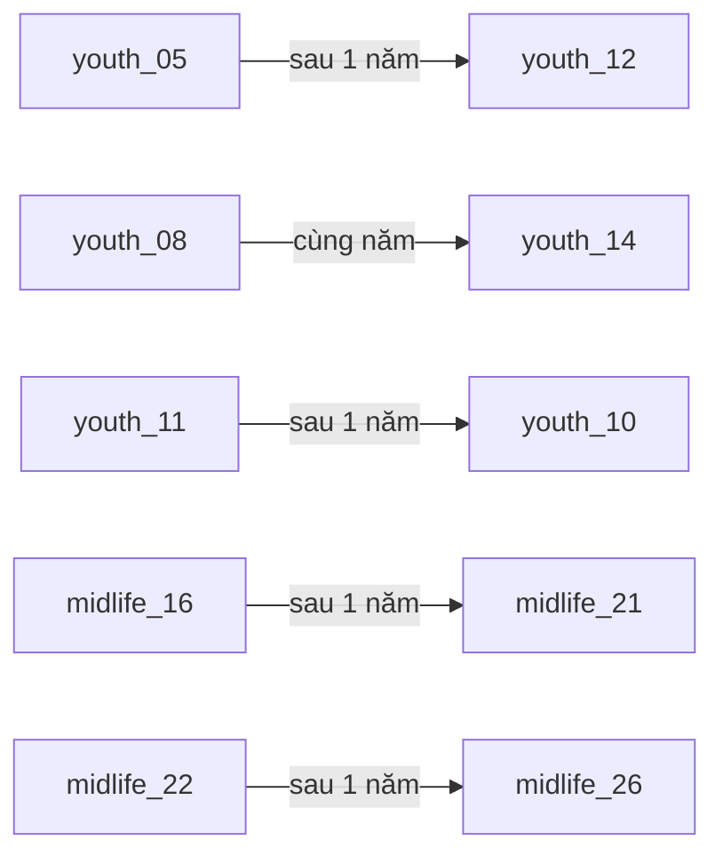
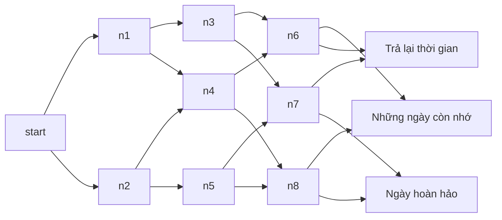
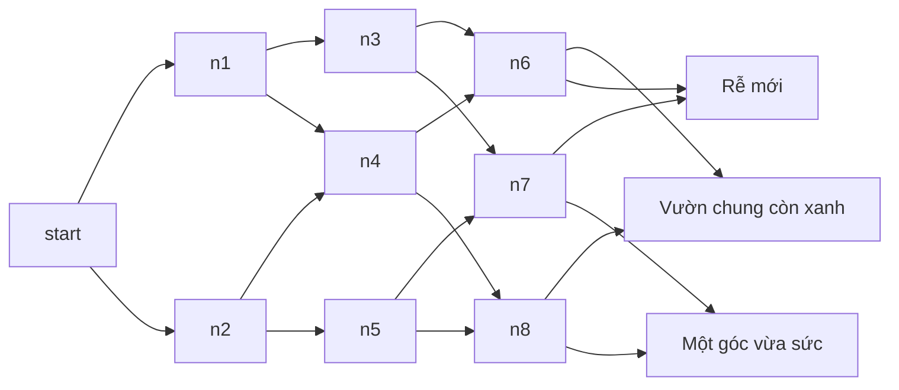
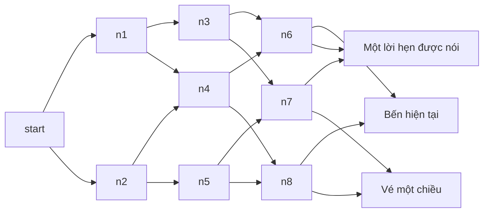
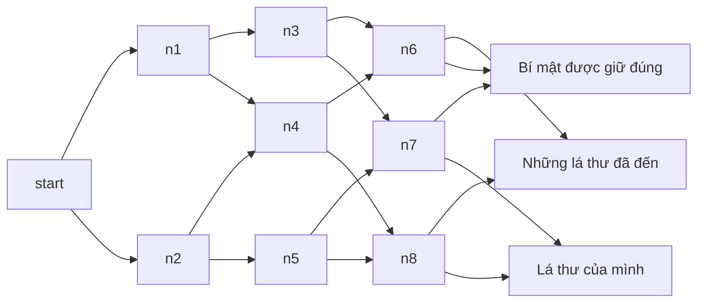
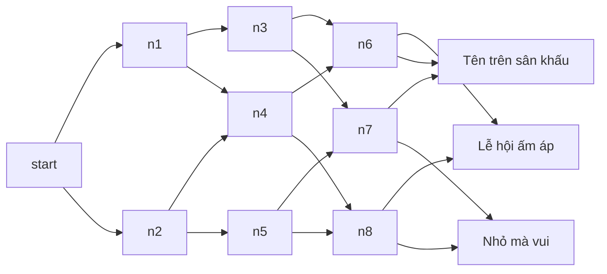

# Đồ thị nội dung v1

Có 294 sự kiện trong pool: 150 thường + 144 nghề. Có 5 dự phòng, được đếm riêng. Các nhánh khó đạt được kiểm bằng fixture; bot mô phỏng không bảo đảm gặp hết nghề.

## Chuỗi đời thường

## Chiếc đồng hồ ở chợ cũ

## Khu vườn trên mái

## Chuyến xe lúc nửa đêm

## Tiệm thư chưa gửi

## Đội hội làng bất đắc dĩ

